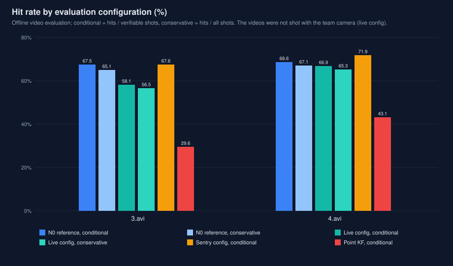
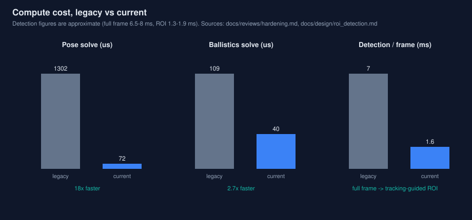
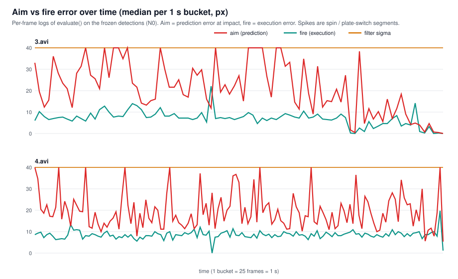

# rm-vision — RoboMaster Vision Auto-Aim

A complete vision auto-aim system for RoboMaster robots, written in C++17
(no ROS, no Eigen — OpenCV only). One shared core serves the infantry/hero
robots and the sentry: armor detection → PnP pose estimation → whole-robot
EKF tracking → ballistic solution → aiming and fire control. The sentry
adds its own module on top of the same core: multi-target management
(including the outpost), a serial link to the MCU, and tracking-guided ROI
detection.

The system is built around three concerns that competition code often gets
wrong: **time** (every observation is aligned to the camera's exposure
instant, not to when the frame happened to arrive), **identity** (a target
is a physical robot — colour + plate number + plate size — not "whatever
blob is nearest"), and **evidence** (every headline number in this README
can be reproduced from this repository alone, data included).

## Contents

- [Design rationale](#design-rationale) — the reasoning behind each stage,
  including what was tried and rejected, with the numbers that decided it
- [Measured data](#measured-data) — calibration values, real-video results,
  simulator results, field-condition stress results, timing
- [Evaluation method](#evaluation-method) — what the numbers mean
- [Repository layout](#repository-layout)
- [Build and run](#build-and-run)
- [Configuration](#configuration)
- [On the robot](#on-the-robot)
- [Limitations and open problems](#limitations-and-open-problems)
- [Documentation](#documentation) · [License](#license)

## Design rationale

```
frame ──► Detector ──► PoseSolver ──► Tracker (EKF) ──► Aimer ──► fire command
            │              │               │               │
     light bars +     IPPE multi-     13-state whole-   ballistic RK4 +
     MLP digits,      solution +      robot model,      Hermite crossing,
     or ONNX          physical        multi-armor       centre mode for
     keypoints        screening       association       fast spinners
```

### Time first: exposure-instant alignment

The single largest error source in a spinning-target auto-aim is not the
detector or the filter — it is *when* things are stamped. The previous
codebase stamped frames at serial-receipt time and averaged the two
neighbouring attitude samples. At a gimbal rate of 3 rad/s, every 1 ms of
stamp error is 0.17° of aim error, and receipt-time stamping is wrong by
the whole processing+transport delay, always in the same direction.

This system stamps every frame at its **exposure instant** and keeps the
gimbal attitude in a ring buffer (`PoseBuffer`) that interpolates with
quaternion SLERP at exactly that instant; a frame whose exposure time has
no bracketing attitude is dropped rather than aimed from a wrong pose.
Two subtler points, both found by review and measurement:

- **Constant transport delay.** The camera stream lags real time by a
  constant D. Prediction can absorb D through the configured latency, but
  the *attitude lookup* cannot: querying attitude at the late stamp
  rotates every observation by gimbal_rate × D (6 rad/s × 10 ms = 3.4°,
  ≈ 30 cm at 5 m). `DelayCalibrator` measures D on the robot: park on a
  static plate, sweep the gimbal for ~10 s, and take the offset that
  minimises the world-position scatter of the plate; it refuses to report
  a value if the gimbal did not actually move.
- **Clock skew.** Long-running streams can drift apart;
  `ClockAligner` estimates the offset between the camera and host clocks
  so the exposure stamps stay honest over a full match.

### Detector: boring front end, guarded edges

Colour-channel differencing (R−B for red targets) with an adaptive
threshold finds light bars; bars are paired geometrically into armors,
corners are refined on each bar's PCA symmetry axis, and a small MLP
classifies the digit. An ONNX keypoint backend (four corners per plate,
per-corner confidence gating, `keypoint_min_conf` 0.25) can replace the
front end without touching downstream code; if the model fails to load,
the system falls back to the classical path.

The defensive part matters more than the algorithm: the detector entry
point normalises its input (an empty frame once segfaulted the pipeline —
`cv::split` on an empty image yields zero channels — and degenerate or
non-finite observations are now rejected at every stage boundary: PnP,
tracker, pose buffer). Every one of those guards has a regression test,
because each was a real crash or a real poisoned filter first.

### Pose: multi-solution PnP with physical screening

`SOLVEPNP_IPPE` returns two candidate poses for a planar plate; both are
kept through a physical screen (finite values, positive depth, plausible
pitch) and a coarse-to-fine yaw search minimises the reprojection error
of the survivor. Two error numbers are reported separately — the *fit*
residual (how well the chosen pose explains the corners) and the *final*
residual after the yaw-gain correction below — because mixing them hid a
real association problem during development; an opt-in `--diagnostics`
mode dumps per-frame association data for exactly that kind of debugging.

**Yaw self-calibration.** Two plates of the same robot seen in one frame
must be 90° apart. On the reference footage the measured separation is
69.3° (video 3, 248 dual-plate frames) and 69.7° (video 4, 542 frames):
light-bar glow makes oblique plates look too wide, which biases the
solved yaw. The correction `yaw_gain = 90 / 69.5 ≈ 1.3` brings the
separation to 89–91°. Caveat, stated plainly: the 69.5° figure is measured
on these two recordings only; it is a fitted correction for this
detector/camera combination, not a physical constant, and should be
re-measured if either changes.

### Tracker: the robot is the state, not the plate

A plate is a terrible thing to track: it disappears every quarter-turn,
jumps by the robot's diameter when the next plate rotates in, and its
apparent motion mixes translation, spin and perspective. So the filter
tracks the **robot**: a 13-state EKF — centre position and velocity,
yaw and yaw rate, both armor radii (r1, r2), the second pair's height
offset (dz), and an optional constant-acceleration pair. Details that
carry the performance:

- **Multi-armor association.** Each detection is matched by Mahalanobis
  gate to whichever of the four model plates it fits; two plates in one
  frame are fused sequentially. Plate switching needs no hand-written
  jump logic because the model already knows where the next plate is.
- **Anisotropic measurement noise.** Across the viewing ray,
  σ = d·px/f; along the ray, depth comes from apparent size and is
  roughly 10× worse. Feeding PnP output as isotropic noise either
  over-trusts depth (filter jitter) or under-trusts bearing (lag).
- **Two innovation channels.** Process-noise adaptation watches the
  position NIS *and* the yaw NIS separately. A spin-phase error is
  invisible in the position innovation (the centre barely moves when a
  robot spins in place), so a single-channel adapter leaves the yaw
  state chronically under- or over-driven. This split is what the
  `q_yaw_walk` / `q_yaw_adapt` knobs (Stage K, below) tune.
- **Singer velocity damping (τ = 0.3 s).** A real infantry reverses its
  translation and spin direction inside the 0.33 s prediction lead, so
  constant-velocity extrapolation systematically overshoots. Damping
  the velocity states gained +4.1 / +5.8 pp on the two videos.
- **Joseph-form covariance update and wrapped yaw residuals** — the
  unglamorous numerics that keep a 13-state filter honest over minutes
  of 25 fps updates.

**Rejected, with evidence.** A constant-acceleration model was tested
behind a flag: on the simulator it helped (mean 78.0% → 79.6%), on both
real videos it regressed hard (66.6% → 61.3%, 65.4% → 58.7%) — at 25 fps
with ~1 px corner noise and a biased yaw observation, acceleration is
not observable and the filter amplifies noise instead. An IMM /
model-switching design is the principled answer to the hard-strafe
scenarios (see Limitations) but is deliberately not shipped unproven.

### Aimer and fire control: optimise damage per second, not hit rate

The aimer predicts the target over system latency + bullet flight time,
solves the ballistic shot (below), and picks which plate to engage.
Three lessons are baked in:

- **Hit rate alone is gameable.** Widening the fire window or the plate
  switch angle raises hit rate monotonically while destroying volume
  (video 4: switch angle 20° → 45° gives 65.4% → 71.9% but 9.2 →
  5.3 hits/s). Every shipped value is chosen on **hits per second**
  (damage output), and both the fire window (≈ 30° facing) and the
  switch hysteresis (3°, the one knob that improved both videos at no
  volume cost) are set at their DPS optimum, not their accuracy optimum.
- **Centre mode is a threshold, not a default.** At high spin rates it
  is better to aim at the robot centre and fire as a plate rotates
  through the window. Measured at 25 fps with a realistic gimbal lag,
  centre mode only wins above ≈ 12 rad/s — at 10 rad/s armor mode still
  leads (99.4% vs 98.1%) — so it switches on only above that.
- **Feedforward is an electronics question.** The aimer outputs yaw/pitch
  *rates* alongside the angles (B-01). In simulation, gimbal rate
  feedforward lifts the hard-strafe scenario 43.8% → 51.1%; whether the
  MCU consumes the rate term is a firmware decision the vision side
  cannot make alone.

### Ballistics: exact enough, fast enough

RK4 integration with aerodynamic drag for both calibre classes
(17 mm / 42 mm), a cubic-Hermite impact crossing that is sub-0.05 µm
against a 10 µs reference integration, and a warm-started secant pitch
solve at ~40 µs per shot (down from ~109 µs before warm-starting).
Bullet speed is configuration per calibre, and a measured muzzle
velocity from the referee system overrides it at runtime
(`setMeasuredBulletSpeed`) — under the current rules the 17 mm cap is
25 m/s with over-speed lockout, so the *measured* speed, not the nominal
one, is the only safe input. The 42 mm values shipped today are
placeholders (see Measured data) pending hero-robot measurement.

### Identity: one robot, one track

Detections carry a `DeviceId` — colour + plate number + plate size —
and every association, track and fire decision is keyed by it. The
failure this prevents is silent: two robots wearing "3" (one per team,
or a hero's large plate) merging into a single track and producing
confident, wrong aim. The sentry's target manager keeps one track per
DeviceId, selects targets with hysteresis (a challenger must be
*measurably* better, not just momentarily closer), and runs a dedicated
tracker for the outpost's three-plate geometry.

### Sentry: tracking-guided ROI, decided by experiment

Full-frame detection costs ~6.3 ms; the sentry cannot afford it at
camera rate on an embedded board. ROI windows are therefore predicted
from the tracker's own state — every active track's plate positions at
the frame stamp, projected through the current attitude, with a 60 px
margin. A/B on the real footage (tracker driven by its own windowed
detections): tracking-guided windows miss 3 / 15 frames' targets vs
49 / 14 for the previous observation-based windows, end-to-end hit rate
matches full-frame (67.8% / 68.3%), and detection drops to 1.3–1.6 ms.
The wider 110 px margin was tested and *rejected*: overlapping windows
clip light bars at their borders, spawning duplicate armors that feed
back into the tracker (misses 48 / 98). End-to-end smoke test of the
shipped path: ROI on vs off gives identical observations (890 = 890).
`--roi` still defaults to off until gimbal-motion projection accuracy
is validated on the robot.

### Serial link: the protocol is part of the algorithm

The sentry's MCU link (17-byte attitude frames in, 21-byte commands
out) has no timestamp and no checksum in its legacy form; the stamp is
therefore receive-time minus a measured transmission delay (~1.5 ms),
and an optional CRC-8 rides in a previously unused byte (vision side
ready, default off — it must stay off until the MCU firmware writes the
byte, or every attitude frame would be rejected). Review of this link
found and fixed defects that no offline test would have caught: termios
left `ICRNL` set (a 0x0D byte read back as 0x0A — a corrupted attitude
angle every few hundred frames), an fd-reuse race on reconnect, and a
`wrapAngle(±inf)` infinite loop (now `std::remainder`). The link has a
PTY end-to-end test in the suite, and the robot program's calibration
mode forces fire = 0 (an earlier build could fire during bench
calibration; that is now structurally impossible, PTY-verified).

## Measured data

The headline results as charts (generated by `tools/make_charts.py`,
each figure sourced and captioned in
[docs/performance_charts.md](docs/performance_charts.md)):







### Calibration and hardware values (as shipped in `core/config/default.yaml`)

Recovered from the team's previous on-robot codebase, where they were
measured, and backfilled — the new code originally shipped assumed
values (fx = 2400, zero distortion), which is exactly the kind of silent
error this repository tries not to repeat.

| Quantity | Value | Status |
|---|---|---|
| fx / fy | 2399.58 / 2398.60 px | measured |
| cx / cy | 688.70 / 533.42 px | measured |
| Distortion (5 coefficients, as stored) | 0.002593, 0.048045, 0.293334, 0.000164, 0.000193 | measured; **storage order unconfirmed** — the legacy code passes the vector to OpenCV as-is with no reordering anywhere, which suggests OpenCV order (k1,k2,p1,p2,k3) but does not prove what the calibration tool emitted |
| Camera→gimbal lever arm t | [0.10, −0.05, 0] m | measured; support implemented, values left commented out pending on-robot frame-convention verification |
| 17 mm bullet speed | 22 m/s | measured on the team's gun (was a hardcoded `#define` in the legacy code) |
| 42 mm bullet speed / drag | 16 m/s / 0.009 | **placeholders** — must be measured on the hero before use |
| Aim compensation (legacy, its own convention) | yaw +0.5°, pitch −0.5° | recorded; `yaw_offset_deg` / `pitch_offset_deg` default to 0 in the new config |
| Armor geometry | large 0.225×0.055 m, small 0.135×0.055 m (new detector's corner definition) | do not mix with the legacy geometry (0.230×0.050 / 0.130×0.050, light-bar endpoints) — each detector is self-consistent with its own |

### Real videos: strategy comparison

Virtual shooting (see Evaluation method) on the two reference recordings
(1440×1080, 25 fps, red #3 infantry; video 3 spins at a median 2.6 rad/s
and reverses direction several times, video 4 spins steadily at
8.3 rad/s). Historical configuration lineage; the frozen gate values are
in the next table.

| Strategy | 3.avi hit rate | 3.avi hits/s | 4.avi hit rate | 4.avi hits/s |
|---|---:|---:|---:|---:|
| direct (aim at current plate, no prediction) | 35.5% | 7.4 | 56.7%* | 11.8 |
| point KF (constant-velocity, per-plate) | 29.6% | 5.5 | 43.1% | 3.5 |
| **robot EKF (this system)** | **67.6%** | **10.6** | **68.6%** | **10.0** |
| oracle (aims at the plate as it will be at impact) | 99.3% | 22.4 | 93.8% | 22.0 |

\* At video 4's spin rate the 0.33 s lead is ≈ 155°, so "aim where a plate
is now" often meets the *next* plate — aliasing luck at one speed. In the
simulator at 10 rad/s, direct scores 43% where the robot EKF scores
99.6%. The oracle row is the evaluation's own ceiling (detector and
judge noise), not a target.

Prediction error (median px between predicted and observed plate centre;
a plate's half-width is ≈ 24 px):

| Horizon | no prediction | point KF | robot EKF |
|---|---:|---:|---:|
| video 3, 0.12 s | 27.4 | 9.7 | **5.0** |
| video 3, 0.20 s | 44.1 | 29.7 | **8.3** |
| video 3, 0.32 s | 39.1 | 66.6 | **14.3** |
| video 4, 0.20 s | 23.1 | 91.0 | **9.5** |
| video 4, 0.32 s | 44.5 | 84.9 | **13.4** |

Recovered robot geometry — the two recordings are independent, and the
tracker recovers the same robot from both, which is the strongest
available evidence that the model (not the tuning) is right:

| | r1 | r2 | dz | median ω |
|---|---|---|---|---|
| video 3 | 0.243 m | 0.210 m | 0.050 m | 2.6 rad/s, direction-changing |
| video 4 | 0.239 m | 0.214 m | 0.046 m | 8.3 rad/s |

### Frozen baselines (the regression gate)

Two configurations are tracked separately, and a number without its
configuration is meaningless — they differ by ~10 pp on identical code
and footage:

| Configuration | Role | 3.avi | 4.avi | pred 0.32 s | hits/s |
|---|---|---:|---:|---:|---:|
| `core/config/video_reference.yaml` | frozen reference (assumed pinhole, zero distortion, 25 m/s) — reproduces the historical baselines | **67.5%** | **68.6%** | 14.3 / 13.3 px | 10.6 / 10.1 |
| `core/config/default.yaml` | live config (measured calibration, 22 m/s, Stage K tracker tuning) | **57.3%** | **66.9%** | 15.3 / 12.4 px | 8.8 / 8.8 |
| sentry configs (`sentry/config/…`) | sentry strategy on the same footage | 67.6% | 71.9% | — | — |

The live config scores lower *on these videos* because the videos were
not shot with the team's camera: the reference configuration's assumed
intrinsics were fitted to this footage, the measured ones were not. The
gap is a camera-provenance artefact, not a code regression — a baseline
in the live calibre needs footage from the team's own camera (the "N1
baseline", pending). `tools/regression.py` gates both calibres with
one-sided, drop-only tolerances.

The same runs under all three reporting conventions (see Evaluation
method for definitions; robot EKF):

| Config | Video | shots | verifiable | verifiability | conservative | conditional |
|---|---|---:|---:|---:|---:|---:|
| reference | 3.avi | 1440 | 1388 | 96.4% | 65.1% | 67.5% |
| reference | 4.avi | 2049 | 2004 | 97.8% | 67.1% | 68.6% |
| live | 3.avi | 1406 | 1356 | 96.4% | 55.3% | 57.3% |
| live | 4.avi | 1848 | 1804 | 97.6% | 65.3% | 66.9% |

On this footage the detector is present at impact time for ~97% of
shots, so the conditional headline overstates the conservative figure
by only 1.5–2.4 pp. That is a property of *this* footage (one visible
target, few full occlusions), not a guarantee: on occlusion-heavy
footage the gap is exactly the bias the three-metric report exists to
expose.

### Simulator (ground truth)

`autoaim_sim`: 0.7 px corner noise, 5% detection drop-out, 25 fps,
60 ms latency. Eight scenarios (22 m/s calibre; absolute values shift a
few points with calibre and machine, rankings do not):

| Scenario | direct | point KF | **robot EKF** | hits/s | centre err | ω err |
|---|---:|---:|---:|---:|---:|---:|
| spin 2.1 rad/s at 5 m (video-like) | 42.3% | 97.5% | **99.7%** | 16.9 | 3.9 cm | 0.55 rad/s |
| fast spin 10 rad/s at 4 m | 43.2% | 37.0% | **99.3%** | 14.4 | 2.1 cm | 0.38 |
| spin 4 rad/s, approaching 7 → 3 m | 51.8% | 44.4% | **97.4%** | 13.2 | 3.0 cm | 0.49 |
| variable spin 0.5–4.5 rad/s at 6 m | 69.9% | 73.2% | **94.4%** | 12.6 | 4.4 cm | 0.53 |
| swing ±3 rad/s | 64.4% | 88.7% | **96.2%** | 16.4 | 4.2 cm | 0.55 |
| spin 3 rad/s + gentle strafe 0.3 m | 74.9% | 67.0% | **79.3%** | 11.3 | 4.4 cm | 0.57 |
| spin 6 rad/s + hard strafe 0.5 m / 2 s | 53.6% | 14.6% | 43.2% | 5.8 | 3.5 cm | 0.97 |
| no spin, hard strafe 0.8 m / 2 s | 14.0% | 24.5% | 14.6% | 2.1 | 10.7 cm | 1.68 |

The last two rows are the open problem (see Limitations): sideways
acceleration of 5–8 m/s² over a 0.33 s lead is a 0.27–0.43 m prediction
error under any constant-velocity model — several plate widths.

Noise robustness of the shipped configuration (8 scenarios × 3 seeds):
5× the corner noise and 3× the drop-out cost only ~5 pp and ~2 hits/s,
with no cliff (78.6% → 73.7% mean) — and the worst scenario stays the
hard strafe, i.e. it is a model problem, not a noise problem.

### Field-condition stress results

The `--stress` harness perturbs the frozen detection caches (occlusion
dropout, whole-frame drops, decimation to half rate, timestamp jitter)
and sweeps latency. Headline findings; the full matrix is in
[`docs/FIELD_CONDITIONS_2026-11-11.md`](docs/FIELD_CONDITIONS_2026-11-11.md):

- **Frame drops are survivable; the old evaluator could not see it.**
  The pre-fix evaluator stepped the simulated gimbal by a constant
  1/fps and indexed impact frames as T·fps, so a 20% frame drop read
  as a 22.5% hit rate. The rate-agnostic evaluator (dt from stamp
  deltas, impacts bracketed by timestamp) reads the same run as
  **68.3%** — the drops cost ~0 pp because the tracker and aimer are
  timestamp-driven. Every framedrop conclusion drawn before that fix
  was invalid and has been re-measured.
- Association gates widen with the actual frame interval, so a dropped
  frame does not masquerade as a lost target; sustained half-rate
  operation (12.5 fps) degrades gracefully rather than collapsing.
- End-to-end latency is the dominant field variable: it enters the
  prediction lead linearly, and its on-robot value is a measurement,
  not a constant — see the trial checklist in Documentation.

### Timing

Single-thread, Release. Historical Windows/MSVC figures for the
infantry pipeline were ≈ 5 ms/frame total (detector 3.6 ms, pose
0.8–1.0 ms, tracker+aimer+judge 0.4 ms). Current Linux figures after two
optimisation rounds (direct distortion formula in place of generic
projection: pose solve 1302 µs → ~72 µs; morphology pipeline collapsed
from 5 passes to 3, pixel-identical over 470 M px):

| Stage | Time |
|---|---|
| full-frame detection | ≈ 6.3 ms (was ≈ 11.8 ms) |
| tracking-guided ROI detection (sentry) | 1.3–1.6 ms |
| pose solve | ≈ 72 µs |
| ballistic solve (warm-started) | ≈ 40 µs |

### Tuning history (ablation, one change at a time)

Robot-EKF hit rate on the real videos (0.32 s prediction error in
brackets). The full log with every sweep table is
[`docs/pipeline_and_tuning.md`](docs/pipeline_and_tuning.md); the
canonical frozen values are `BASELINE.md`'s.

| Step | Change | video 3 | video 4 |
|---|---|---:|---:|
| A | first working version | 51.2% (18.6 px) | 49.6% (21.7 px) |
| B | + yaw self-calibration | 51.8% (18.0) | 49.4% (21.9) |
| C | + measured yaw noise (σ ≈ 6°) | 53.6% (17.8) | 50.0% (22.5) |
| D | + stiff centre + adaptive Q | 56.3% (16.2) | 54.2% (19.3) |
| E | + fire only at plates within 30° | 62.5% (16.2) | 59.6% (19.3) |
| F | + Singer damping τ = 0.3 s | 66.6% (14.2) | 65.4% (16.7) |
| G | + plate-switch hysteresis 3° | 66.8% (14.2) | 65.8% (16.7) |
| H | + yaw process noise 30 → 8 | 67.2% (14.2) | 68.1% (14.8) |
| I | hysteresis state fix (external review) | 66.9% (14.2) | 67.3% (14.8) |
| J | + `q_yaw` 3, `q_r` 3e-3 (plateaus, not spikes) | 67.6% (14.3) | 68.6% (13.4) |
| K | + `q_yaw_walk` 0.05, yaw-channel adaptation (live config only) | 57.3%* | 66.9%* |

\* Stage K ships only in the live/sentry configurations; its row is
therefore in the live calibre (see Frozen baselines) and is not
comparable with the rows above. Under the reference calibre the same
knob would read 68.4% / 71.1%, but writing it into the frozen calibre
is a team decision and has not been taken.

Two cautionary results from the same log:

- **Simulator-tuned parameters were rejected by the real-video guard.**
  A cross-entropy search over 8 parameters improved the simulator
  (mean 79.9% → 83.4%, worst case 17.9% → 28.9%) and *destroyed* video 3
  (62.5% → 53.9%): it had pushed `q_xyz` 1.0 → 16.9, which tracks the
  simulator's clean Gaussian noise beautifully and chases real detector
  noise (yaw bias, glow, drop-outs) off a cliff. `tools/tune_sim.py`
  therefore refuses to ship on simulator numbers alone; its guard
  re-evaluates on real footage and exits non-zero on regression.
- **The remaining knobs are flat.** Five never-swept parameters were
  tried after step I; none beats the shipped value on both videos
  (e.g. `max_match_distance` 0.25 raises hit rate but costs
  1.1–1.2 hits/s — a DPS loss). Tuning is exhausted; only structural
  change (higher frame rate, a better yaw observation, gimbal
  feedforward) moves the numbers now.

A per-shot miss analysis (`docs/miss_analysis.md`) backs the direction:
misses are dominated by yaw-rate jitter, not bias — aimed-at plate
centres are correct (median `off_u` ≈ 0 on hits), the error direction
follows the spin sign, and 40–49% of misses miss by less than half a
panel width.

## Evaluation method

**Virtual shooting on real video.** Every frame, each strategy commands
a simulated first-order gimbal (τ = 30 ms, 12 rad/s limit) and decides
whether to fire. A shot leaves after the configured latency, flies with
drag, and is judged against *future* frames: plates are interpolated to
the exact impact time, and the shot is a hit if the impact point
projects inside the plate's panel outline at that instant. Shots whose
impact time has no detected plate count as unverifiable and leave the
denominator of the headline rate — a selection effect that can flatter
the system exactly when detection is fragile (hard shots are the ones
most likely to be unverifiable). Every report therefore publishes all
three conventions: the **conditional** hit rate (hits / verifiable —
the historical headline, kept for comparability), the **verifiability
rate** (verifiable / shots), and the **conservative** hit rate
(hits / shots, unverifiable counted as misses). The frozen values of
all three are tabulated with the baselines above. The evaluator is
rate-agnostic (dt from frame-stamp
deltas; gapless 25 fps input is bit-identical to the historical
evaluator, guarded by a regression test), so dropped frames and
variable-rate cameras are measured honestly.

**What the numbers are not.** Virtual-shooting scores are comparable
across code changes on the same data and configuration. They are not
live-fire hit rates: no real gimbal dynamics, no real projectile
dispersion, no referee-system behaviour. The simulator numbers carry a
further caveat — absolute values drift by a few points across machines
and OpenCV builds (the reference table above was produced at the
22 m/s calibre; a 25 m/s calibre reads ~4 pp higher), so simulators
are compared on the same machine, and the videos are the gate.

**Reproduce them yourself.** The two recordings are assets of this
repository's own
[`data-v1-2026-11-09` release](https://github.com/Kisketch/rm-vision/releases/tag/data-v1-2026-11-09)
(SHA-256 sums in the release notes); the detection caches, tracker
outputs and raw run reports are in [`data/eval_cache/`](data/eval_cache/)
(one canonical cache per video — all historical copies are byte-identical,
md5-verified; see that directory's README). Download the assets into
`video/` (4.avi ships as two parts — concatenate them as the release
notes describe), then:

```bash
gh release download data-v1-2026-11-09 --repo Kisketch/rm-vision -D ./video
python3 tools/regression.py            # video gate (frozen reference) + simulator gate
```

## What runs on the robot

The only live executable this repository builds is the **sentry program**:
`sentry/apps/sentry_robot.cpp` (library `autoaim_sentry` in `sentry/`)
linked against the shared core library `autoaim_core` in `core/`, using
`sentry/config/sentry.yaml` and the measured-calibre
`core/config/default.yaml`. For infantry/hero there is no standalone live
binary here by design — the algorithm ships as the `autoaim_core` library
(`apps/` holds offline evaluation and simulation tools only), and
`legacy/` is the previous on-robot program kept as a read-only archive,
not a build input. A one-page deployment map (in Chinese, for the team)
includes the [camera inventory and capture settings](docs/deployment_map.md#相机配置核对).

## Repository layout

```
rm-vision/
├── CMakeLists.txt        # top level; options BUILD_SENTRY, AUTOAIM_WITH_MVS
├── README.md             # this file
├── BASELINE.md           # frozen regression baselines and how to reproduce them
├── CHANGELOG.md
├── CLAUDE.md             # repository conventions for AI-assisted development
├── LICENSE / THIRD_PARTY.md
│
├── core/                 # the shared auto-aim core (one copy, used by all robots)
│   ├── include/autoaim/  # config, detector, pose, tracker, ballistics, aimer,
│   │                     # evaluation, camera sources, pose buffer, delay calibration
│   ├── src/
│   ├── config/           # default.yaml (live config) · video_reference.yaml (frozen reference)
│   └── model/            # digit-classifier MLP (onnx) + labels
│
├── sentry/               # sentry module, links against core
│   ├── include/          # target manager, SentryVision, serial protocol, serial port
│   ├── src/ · apps/      # sentry_robot (on-robot) · sentry_offline
│   ├── config/           # sentry.yaml · default.yaml (sentry-flavoured)
│   └── tools/            # legacy-comparison bench
│
├── apps/                 # autoaim_video (offline evaluation) · autoaim_sim (simulator)
│                         # autoaim_lights · detector_bench
├── tests/                # three ctest suites: core, sentry, serial (PTY end-to-end)
├── tools/                # regression gate, sim tuning, calibration helpers,
│                         # offline evaluation harnesses
├── data/eval_cache/      # detection caches + tracker outputs + raw reports for both videos
├── docs/                 # design notes, reviews, tuning studies (indexed in docs/INDEX.md)
├── reports/              # simulation and real-video evaluation reports
├── legacy/               # the previous on-robot codebase, kept whole for reference
└── archive/              # retired tooling and historical patches, labelled as such
```

A complete, annotated index of every directory is in
[`docs/INDEX.md`](docs/INDEX.md).

## Build and run

Requirements: CMake ≥ 3.16, a C++17 compiler, OpenCV 4 (core, imgproc,
calib3d, features2d, dnn).

```bash
cmake -S . -B build -DCMAKE_BUILD_TYPE=Release
cmake --build build -j"$(nproc)"
ctest --test-dir build --output-on-failure     # 3 suites: core / sentry / serial
./build/apps/autoaim_sim                       # simulator table (see BASELINE.md)
./build/apps/autoaim_video <video.avi>         # offline evaluation on a recording
./build/sentry/sentry_robot --help             # sentry on-robot program
```

Options:

- `-DBUILD_SENTRY=OFF` — infantry/hero only (core, apps, core tests).
- `-DAUTOAIM_WITH_MVS=ON -DMVS_ROOT=<path>` — build against the HikRobot
  MVS camera SDK for the physical robot. This path is compile-verified
  against an SDK stub; verify the SDK version/ABI on the target machine
  before relying on it.

For a physical camera, `tools/calibrate_camera.py` produces measured
intrinsics from chessboard captures (≥ 12 sharp views, same lens/focus/
resolution as the robot); `autoaim_video --camera <file.yml>` evaluates
a recording under a specific calibration without touching the detector
configuration.

## Configuration

Three configuration files, three distinct jobs — do not mix their
numbers:

| File | Role |
|---|---|
| `core/config/default.yaml` | **Live configuration.** Measured camera intrinsics and distortion, measured 17 mm bullet speed (22 m/s), current tracker tuning (incl. Stage K). This is what runs on the robot. |
| `sentry/config/sentry.yaml` | Sentry overrides (target management, outpost, tracker behaviour) on top of the same core. |
| `core/config/video_reference.yaml` | **Frozen evaluation reference** (assumed pinhole intrinsics, zero distortion, 25 m/s). Exists only so the historical video baselines stay reproducible; it is not a robot configuration. |

The 17 mm speed limit of the current season's rules (25 m/s, with
over-speed lockout) is a referee constraint, not a tuning target.

## On the robot

- Work through [`docs/on_robot_trial_checklist.md`](docs/on_robot_trial_checklist.md)
  in order. The **first** item is delay calibration: park the gimbal on
  a static plate, sweep for ~10 s (`sentry_robot --calib-delay`), and
  write the measured offset back — every later measurement depends on
  it. Then, in order: end-to-end latency, static aim offsets, the 42 mm
  speed/drag fit, distortion-order confirmation, and team-camera
  footage for the N1 baseline.
- The MCU attitude frame carries no timestamp; its stamp is estimated
  as receive-time minus the serial transmission delay. The serial link
  itself is covered by a PTY end-to-end test in the suite.
- CRC-8 checking on attitude frames is implemented but **off by
  default**: it stays off until the MCU firmware writes the CRC byte,
  and the firmware should treat a vision-side timeout as a fail-safe
  regardless.
- Mind the sign conventions when moving code between modules: the
  sentry module's pitch axis points *down* (positive pitch = down),
  the core's does not. The conventions are written down in `CLAUDE.md`.

## Limitations and open problems

- **Hard strafing** (≥ 5 m/s² sideways) defeats the 0.33 s lead under
  any constant-velocity-style model (simulator: 43% / 15%). Singer
  damping fixed part of it on real footage; the remaining options are
  an IMM model or centre-of-strafe aiming, both unproven here, and the
  constant-acceleration experiment argues for caution.
- **25 fps footage.** The reference recordings are 25 fps; a real
  camera at 100–200 fps cuts prediction noise considerably. Tracker and
  aimer are timestamp-driven and frame-rate independent, so nothing
  structural changes — but every baseline here is a 25 fps baseline.
- **Not included:** the energy-rune (buff) pipeline — the previous
  codebase's complete implementation is preserved in `legacy/` for
  reference but has not been ported; ROS 2 nodes; number-model
  retraining (only "3" appears in the recordings, so per-number
  generalisation is unverified).
- **On-robot validation is pending by construction.** Everything above
  is offline evidence. The items that only a robot can settle are
  listed in the trial checklist; until they are measured, values marked
  as estimates or placeholders in this README stay exactly that.

## Documentation

- [`docs/INDEX.md`](docs/INDEX.md) — annotated index of the whole tree.
- [`docs/camera_hardware.md`](docs/camera_hardware.md) — the team's
  actual cameras (Hikrobot MVS main camera, twin 720p omni cameras):
  frame rates, exposures, pixel formats, and the USB bandwidth caveat.
- [`docs/pipeline_and_tuning.md`](docs/pipeline_and_tuning.md) — the
  full tuning log with every sweep table, the simulator-in-the-loop
  tuning study, and the detector visualisations.
- [`BASELINE.md`](BASELINE.md) — frozen baselines, machine-dependence
  notes, and the two-configuration rule.
- [`docs/FIELD_CONDITIONS_2026-11-11.md`](docs/FIELD_CONDITIONS_2026-11-11.md) —
  field-condition stress matrix.
- [`data/eval_cache/README.md`](data/eval_cache/README.md) — what the
  cached evaluation data is and how it was deduplicated.
- Design notes per subsystem (timestamp alignment, bullet speed, target
  identity and CRC, ROI detection, delay calibration) are in `docs/`,
  indexed by topic in the index file.

## License

MIT — see `LICENSE`. Third-party components and the ideas adapted from
other open-source RoboMaster projects are credited in `THIRD_PARTY.md`.
