<p align="center">
  
</p>

<h1 align="center">robot-vision-aim</h1>

<p align="center">
  <strong>看清装甲板，跟住整台车，把子弹打到装甲板将要转到的位置。</strong><br>
  C++17 视觉自瞄系统：灯条检测 → PnP 位姿 → 整车 EKF → 弹道解算与火控。<br>
  只依赖 OpenCV，不用 ROS、不用 Eigen；步兵、英雄与哨兵共用一套核心。
</p>

<p align="center">
  <a href="https://github.com/Kisketch/robot-vision-aim/actions/workflows/ci.yml"></a>
  
  
  
</p>

<p align="center">
  Languages: <a href="README.md">English</a> · <a href="README.zh-CN.md">简体中文</a>
</p>

<p align="center">
  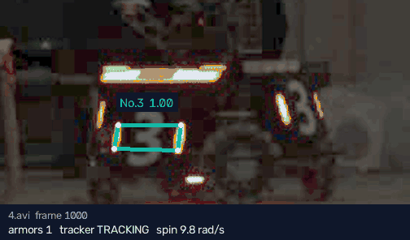<br>
  <sub>真实视频（4.avi，约 8.3 rad/s 小陀螺），为便于观看提亮了画面。框线是检测器自己的缓存输出，底栏是跟踪器的状态——没有任何手工标注。用 <code>tools/make_figures.py</code> 可重新生成。</sub>
</p>

---

## 一览

- **它做什么。** 在每一帧里找到敌方机器人的装甲板，解出每块板的 3D 位姿，
  用一个滤波器跟踪*整台机器人*——中心、转速、装甲半径——并瞄准子弹到达时
  正对枪口的那块板。
- **为什么打得中小陀螺。** 逐板跟踪每转四分之一圈就丢一次目标；整车模型
  始终知道下一块板在哪。在两段参考视频上，整车 EKF 的虚拟射击命中率是
  **67.6% / 68.6%**，逐板卡尔曼滤波只有 **29.6% / 43.1%**。
- **跑在哪里。** 步兵与英雄把共享核心当库使用；哨兵在此之上加了多目标管理、
  与 MCU 的串口链路和跟踪引导的 ROI 检测。此版本公开的验证结果来自离线视频与仿真。
- **数字可以自己验。** 运行下方的回归命令，可以把指定的视频与仿真指标同冻结基线比较。
  判定采用各指标的容差，详见 [BASELINE.md](BASELINE.md)。

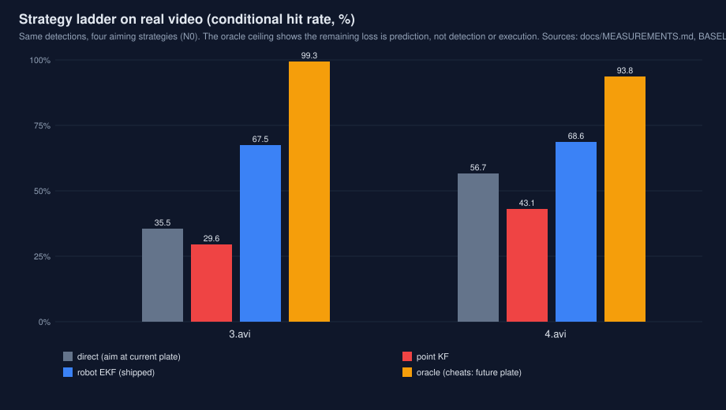

整套设计围绕竞赛代码最容易做错的三件事：**时间**——每个观测都对齐到相机的
曝光时刻，而不是帧碰巧到达的时刻；**身份**——目标是一台实实在在的机器人
（颜色 + 装甲编号 + 装甲尺寸），而不是"离得最近的那个色块"；**证据**——结论
连同产生它的数据和脚本一起提交。完整结果、每张图配数据表：[实测数据](#实测数据)。

## 快速上手

Linux、CMake ≥ 3.16、C++17 编译器、OpenCV 4。构建、跑测试，然后用和回归门禁
完全一样的方式评测两段参考视频：

```bash
cmake -S . -B build -DCMAKE_BUILD_TYPE=Release
cmake --build build -j"$(nproc)"
(cd build && ctest --output-on-failure)          # 5 项，必须全过
gh release download data-v1-2026-11-09 --repo Kisketch/robot-vision-aim -D ./video
cat video/4.avi.part-00 video/4.avi.part-01 > video/4.avi
python3 tools/regression.py --exe build/apps/autoaim_video   # 冻结参考口径
python3 tools/regression.py --exe build/apps/autoaim_video --config core/config/default.yaml
```

每段视频约 20 s（检测单核 ≈ 3.4 ms / 帧，1440×1080）。想看检测器在某一帧上
看到了什么：`./build/apps/autoaim_lights video/3.avi --frames 2023 --out lights/`。

**两段参考视频**（Release 附件，1440×1080、25 fps，一台红色 3 号步兵在镜头前小陀螺）：

| | 帧数 | 运动 | 考验什么 |
|---|---:|---|---|
| `3.avi` | 2209 | 约 2.6 rad/s，会换向，末段开到镜头前 | 换向、近距离过曝灯条 |
| `4.avi` | 3416 | 约 8.3 rad/s 稳态旋转 | 快速换板 |

## 目录

- [一览](#一览) · [快速上手](#快速上手)
- [设计理据](#设计理据) — 每个环节为什么这样做，
  试过又否掉了什么，以及拍板的数字
- [实测数据](#实测数据) — 标定数值、真实视频结果、
  模拟器结果、赛场条件压力测试、耗时
- [评测方法](#评测方法) — 这些数字代表什么
- [仓库结构](#仓库结构)
- [构建与运行](#构建与运行)
- [配置](#配置)
- [上车运行](#上车运行)
- [局限与开放问题](#局限与开放问题)
- [文档](#文档) · [许可证](#许可证)

## 设计理据

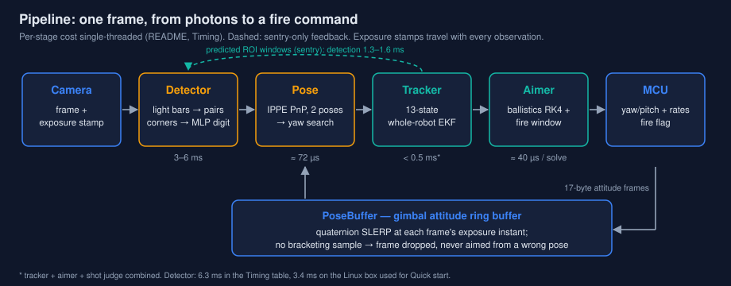

下面逐个环节说明：它做什么、为什么这样做、测过并否掉了哪些替代方案。

### 时间优先：按曝光时刻对齐

打小陀螺时，最大的误差来源不是检测器，也不是滤波器，而是*时间戳打在哪一刻*。
旧代码在串口收到帧时打时间戳，再把前后两个姿态样本取平均。云台转速 3 rad/s 时，
时间戳每错 1 ms，瞄准就偏 0.17°；而按接收时刻打戳，错的是整段处理 + 传输延迟，
而且永远朝同一个方向错。

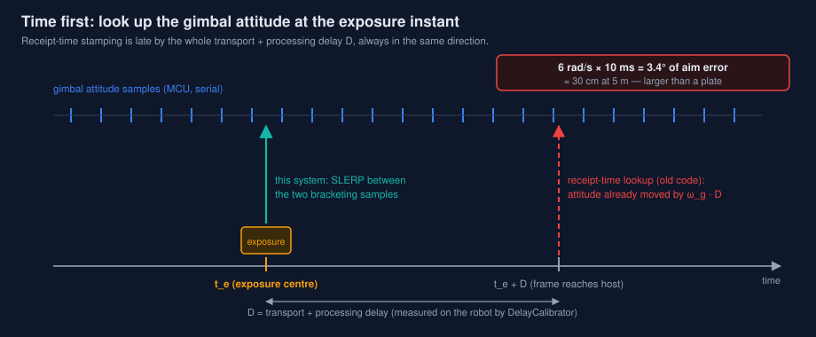

本系统给每一帧打的是**曝光时刻**，云台姿态存进环形缓冲 `PoseBuffer`，在那个时刻
用四元数 SLERP 精确插值；如果某帧的曝光时刻前后找不到姿态样本，就直接丢弃这一帧，
绝不拿错误的位姿去瞄。另有两个更隐蔽的问题，都是审查和实测中发现的：

- **恒定传输延迟。** 相机流比真实时间恒定地晚 D。预测环节可以把 D 算进配置的延迟，
  但*姿态查询*不行：在晚到的时间戳上查姿态，每个观测都会被转偏 gimbal_rate × D
  （6 rad/s × 10 ms = 3.4°，在 5 m 处约 30 cm）。`DelayCalibrator` 在实车上测 D：
  对准一块静止装甲板，扫动云台约 10 s，取让装甲板世界坐标最集中的那个偏移；
  如果云台其实没动，它拒绝给出结果。
- **时钟漂移。** 长时间运行时两路时钟会慢慢错开；`ClockAligner` 估计相机时钟与
  主机时钟之间的偏移，让曝光时间戳在整场比赛里都可信。

### 检测器：前端朴素，边界严防

用颜色通道差分（红方目标取 R−B）加固定阈值 70 找灯条（自适应阈值作为暗场鲁棒性
开关保留，默认关——它在参考视频上会掉 0.8–1.0 pp）；灯条按几何关系配成装甲板，
在每根灯条的 PCA 对称轴上精修角点，再由一个小 MLP 识别数字。也可以换成 ONNX
关键点后端（每块装甲四个角点、逐角点置信度门控，`keypoint_min_conf` 0.25），
下游代码不用动；模型加载失败时自动退回传统路径。

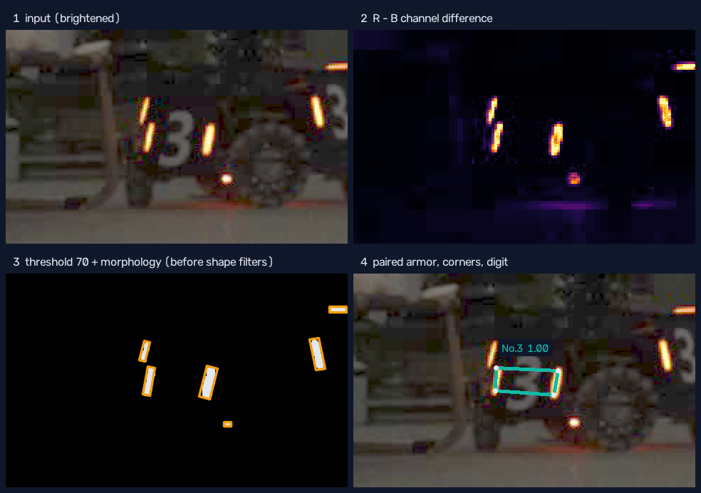

<sub>一帧真实画面（3.avi 第 1600 帧），为便于观看提亮。第 2、3 格按检测器自己的
预处理重放（R − B、阈值 70、相同的形态学）；第 4 格是检测器的缓存输出。</sub>

防御比算法更要紧：检测器入口先规整输入（曾经一帧空图就让整条流水线段错误——
对空图做 `cv::split` 得到零个通道），退化或非有限的观测在每个环节边界都会被拒收：
PnP、跟踪器、姿态缓冲。每一道防护都配了回归测试，因为它们每一个都曾经真的导致
崩溃，或者真的把滤波器带歪过。

**过曝灯条：逐帧查出来的。** 近距离时灯条中心三个通道同时饱和，R−B 在那里塌掉；
1–2 px 宽的红边能过阈值却过不了第一次腐蚀，于是一根灯条变成两截，与另一侧灯条的
长度比不合格——一块正对相机的板会整帧消失（3.avi 第 1966–2050 帧）。检测器现在
把上下两段碎片的并集作为**额外**灯条候选加入，前提是两段之间的缝至少和碎片一样亮
（那是过曝的芯；地面倒影留下的缝是暗的），碎片本身保留，由配对选出和另一侧灯条
最匹配的读法。第一版用并集**替换**碎片，误伤了六块正确的板——灯条上方的杂光也有
亮缝——所以合并必须是追加式的。同一次排查还发现横向灯带能混过灯条过滤（`makeLight`
把横躺色块的厚度量成了长度，倾角读成 0°），还可能否决真实的板；现在一律拒收。
出厂口径：3.avi 57.3% → 58.1%，4.avi 检测输出逐字节不变，检测耗时不变
（[`docs/studies/split_light_merge.md`](docs/studies/split_light_merge.md)）。

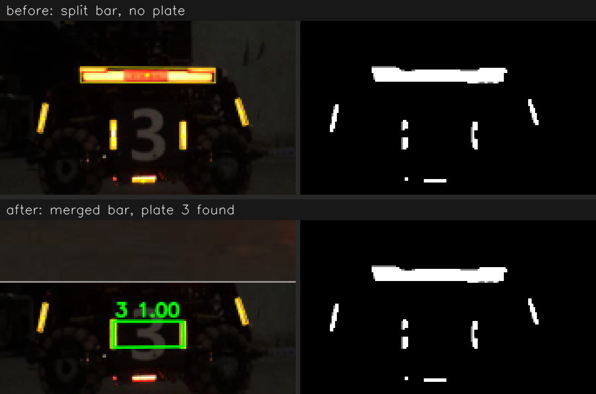

### 位姿：多解 PnP 加物理筛选

`SOLVEPNP_IPPE` 对一块平面装甲板会给出两个候选位姿；两个都保留，先做物理筛选
（数值有限、深度为正、俯仰合理），再对留下的解做由粗到细的 yaw 搜索，使重投影
误差最小。误差分两个数报告——*拟合*残差（所选位姿对角点的解释程度）和经过下文
yaw 增益修正后的*最终*残差——因为开发时把两者混在一起，曾经掩盖了一个真实的关联
问题；可选的 `--diagnostics` 模式会导出逐帧关联数据，专门用来排查这类问题。

**Yaw 自标定。** 同一台车的两块装甲板同时出现在画面里时，朝向应当正好差 90°。
在参考视频上实测是 69.3°（视频 3，248 个双板帧）和 69.7°（视频 4，542 帧）：
灯条光晕让斜着的装甲板看起来偏宽，解出的 yaw 因此有偏。修正系数
`yaw_gain = 90 / 69.5 ≈ 1.3` 把夹角拉回 89–91°。必须讲清楚：69.5° 只在这两段视频上
测过，是针对这套检测器/相机组合拟合出来的修正，不是物理常数；任何一方变了都要重测。

### 跟踪器：跟整台车，不跟装甲板

装甲板本身很难跟：每转四分之一圈就消失一次，下一块板转进来时位置跳一个车身直径，
表观运动里又混着平移、旋转和透视。所以滤波器跟的是**整台车**：一个 13 维 EKF——
中心位置与速度、yaw 与角速度、两组装甲半径（r1、r2）、第二组装甲的高度差（dz），
外加一对可选的匀加速状态。决定性能的细节：

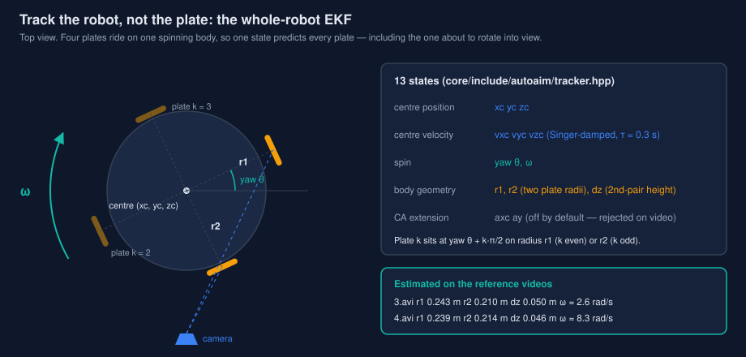

- **多装甲关联。** 每个检测按马氏距离门控，匹配到四块模型装甲里最吻合的那一块；
  同一帧里的两块板依次融合。换板不需要手写跳变逻辑，因为模型本来就知道下一块板
  在哪。
- **各向异性量测噪声。** 垂直视线方向 σ = d·px/f；沿视线方向的深度来自表观尺寸，
  精度约差 10 倍。把 PnP 输出当各向同性噪声喂进去，要么过度相信深度（滤波器抖动），
  要么不够相信方位（跟踪滞后）。
- **两路新息分开监视。** 过程噪声自适应分别看位置 NIS *和* yaw NIS。旋转相位误差
  在位置新息里看不出来（原地旋转时中心几乎不动），只看一路的话，yaw 状态会长期
  驱动不足或过度。下文的 `q_yaw_walk` / `q_yaw_adapt` 旋钮（Stage K）调的就是这一路。
- **Singer 速度阻尼（τ = 0.3 s）。** 真实步兵会在 0.33 s 的预测提前量之内反转平移
  和旋转方向，恒速外推必然冲过头。给速度状态加阻尼，两段视频分别提升了
  +4.1 / +5.8 pp。
- **Joseph 形式协方差更新与 yaw 残差绕回**——不起眼的数值细节，却是 13 维滤波器在
  25 fps 下连续跑几分钟仍然可信的前提。

在真实视频上，滤波器"认为"的转速——两段视频上估计的 ω：

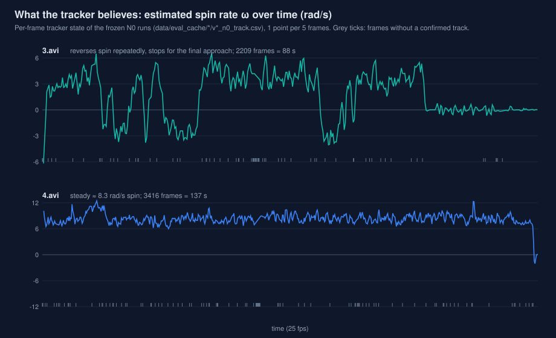

**否掉的方案，附证据。** 匀加速模型曾经挂在开关后面测过：在模拟器上有用
（平均 78.0% → 79.6%），在两段真实视频上却明显退化（66.6% → 61.3%、
65.4% → 58.7%）——25 fps、约 1 px 角点噪声、yaw 观测本身有偏，加速度根本观测不到，
滤波器只会放大噪声。应对强横移场景（见局限）的正路是 IMM / 多模型切换，但没验证过
的东西不出厂。

### 瞄准与火控：看每秒伤害，不只看命中率

瞄准器把目标预测到"系统延迟 + 子弹飞行时间"之后，解出弹道（见下节），并决定打
哪块板。里面固化了三条经验：

- **只看命中率会被"刷"出来。** 开火策略越保守，命中率越高，但出弹量也越少
  （视频 4：换板角 20° → 45°，命中率 65.4% → 71.9%，却从 9.2 → 5.3 hits/s），
  所以每个旋钮都同时按**每秒伤害**评判。下图的扫描显示这是一个真实的取舍，而非
  白捡：开火窗口放宽到 39° 能多出 +10.6% DPS，代价是命中率约降 2 pp。出厂值
  （开火窗口 30°、换板角 20°、关联门 0.35 m）取在两者的平衡点；换板滞回（3°）是
  唯一一个在两段视频上都有改善、又不损失出弹量的旋钮。
- **中心模式是阈值，不是默认。** 转得很快时，更好的打法是瞄准车体中心、等装甲板
  转进窗口再开火。在 25 fps、带真实云台滞后的条件下实测，中心模式只在约 12 rad/s
  以上才占优——10 rad/s 时装甲模式仍然领先（99.4% 对 98.1%）——所以只在这个转速
  以上启用。
- **前馈是电控的事。** 瞄准器除了角度还输出 yaw/pitch *角速度*（B-01）。仿真中，
  云台角速度前馈把强横移场景从 43.8% 提到 51.1%；MCU 用不用这个角速度项，是固件
  侧的决定，视觉侧单方面定不了。

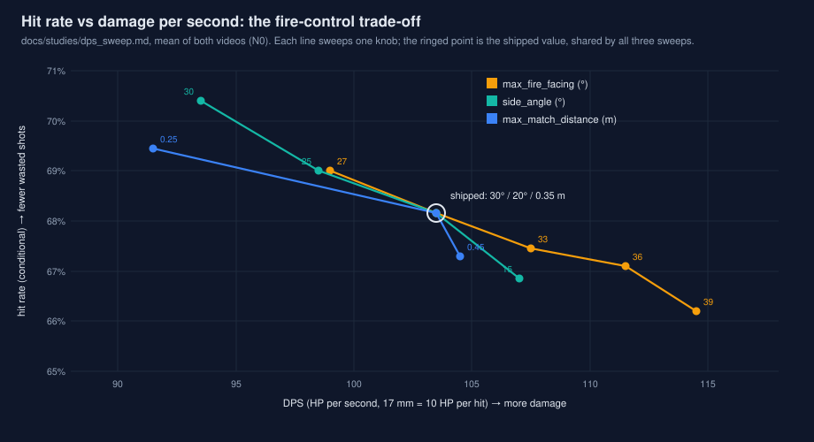

### 弹道：够准，也够快

两种弹种（17 mm / 42 mm）都用带空气阻力的 RK4 积分，三次 Hermite 弹着点求交的误差
在 0.05 µm 以内（以 10 µs 步长的参考积分为对照），热启动割线法解俯仰每发约 40 µs
（热启动前约 109 µs）。弹速按弹种配置，运行时由裁判系统回传的实测枪口初速覆盖
（`setMeasuredBulletSpeed`）——现行规则下 17 mm 上限 25 m/s、超速锁枪，所以只有
*实测*弹速、而不是名义弹速，才是安全的输入。目前出厂的 42 mm 数值是占位值
（见实测数据），等英雄实测。

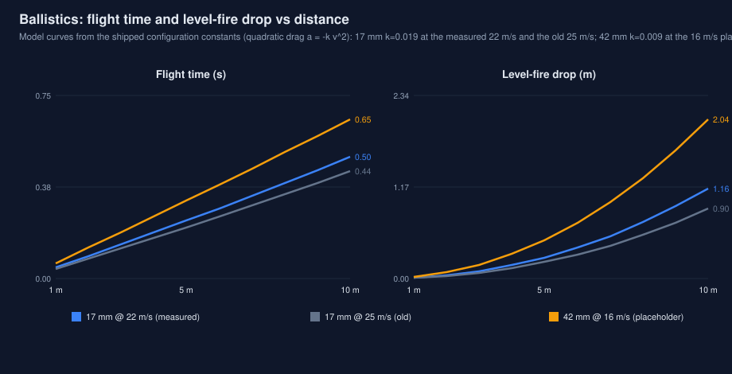

### 身份：一台车，一条轨迹

检测结果带一个 `DeviceId`——颜色 + 装甲编号 + 装甲尺寸——之后的每一次关联、跟踪和
开火决策都以它为键。它防的是一种悄无声息的故障：两台都挂着 "3" 的车（两队各一台，
或者英雄的大装甲）被合成一条轨迹，给出信心十足却是错的瞄准。哨兵的目标管理器为每个
DeviceId 维护一条轨迹，选目标带滞回（挑战者必须*实打实地*更好，而不只是这一瞬间
更近），并为前哨站的三装甲几何单独跑一个跟踪器。

### 哨兵：跟踪引导的 ROI，由实验拍板

全帧检测约 6.3 ms，哨兵的嵌入式板子按相机帧率跑不动。因此 ROI 窗口由跟踪器自己的
状态预测：每条活跃轨迹在帧时间戳处的装甲位置，经当前姿态投影，留 60 px 边距。
真实视频上的 A/B（跟踪器只用自己窗口里的检测）：跟踪引导窗口漏掉 3 / 15 帧的目标，
上一代基于观测的窗口漏掉 49 / 14 帧；端到端命中率与全帧持平（67.8% / 68.3%），
检测耗时降到 1.3–1.6 ms。更宽的 110 px 边距测过并*被否决*：窗口相互重叠，在边界处
截断灯条，生成重复装甲又回灌进跟踪器（漏检 48 / 98）。出厂路径的端到端冒烟测试：
ROI 开与关给出完全相同的观测（890 = 890）。在云台运动时的投影精度上车验证之前，
`--roi` 仍默认关闭。

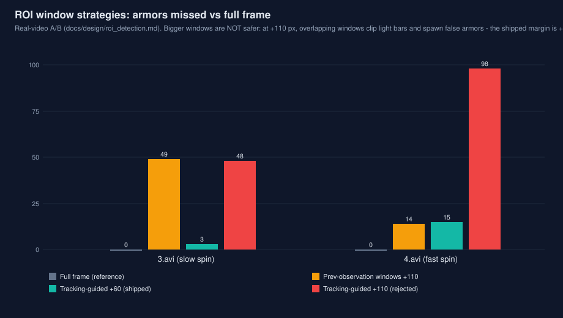

### 串口链路：协议也是算法的一部分

哨兵与 MCU 的链路（收 17 字节姿态帧、发 21 字节指令）在旧版本里既没有时间戳，也没有
校验；所以时间戳只能取"接收时刻减去实测的传输延迟（约 1.5 ms）"，可选的 CRC-8 放在
一个原本没用的字节里（视觉侧已就绪，默认关——在 MCU 固件真正写入这个字节之前必须
保持关闭，否则每一帧姿态都会被拒）。对这条链路的审查查出并修好了离线测试抓不到的
缺陷：termios 没清 `ICRNL`（0x0D 被读成 0x0A——每几百帧就有一个姿态角被写坏）、
重连时的 fd 复用竞态，以及 `wrapAngle(±inf)` 死循环（现改用 `std::remainder`）。
链路在测试套件里有 PTY 端到端测试；机器人程序的标定模式强制 fire = 0（早先某个
版本在台架标定时可能开火，现在从结构上就不可能，已经 PTY 验证）。

## 实测数据

下面每张表都配一张图（由 `tools/make_charts.py` 生成；全部 20 张图的解读与出处见
[docs/performance_charts.md](docs/performance_charts.md)）。

### 标定与硬件数值（即 `core/config/default.yaml` 中的出厂值）

这些数值是从队伍以前的实车代码里找回来的（当时在那里实测过），再补回本仓库；新代码
最初出厂时用的是假设值（fx = 2400、零畸变）——这正是本仓库竭力避免再犯的那种悄无
声息的错误。

| 量 | 值 | 状态 |
|---|---|---|
| fx / fy | 2399.58 / 2398.60 px | 实测 |
| cx / cy | 688.70 / 533.42 px | 实测 |
| 畸变（5 个系数，按存储原样） | 0.002593, 0.048045, 0.293334, 0.000164, 0.000193 | 实测；**存储顺序未确认**——旧代码把这个向量原样传给 OpenCV、全程没有任何重排，这提示它是 OpenCV 顺序（k1,k2,p1,p2,k3），但不能证明标定工具输出的就是这个顺序 |
| 相机→云台力臂 t | [0.10, −0.05, 0] m | 实测；支持已实现，数值暂时注释掉，等实车坐标系约定核对 |
| 17 mm 弹速 | 22 m/s | 在队伍的枪上实测（旧代码里是一个写死的 `#define`） |
| 42 mm 弹速 / 阻力 | 16 m/s / 0.009 | **占位值**——使用前必须在英雄上实测 |
| 瞄准补偿（旧代码，其自身约定） | yaw +0.5°, pitch −0.5° | 已记录；新配置里 `yaw_offset_deg` / `pitch_offset_deg` 默认 0 |
| 装甲几何 | 大 0.225×0.055 m、小 0.135×0.055 m（新检测器的角点定义） | 不要与旧几何混用（0.230×0.050 / 0.130×0.050，灯条端点定义）——每个检测器与自己的几何自洽 |

### 真实视频：策略对比

在两段参考视频（1440×1080、25 fps、红色 3 号步兵；视频 3 中位转速 2.6 rad/s、多次
换向，视频 4 以 8.3 rad/s 稳定旋转）上做虚拟射击（见评测方法）。这是历史配置谱系上
的结果；冻结的门禁数值见下一张表。

| 策略 | 3.avi 命中率 | 3.avi hits/s | 4.avi 命中率 | 4.avi hits/s |
|---|---:|---:|---:|---:|
| direct（瞄准当前装甲板，无预测） | 35.5% | 7.4 | 56.7%* | 11.8 |
| point KF（恒速，逐装甲板） | 29.6% | 5.5 | 43.1% | 3.5 |
| **robot EKF（本系统）** | **67.6%** | **10.6** | **68.6%** | **10.0** |
| oracle（瞄准装甲板在弹着时刻的位置） | 99.3% | 22.4 | 93.8% | 22.0 |

**图 — 上表的柱状图（oracle 即天花板）：**


\* 在视频 4 的转速下，0.33 s 的提前量约等于转过 155°，所以"瞄准装甲板现在的位置"
常常正好碰上*下一块*板——这是某个转速下的混叠运气。模拟器里 10 rad/s 时，direct
只有 43%，robot EKF 是 99.6%。oracle 一行是评测本身的上限（受检测器与判定噪声限制），
不是目标。

预测误差（预测与实际观测到的装甲中心之间的像素距离中位数；装甲板半宽约 24 px）：

| 预测时域 | 无预测 | point KF | robot EKF |
|---|---:|---:|---:|
| 视频 3，0.12 s | 27.4 | 9.7 | **5.0** |
| 视频 3，0.20 s | 44.1 | 29.7 | **8.3** |
| 视频 3，0.32 s | 39.1 | 66.6 | **14.3** |
| 视频 4，0.20 s | 23.1 | 91.0 | **9.5** |
| 视频 4，0.32 s | 44.5 | 84.9 | **13.4** |

**图 — 预测误差随预测时域的变化（robot EKF 与 point KF）：**

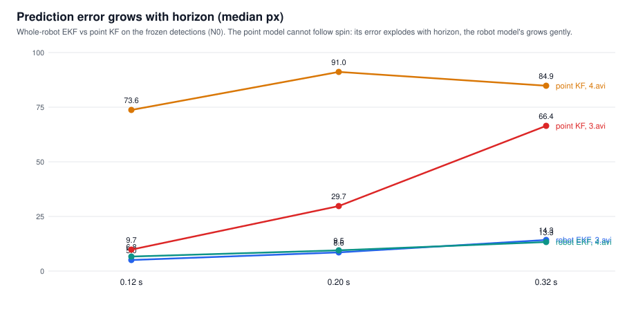

**图 — 同样的误差按时间展开（瞄准误差与开火误差，逐秒）：**

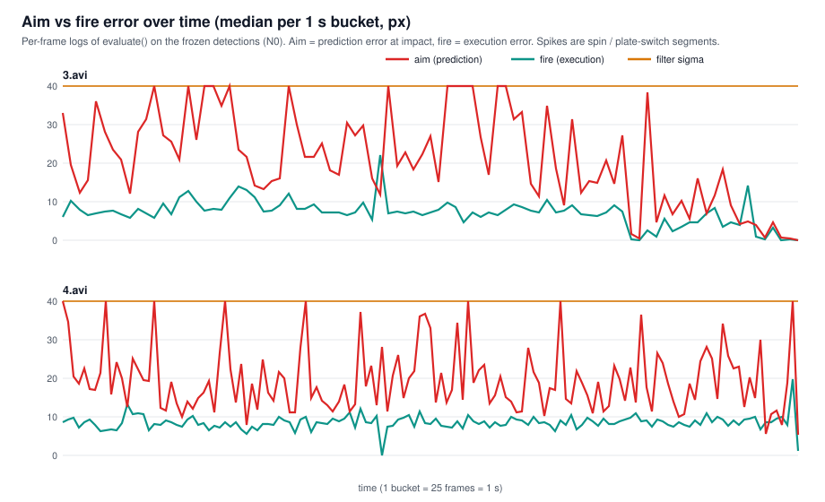

估计出的车体几何——两段视频互相独立，跟踪器却从中估出了同一台车，这是"模型本身是对的
（而不是调参调出来的）"最有力的证据：

| | r1 | r2 | dz | 中位 ω |
|---|---|---|---|---|
| 视频 3 | 0.243 m | 0.210 m | 0.050 m | 2.6 rad/s，方向多变 |
| 视频 4 | 0.239 m | 0.214 m | 0.046 m | 8.3 rad/s |

### 冻结基线（回归门禁）

两套配置分开记录，不注明配置的数字没有意义——同一份代码、同一段视频，两者相差
约 10 pp：

| 配置 | 角色 | 3.avi | 4.avi | 预测 0.32 s | hits/s |
|---|---|---:|---:|---:|---:|
| `core/config/video_reference.yaml` | 冻结参考（假设针孔、零畸变、25 m/s）——复现历史基线 | **67.5%** | **68.6%** | 14.3 / 13.3 px | 10.6 / 10.1 |
| `core/config/default.yaml` | 出厂配置（实测标定、22 m/s、Stage K 跟踪调参、灯条断裂修复） | **58.1%** | **66.9%** | 15.2 / 12.4 px | 9.1 / 8.8 |
| 哨兵配置（`sentry/config/…`） | 同一段视频上的哨兵策略 | 67.6% | 71.9% | — | — |

出厂配置*在这两段视频上*分数更低，是因为视频不是用队伍的相机拍的：参考配置的假设
内参是照着这段视频拟合的，实测内参不是。这个差距来自相机来源，不是代码退步——要给
出厂配置建基线，需要队伍自己相机拍的视频（"N1 基线"，待补）。`tools/regression.py`
对两套配置都设单侧门限：只拦下降。

同一批运行在三种统计口径下的结果（定义见评测方法；robot EKF）：

| 配置 | 视频 | 发射数 | 可验证 | 可验证率 | 保守口径 | 条件口径 |
|---|---|---:|---:|---:|---:|---:|
| 参考口径 | 3.avi | 1440 | 1388 | 96.4% | 65.1% | 67.5% |
| 参考口径 | 4.avi | 2049 | 2004 | 97.8% | 67.1% | 68.6% |
| 出厂口径 | 3.avi | 1420 | 1383 | 97.4% | 56.5% | 58.1% |
| 出厂口径 | 4.avi | 1848 | 1804 | 97.6% | 65.3% | 66.9% |

在这两段视频上，约 97% 的发射在弹着时刻都有检测结果，所以条件口径只比保守口径高
1.5–2.4 pp。这是*这两段*视频的特点（只有一个可见目标、很少完全遮挡），不是保证：
在遮挡严重的视频上，这个差距正是三口径并列报告要暴露的偏差。

**图 — 上面两张冻结表的柱状图（两套配置、两种口径）：**

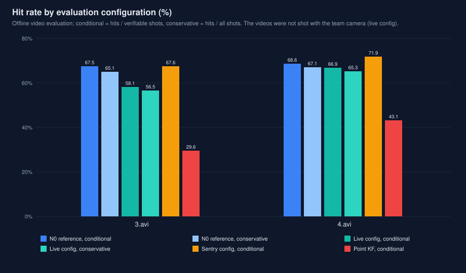

**图 — 同一批运行的交战强度（跟踪占比与累计命中随时间变化）：**

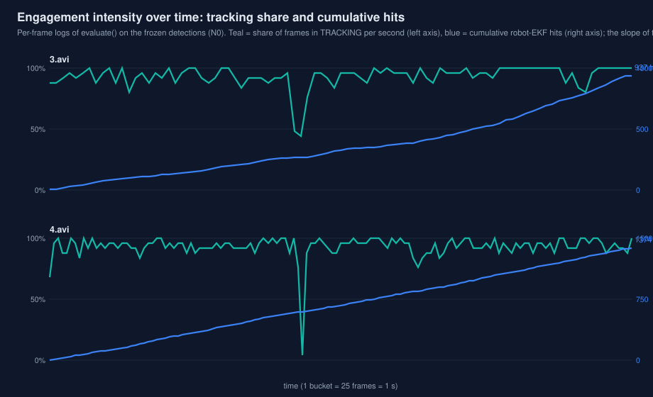

### 模拟器（有真值）

`autoaim_sim`：0.7 px 角点噪声、5% 检测丢失、25 fps、60 ms 延迟。八个场景（弹速
22 m/s；绝对值会随弹速和机器漂移几个点，排名不变）：

| 场景 | direct | point KF | **robot EKF** | hits/s | 中心误差 | ω 误差 |
|---|---:|---:|---:|---:|---:|---:|
| 旋转 2.1 rad/s、5 m（类视频） | 42.3% | 97.5% | **99.7%** | 16.9 | 3.9 cm | 0.55 rad/s |
| 快速旋转 10 rad/s、4 m | 43.2% | 37.0% | **99.3%** | 14.4 | 2.1 cm | 0.38 |
| 旋转 4 rad/s，接近中 7 → 3 m | 51.8% | 44.4% | **97.4%** | 13.2 | 3.0 cm | 0.49 |
| 变速旋转 0.5–4.5 rad/s、6 m | 69.9% | 73.2% | **94.4%** | 12.6 | 4.4 cm | 0.53 |
| 摇摆 ±3 rad/s | 64.4% | 88.7% | **96.2%** | 16.4 | 4.2 cm | 0.55 |
| 旋转 3 rad/s + 轻横移 0.3 m | 74.9% | 67.0% | **79.3%** | 11.3 | 4.4 cm | 0.57 |
| 旋转 6 rad/s + 强横移 0.5 m / 2 s | 53.6% | 14.6% | 43.2% | 5.8 | 3.5 cm | 0.97 |
| 不旋转，强横移 0.8 m / 2 s | 14.0% | 24.5% | 14.6% | 2.1 | 10.7 cm | 1.68 |

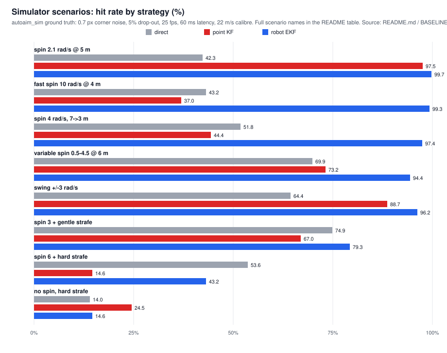

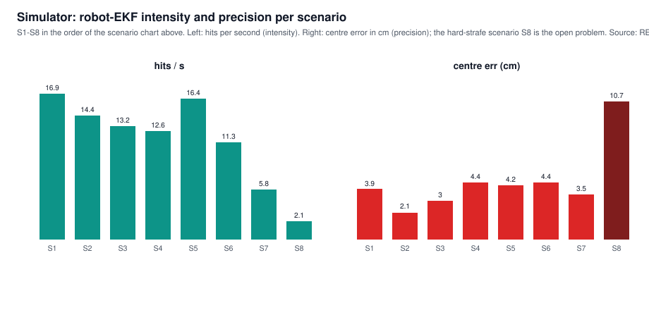

最后两行就是那个尚未解决的问题（见局限）：0.33 s 提前量内 5–8 m/s² 的横向加速度，
在任何恒速模型下都意味着 0.27–0.43 m 的预测误差——好几块装甲板宽。

出厂配置的抗噪能力（8 场景 × 3 个随机种子）：角点噪声放大 5 倍、丢失率放大 3 倍，
只损失约 5 pp 和约 2 hits/s，没有断崖（平均 78.6% → 73.7%）——而最差的场景始终是
强横移，说明那是模型问题，不是噪声问题。

### 赛场条件压力测试

`--stress` 工具在冻结的检测缓存上施加扰动（遮挡丢失、整帧丢失、降到半帧率、时间戳
抖动），并扫描延迟。主要结论如下；完整矩阵见
[`docs/studies/FIELD_CONDITIONS_2026-11-11.md`](docs/studies/FIELD_CONDITIONS_2026-11-11.md)：

- **丢帧：慢目标不怕，快目标怕。** 丢掉 20% 的帧，3.avi 保持 **68.3%**，4.avi 却从
  68.6% 掉到 **62.1%**（丢 40% 时 55.3%）：8 rad/s 下丢一帧就等于少看了约 19° 的旋转。
  以上数字来自与帧率无关的评测器（dt 取相邻时间戳之差、弹着时刻按时间戳定位）。修复
  前的评测器以固定的 1/fps 步进模拟云台、按 T·fps 索引弹着帧，同样丢 20% 帧的 3.avi
  被读成 22.5%；修复前得出的所有丢帧结论都已重新测量。
- 关联门会随实际帧间隔放宽，所以丢一帧不会被误判成丢目标；长时间半帧率运行
  （12.5 fps）是平缓退化，而不是崩溃。
- **时间戳比帧更要紧。** 10 ms 的时间戳抖动让 4.avi 掉得比丢 40% 帧还多
  （68.6% → 49.0%）。
- 端到端延迟是赛场上影响最大的变量：它线性进入预测提前量，而且实车上的值要靠测量，
  不是一个常数——见文档中的试机清单。

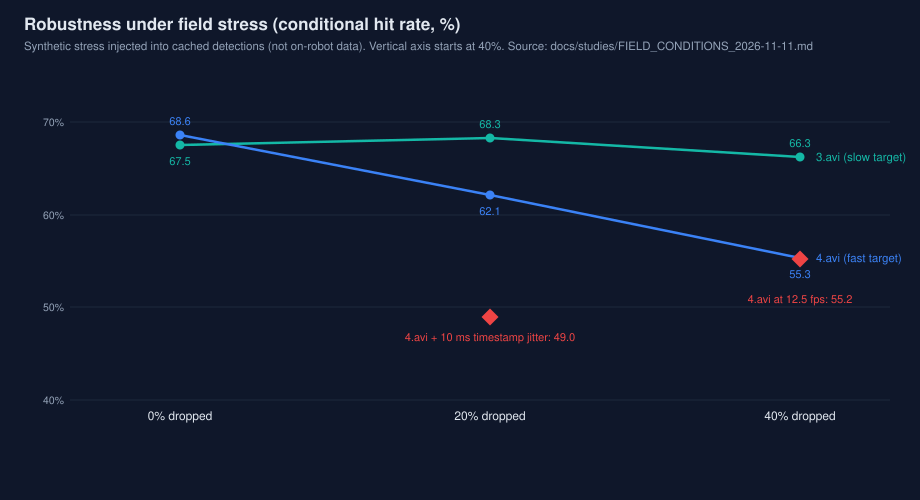

### 耗时

单线程，Release。步兵流水线早期在 Windows/MSVC 上总计约 5 ms/帧（检测器 3.6 ms、
位姿 0.8–1.0 ms、跟踪 + 瞄准 + 判定 0.4 ms）。两轮优化后的现行 Linux 数字（用直接的
畸变公式替代通用投影：位姿解算 1302 µs → 约 72 µs；形态学从 5 趟合并到 3 趟，在
470 M px 上逐像素一致）：

| 环节 | 耗时 |
|---|---|
| 全帧检测 | ≈ 6.3 ms（此前 ≈ 11.8 ms） |
| 跟踪引导 ROI 检测（哨兵） | 1.3–1.6 ms |
| 位姿解算 | ≈ 72 µs |
| 弹道解算（热启动） | ≈ 40 µs |

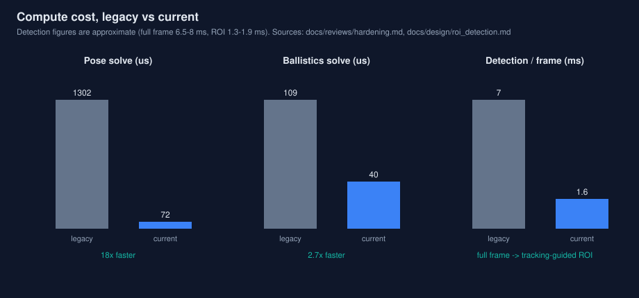

### 调参历史（消融实验，每次只改一项）

真实视频上的 robot EKF 命中率（括号内为 0.32 s 预测误差）。含全部扫描表的完整日志见
[`docs/project/pipeline_and_tuning.md`](docs/project/pipeline_and_tuning.md)；冻结值以
`BASELINE.md` 为准。

| 步骤 | 改动 | 视频 3 | 视频 4 |
|---|---|---:|---:|
| A | 第一个能跑通的版本 | 51.2% (18.6 px) | 49.6% (21.7 px) |
| B | + yaw 自标定 | 51.8% (18.0) | 49.4% (21.9) |
| C | + 实测 yaw 噪声（σ ≈ 6°） | 53.6% (17.8) | 50.0% (22.5) |
| D | + 刚性中心 + 自适应 Q | 56.3% (16.2) | 54.2% (19.3) |
| E | + 只对 30° 以内的装甲开火 | 62.5% (16.2) | 59.6% (19.3) |
| F | + Singer 阻尼 τ = 0.3 s | 66.6% (14.2) | 65.4% (16.7) |
| G | + 换板滞回 3° | 66.8% (14.2) | 65.8% (16.7) |
| H | + yaw 过程噪声 30 → 8 | 67.2% (14.2) | 68.1% (14.8) |
| I | 滞回状态修复（外部审查） | 66.9% (14.2) | 67.3% (14.8) |
| J | + `q_yaw` 3、`q_r` 3e-3（落在平台区而非尖峰） | 67.6% (14.3) | 68.6% (13.4) |
| K | + `q_yaw_walk` 0.05、yaw 通道自适应（仅出厂配置） | 57.3%* | 66.9%* |
| L | + 灯条断裂合并、横向色块拒收（检测器；仅出厂配置） | 58.1%* (15.2) | 66.9%* (12.4) |

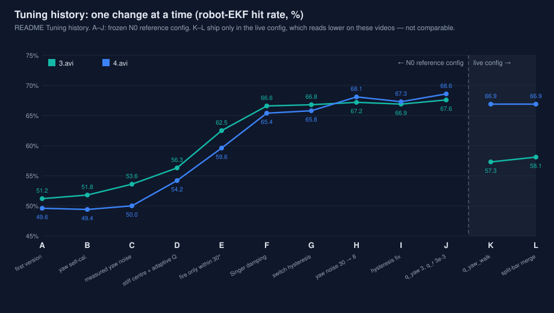

\* Stage K 与 L 只在出厂/哨兵配置中启用，所以这两行属于出厂口径（见冻结基线），与上面
各行不可比。同一个旋钮在参考口径下会是 68.4% / 71.1%，但要不要把它写进冻结参考，
是队伍的决定，目前尚未做出。

同一份日志里有两条值得警惕的结果：

- **在模拟器上调出的参数被真实视频否决。** 对 8 个参数做交叉熵搜索，模拟器成绩变好了
  （平均 79.9% → 83.4%，最差场景 17.9% → 28.9%），却*毁掉*了视频 3（62.5% → 53.9%）：
  搜索把 `q_xyz` 从 1.0 推到 16.9——在模拟器干净的高斯噪声上跟得很漂亮，遇到真实
  检测器噪声（yaw 偏置、光晕、丢检）就直接崩掉。因此 `tools/tune_sim.py` 拒绝只凭
  模拟器数字出厂：它会在真实视频上复核，一旦退化就以非零码退出。
- **剩下的旋钮已经调不动了。** 步骤 I 之后又试了五个从没扫过的参数，没有一个能在两段
  视频上同时胜过出厂值（例如 `max_match_distance` 取 0.25 能提高命中率，却损失
  1.1–1.2 hits/s——DPS 下降）。调参已到头；现在只有结构性改变（更高帧率、更好的
  yaw 观测、云台前馈）才能再推动这些数字。

逐发脱靶分析（`docs/studies/miss_analysis.md`）也指向同一方向：脱靶主要来自 yaw 角速度
抖动，而不是偏置——瞄准的装甲中心是准的（命中时 `off_u` 中位数 ≈ 0），误差方向随
旋转方向变化，40–49% 的脱靶偏出不到半块装甲板宽。

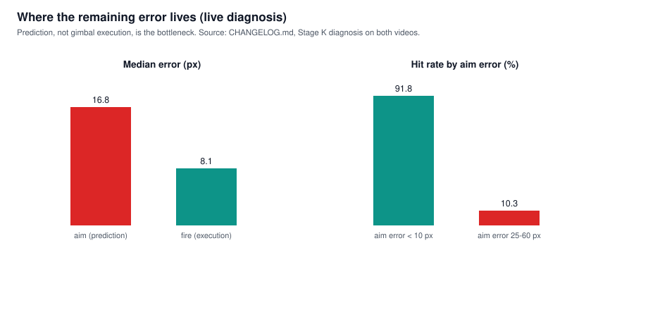

## 评测方法

**在真实视频上虚拟射击。** 每一帧，每种策略都驱动一个模拟的一阶云台（τ = 30 ms、
上限 12 rad/s）并决定是否开火。子弹在配置的延迟之后出膛，带阻力飞行，并用*未来*的帧
判定：把装甲板插值到精确的弹着时刻，弹着点在那一刻投影落在装甲板板面轮廓之内即算
命中。弹着时刻没有检测到装甲板的发射记为"不可验证"，并从标题命中率的分母中剔除——
这是一种选择效应，恰恰在检测不稳时（最难打的几发最容易不可验证）会美化结果。所以每份
报告都同时给出三种口径：**条件**命中率（命中 / 可验证——历史上的标题口径，为可比性
保留）、**可验证率**（可验证 / 发射数），以及**保守**命中率（命中 / 发射数，不可验证
记为脱靶）。三者的冻结值都列在上面的基线表里。评测器与帧率无关（dt 取相邻帧时间戳
之差；无间断的 25 fps 输入与历史评测器逐比特一致，有回归测试守护），所以丢帧和变帧率
相机都能被如实测量。

**这些数字不代表什么。** 虚拟射击分数可以在同一数据、同一配置下跨代码版本比较。它们
不是实弹命中率：没有真实的云台动力学，没有真实的弹丸散布，也没有裁判系统的行为。
模拟器数字还要多一层保留——绝对值在不同机器、不同 OpenCV 构建之间会漂移几个点（上面
的参考表在弹速 22 m/s 下产出；25 m/s 时读数约高 4 pp），所以模拟器只在同一台机器上
比较，门禁以视频为准。

**自己复现。** 两段视频是本仓库自己的
[`data-v1-2026-11-09` Release](https://github.com/Kisketch/robot-vision-aim/releases/tag/data-v1-2026-11-09)
附件（SHA-256 校验和见发布说明）；检测缓存、跟踪器输出与原始运行报告在
[`data/eval_cache/`](data/eval_cache/)（每段视频一份权威缓存——所有历史副本逐字节相同，
经 md5 核验；见该目录的 README）。把附件下载到 `video/`（4.avi 分两片发布——按发布说明
拼接），然后：

```bash
gh release download data-v1-2026-11-09 --repo Kisketch/robot-vision-aim -D ./video
python3 tools/regression.py            # video gate (frozen reference) + simulator gate
```

## 实车上跑的是什么

本仓库构建出的唯一实车程序是**哨兵程序**：`sentry/apps/sentry_robot.cpp`（库为 `sentry/`
中的 `autoaim_sentry`），链接 `core/` 中的共享核心库 `autoaim_core`，使用
`sentry/config/sentry.yaml` 和实测标定的 `core/config/default.yaml`。步兵/英雄在这里特意
没有独立的实车程序——算法以 `autoaim_core` 库的形式交付（`apps/` 里只有离线评测与仿真
工具），`legacy/` 是上一代实车程序，作为只读存档保留，不参与构建。一页式部署地图
（中文，给队员看）里有
[相机清单与采集设置](docs/deploy/deployment_map.md#相机配置核对)。

## 仓库结构

```
robot-vision-aim/
├── CMakeLists.txt        # top level; options BUILD_SENTRY, AUTOAIM_WITH_MVS
├── README.md             # this file
├── BASELINE.md           # frozen regression baselines and how to reproduce them
├── CHANGELOG.md
├── CLAUDE.md             # repository conventions for AI-assisted development
├── LICENSE / THIRD_PARTY.md
│
├── core/                 # the shared auto-aim core (one copy, used by all robots)
│   ├── include/autoaim/  # config, detector, pose, tracker, ballistics, aimer,
│   │                     # evaluation, camera sources, pose buffer, delay calibration
│   ├── src/
│   ├── config/           # default.yaml (live config) · video_reference.yaml (frozen reference)
│   └── model/            # digit-classifier MLP (onnx) + labels
│
├── sentry/               # sentry module, links against core
│   ├── include/          # target manager, SentryVision, serial protocol, serial port
│   ├── src/ · apps/      # sentry_robot (on-robot) · sentry_offline
│   ├── config/           # sentry.yaml · default.yaml (sentry-flavoured)
│   └── tools/            # legacy-comparison bench
│
├── apps/                 # autoaim_video (offline evaluation) · autoaim_sim (simulator)
│                         # autoaim_lights · detector_bench
├── tests/                # five ctest entries: core, sentry, serial (PTY end-to-end),
│                         # regression-gate contract, header self-containment
├── tools/                # regression gate, sim tuning, calibration helpers,
│                         # offline evaluation harnesses, chart/diagram/figure generators
├── data/eval_cache/      # detection caches + tracker outputs + raw reports for both videos
├── docs/                 # INDEX · api_overview · parameters · performance_charts, plus
│   ├── design/           #   why each mechanism is built the way it is
│   ├── studies/          #   A/B tests, ablations, sweeps, stress tests, rejected ideas
│   ├── calibration/      #   camera facts, measurements, on-robot trial checklist
│   ├── deploy/           #   what runs on the robot and how to install it
│   ├── reviews/          #   code reviews, hardening rounds, audits
│   ├── project/          #   monorepo migration, changes vs legacy, backlog, progress
│   └── decisions/ · charts/ · diagrams/ · figures/ · detections/ · assets/
├── reports/              # simulation and real-video evaluation reports
├── legacy/               # the previous on-robot codebase, kept whole for reference
└── archive/              # retired tooling and historical patches, labelled as such
```

每个目录的完整带注索引见 [`docs/INDEX.md`](docs/INDEX.md)。

## 构建与运行

要求：CMake ≥ 3.16、C++17 编译器、OpenCV 4（core、imgproc、imgcodecs、
videoio、highgui、calib3d、dnn）。构建不接受 OpenCV 5。

```bash
cmake -S . -B build -DCMAKE_BUILD_TYPE=Release
cmake --build build -j"$(nproc)"
(cd build && ctest --output-on-failure)     # 5 entries: core / sentry / serial / gate contract / headers
./build/apps/autoaim_sim                       # simulator table (see BASELINE.md)
./build/apps/autoaim_video <video.avi>         # offline evaluation on a recording
./build/sentry/sentry_robot --help             # sentry on-robot program
```

选项：

- `-DBUILD_SENTRY=OFF` — 只构建步兵/英雄（core、apps、core 测试）。
- `-DAUTOAIM_WITH_MVS=ON -DMVS_ROOT=<path>` — 针对海康 MVS 相机 SDK 构建，用于实车。
  这条路径只对着 SDK 桩做过编译验证；依赖它之前，先在目标机器上核对 SDK 版本/ABI。

**CPU 受限的机器与容器。** 如果 OpenCV 用 OpenMP 后端构建（conda-forge 的包就是），
而进程运行在小于核数的 CPU 配额下，OpenMP 默认线程数会超额占用配额、因节流而卡住：
在 16 核主机、2 CPU 配额下实测 164 ms / 帧，正常应为 3.4 ms。把 `OMP_NUM_THREADS`
设成配额数（查看 `/sys/fs/cgroup/cpu.max`）。

接实体相机时，`tools/calibrate_camera.py` 从棋盘格图像算出实测内参（≥ 12 个清晰视角，
镜头/焦距/分辨率与实车一致）；`autoaim_video --camera <file.yml>` 可以在不改检测器配置
的前提下，用指定的标定评测一段录像。

## 配置

三个配置文件，三种职责——不要混用它们的数字：

| 文件 | 角色 |
|---|---|
| `core/config/default.yaml` | **出厂配置。** 实测相机内参与畸变、实测 17 mm 弹速（22 m/s）、现行跟踪调参（含 Stage K）。这是跑在机器人上的配置。 |
| `sentry/config/sentry.yaml` | 在同一核心之上的哨兵覆盖项（目标管理、前哨站、跟踪行为）。 |
| `core/config/video_reference.yaml` | **冻结评测参考**（假设针孔内参、零畸变、25 m/s）。只为让历史视频基线保持可复现而存在；它不是机器人配置。 |

当前赛季规则的 17 mm 限速（25 m/s，超速锁枪）是裁判约束，不是调参目标。

## 上车运行

- 按顺序走一遍 [`docs/calibration/on_robot_trial_checklist.md`](docs/calibration/on_robot_trial_checklist.md)。
  **第一项**是延迟标定：把云台对准一块静止装甲板，扫动约 10 s
  （`sentry_robot --calib-delay`），把测得的偏移写回——之后每一项测量都依赖它。
  然后依次是：端到端延迟、静态瞄准偏差、42 mm 弹速/阻力拟合、畸变顺序确认，以及
  为 N1 基线用队伍相机拍视频。
- MCU 姿态帧不带时间戳，它的时间戳按"接收时刻减去串口传输延迟"估算。串口链路本身
  在测试套件里有 PTY 端到端测试。
- 姿态帧的 CRC-8 校验已经实现但**默认关闭**：在 MCU 固件写入 CRC 字节之前保持关闭；
  无论如何，固件都应把视觉侧超时当作故障安全处理。
- 在模块之间搬代码时注意符号约定：哨兵模块的 pitch 轴朝*下*（正 pitch 为向下），
  核心模块不是。这些约定写在 `CLAUDE.md` 里。

## 局限与开放问题

- **强横移**（横向 ≥ 5 m/s²）会击穿任何恒速类模型的 0.33 s 提前量（模拟器：43% / 15%）。
  Singer 阻尼在真实视频上补回了一部分；剩下的办法是 IMM 模型或瞄准横移中心，两者
  在这里都没验证过，而匀加速实验的教训提示要谨慎。
- **25 fps 视频。** 参考视频是 25 fps；真实相机在 100–200 fps 下预测噪声会明显降低。
  跟踪器与瞄准器由时间戳驱动、与帧率无关，所以结构上不用改——但这里的每一条基线
  都是 25 fps 的基线。
- **尚未包含：** 能量机关（buff）流水线——旧代码的完整实现保存在 `legacy/` 中供参考，
  尚未移植；ROS 2 节点；数字模型重训练（视频里只出现了 "3"，其他数字的泛化未经验证）。
- **上车验证注定待办。** 以上全部是离线证据。只有实车才能确定的事项列在试机清单里；
  在测出来之前，本 README 中标为估计值或占位值的，就只是估计值或占位值。

## 文档

- [`docs/README.md`](docs/README.md) — docs 各目录导航与"新文档放哪"；
  [`docs/INDEX.md`](docs/INDEX.md) — 整棵树逐文件的带注索引。
- [`docs/studies/split_light_merge.md`](docs/studies/split_light_merge.md) —
  过曝灯条修复：诊断过程、被否决的第一版、各配置下的 A/B 数字。
- [`docs/calibration/camera_hardware.md`](docs/calibration/camera_hardware.md) — 队伍实际使用的相机
  （海康 MVS 主相机、两台 720p 全向相机）：帧率、曝光、像素格式，以及 USB 带宽注意事项。
- [`docs/project/pipeline_and_tuning.md`](docs/project/pipeline_and_tuning.md) — 完整的调参
  日志，含全部扫描表、模拟器在环调参研究，以及检测器可视化。
- [`BASELINE.md`](BASELINE.md) — 冻结基线、机器相关性说明，以及双配置规则。
- [`docs/studies/FIELD_CONDITIONS_2026-11-11.md`](docs/studies/FIELD_CONDITIONS_2026-11-11.md) —
  赛场条件压力矩阵。
- [`data/eval_cache/README.md`](data/eval_cache/README.md) — 缓存的评测数据是什么、如何去重。
- 本 README 里的每一张图都是生成的：`tools/make_charts.py`（数据图）、
  `tools/make_diagrams.py`（示意图）、`tools/make_figures.py`（真实画面图，需要 Release
  视频）。每张数据图的解读与数据表见
  [`docs/performance_charts.md`](docs/performance_charts.md)。
- 各子系统的设计说明（时间戳对齐、弹速、目标身份与 CRC、ROI 检测、多目标）在
  [`docs/design/`](docs/design/)；每一项调参决策及其数据在
  [`docs/studies/`](docs/studies/)。

## 许可证

MIT — 见 `LICENSE`。第三方组件，以及借鉴自其他开源 RoboMaster 项目的思路，在
`THIRD_PARTY.md` 中致谢。
