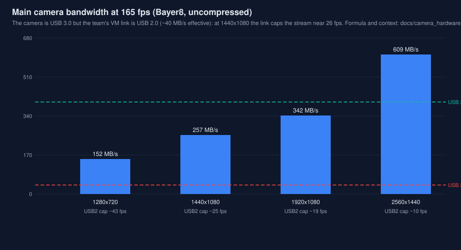

# 相机硬件与采集参数（队伍实机）

> 来源：队伍实车基准仓 perservance 的代码与配置（`io/src/hikrobot.cpp`、
> `io/src/usbcamera.cpp`、`text.yaml`），2026-11-11 由用户提供配置表并
> 逐项与代码对照核实。本页是硬件事实页：换相机、换安装或改采集参数时
> 先改这里，再改代码默认值。

## 主相机（自瞄 / 前哨站 / 大符）

| 项目 | 配置 |
|---|---|
| 类型 | 海康机器人 (Hikrobot) 工业 USB3.0 相机 |
| USB VID:PID | 2bdf:0001（0x2bdf = Hikrobot 厂商 ID） |
| SDK | 海康 MVS SDK（MvCameraControl.h，MV_CC_* 接口） |
| 帧率 | 165 fps（`hikrobot.cpp:95` 写死 `MV_CC_SetFrameRate(handle_, 165)`） |
| 曝光 | 2500 µs（自瞄/前哨站）、2000 µs（大符）；手动曝光（ExposureAuto = OFF） |
| 增益 | 自动连续（GainAuto = CONTINUOUS） |
| 白平衡 | 自动连续 |
| 输出格式 | Bayer8 彩色 → 转 RGB（BayerGR/RG/GB/BG8） |
| 分辨率 | 代码未设置（相机默认输出），待实车确认后补录 |
| 用途 | 自瞄 (Armor)、前哨站 (Outpost)、大符 (Buff) 的主视觉 |

## 全向感知相机（搜敌）

| 项目 | 配置 |
|---|---|
| 数量/位置 | 2 台：video0 = 右、video2 = 左 |
| 分辨率 | 1280×720（`usbcamera.cpp:113-114`） |
| 编码 | MJPG |
| 帧率 | 120 fps（`text.yaml: usb_frame_rate: 120`） |
| 曝光 | 150（V4L2 单位，`text.yaml: new_usb_exposure: 150`） |
| 用途 | Omniperception::Perceptron 全向感知搜敌 |

注：正式仓中 Omniperception 模块存在，但其感知结果的消费在正式基线中
未启用（见 perservance 研读记录），不要按"双目全向已在哨兵上生效"
理解本表。

## 与本仓（robot-vision-aim）的对照

| 项 | 本仓状态 |
|---|---|
| 帧率 | `MvsConfig::frame_rate = 165.0`，与实机一致 |
| 曝光 | `MvsConfig::exposure_us` 原默认 1500 µs，**已按实机修正为 2500 µs**（自瞄口径）；源在启动时会回读相机实际曝光用于帧戳对齐（见 docs/reviews/hardening.md） |
| 通道序 | 本仓 MVS 源把 Bayer/RGB 输入**统一转 BGR** 输出（camera_source.cpp），与 perservance 的 RGB 输出不同——移植其检测代码时必须核对通道序（路线图 P1-4） |
| 内参 | 主相机内参以标定档案为准（见 docs/calibration/calibration_record_template.md 与 core/config 的口径说明），perservance 与本仓的两套标定来自不同相机/安装，不得混用 |

## 带宽提醒（上车必测，路线图 P1-5）

主相机是 USB3.0 设备，但队伍当前的虚拟机环境没有 USB 3.0——相机在该
环境下只能以 USB 2.0 速率工作。Bayer8 未压缩流的带宽需求为
帧率 × 分辨率字节数：以 1440×1080 为例，165 fps 约需 256 MB/s，
远超 USB 2.0 约 40 MB/s 的有效带宽，即该分辨率下帧率会被带宽卡在
约 26 fps。实机分辨率确认后，按上式核算并实测实际出图帧率，不要
默认 165 fps 在 USB2 链路上成立。

