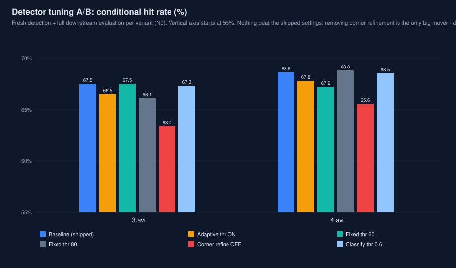

# 检测器参数研究（2026-11-11）

> 问题：现行检测器参数（通道差阈值 70 固定、自适应阈值关、角点精化开、
> 数字分类阈值 0.7）是不是这两段视频上的最优？逐项 A/B，全量下游评测
> （robot EKF 三口径 + 0.32 s 预测误差）判定。出厂配置未动。

## 方法

- 检测在两段实拍视频（3.avi 2209 帧 / 4.avi 3416 帧）上全新运行，
  不使用缓存；评测口径为 N0（video_reference.yaml），与冻结基线同口径。
- 评测管线先在冻结缓存上校验：完整复现冻结数字（67.5% / 68.6% 条件
  命中、预测 14.3 / 13.3 px、10.60 / 10.06 hits/s），管线无误后才跑实验。
- 判定规则（先定后跑）：两个视频的条件命中都不许退化（容忍 0.3 pp），
  且至少一个视频有实质提升，才考虑合入。

## 结果（robot EKF，条件命中 / 保守口径 / hits/s / 预测@0.32s / 装甲数）

| 配置 | 3.avi | 4.avi |
|---|---|---|
| 基线（现行出厂） | 67.5 / 65.1 / 10.60 / 14.3 px / 2380 | 68.6 / 67.1 / 10.06 / 13.3 px / 3885 |
| 自适应阈值开（k=4.5，[40,120]） | 66.5 / 65.0 / 10.82 / 14.4 / 2467 | 67.8 / 66.3 / 9.76 / 13.3 / 3895 |
| 固定阈值 60 | 67.5 / 65.9 / 10.91 / 14.4 / 2502 | 67.2 / 66.2 / 10.06 / 13.3 / 4040 |
| 固定阈值 80 | 66.1 / 62.0 / 9.34 / 14.6 / 2204 | 68.8 / 67.2 / 10.00 / 13.2 / 3743 |
| 关角点精化（消融） | 63.4 / 60.9 / 9.69 / 15.9 / 2380 | 65.6 / 63.9 / 9.01 / 14.5 / 3883 |
| 分类阈值 0.6 | 67.3 / 64.9 / 10.58 / 14.3 / 2388 | 68.5 / 67.1 / 10.06 / 13.3 / 3899 |

## 结论

1. **没有候选达到合入标准，出厂参数保持不变。** 阈值 70 是这两段视频
   上的鞍点：降到 60 多检出的装甲（+122/+155）没有换来命中（4.avi 反而
   −1.4 pp）；升到 80 在 3.avi 上直接丢跟踪（tracking 0.933→0.878）。
2. **角点精化被消融实验证实是真收益**：关掉后装甲数几乎不变，但预测
   误差 +1.6/+1.2 px、条件命中 −4.1/−3.0 pp——角点精度经 PnP 直接
   传导到命中。保持开启，且后续任何检测改动不得牺牲角点精度。
3. **自适应阈值在这两段视频上是负收益**（−1.0/−0.8 pp 条件命中）：
   它多检出的多是边缘帧。它设计的场景是暗光崩溃防护
   （docs/exposure_robustness.md），定位是鲁棒性开关，不作默认。
4. **分类阈值 0.6 与 0.7 无差别**（±0.2 pp 内）：视频里只有 3 号一个
   数字，该旋钮在此数据上不可测，保持 0.7。
5. 与 Stage K 的诊断一致：当前瓶颈不在检测（oracle 口径 99.3%/93.8%
   说明上限由跟踪/瞄准决定）。检测侧真正的提升要等 N1（队伍相机实拍）
   到位后重调——现行参数本就是在这两段非队伍相机的视频上调的。

原始检测输出与复现工具保存在目标工作区 `detector-study/`
（detect/eval 两个 runner 源码 + 10 份实验检测文件）。
