# 数据图表：代码的强项与弱项

> 本页图表由 `tools/make_charts.py` 生成（数据全部抄自仓库内已核验
> 来源，逐图标注；基线变动时改脚本数据重跑即可）。读图原则：
> 强项和弱项都画出来——命中率的天花板在哪、哪种工况最脆弱，
> 比只报最好数字更有用。

## 1. 命中率：整车 EKF 相对点 KF 的代差

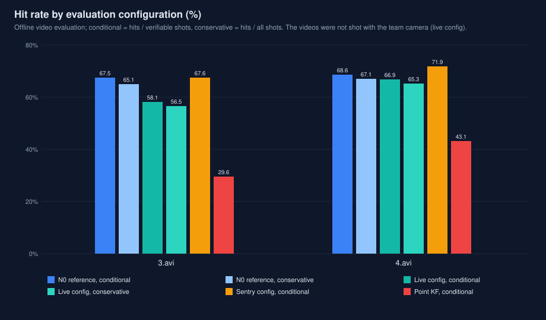

| 配置 | 3.avi 条件 | 3.avi 保守 | 4.avi 条件 | 4.avi 保守 |
|---|---:|---:|---:|---:|
| robot EKF · 参考口径 | 67.5 | 65.1 | 68.6 | 67.1 |
| robot EKF · 出厂口径 | 57.3 | 55.3 | 66.9 | 65.3 |
| 哨兵配置 | 67.6 | — | 71.9 | — |
| point KF · 参考口径 | 29.6 | — | 43.1 | — |

- **强项**：整车 EKF（条件率 67.5/68.6）相对点 KF（29.6/43.1）是
  代差级优势，哨兵配置在 4.avi 达 71.9。
- **注意**：实测口径（57.3/66.9）低于 N0 参考口径不是退化——测试
  视频非队伍相机所摄，口径差异见 changes_vs_legacy.md 第 9 节。
- 出处：BASELINE.md、docs/MEASUREMENTS.md。

## 2. 赛场压力：慢目标稳、快目标怕丢帧、最怕时间戳抖动

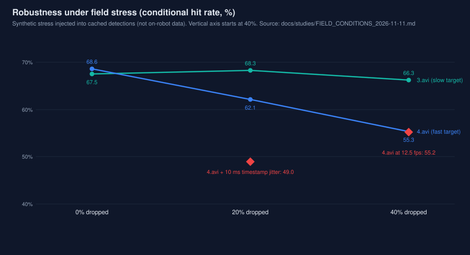

| 压力 | 3.avi | 4.avi |
|---|---:|---:|
| 无（基线） | 67.5 | 68.6 |
| 丢帧 20% | 68.3 | 62.1 |
| 丢帧 40% | 66.3 | 55.3 |
| 帧率减半 12.5 fps | — | 55.2 |
| 时间戳抖动 σ=10 ms | 63.9 | 49.0 |

- **强项**：慢速目标（3.avi，ω≈2.7 rad/s）丢帧 40% 仍保 66.3。
- **弱项**：快速目标（4.avi，ω≈8.4 rad/s）对丢帧与降采样敏感
  （40% 丢帧 55.3、12.5 fps 55.2）；最脆弱的是时间戳质量——
  10 ms 抖动直接掉到 49.0。这就是时间对齐与延迟标定列为
  上车第一优先级的原因。
- 出处：docs/FIELD_CONDITIONS_2026-11-11.md（合成注入，非实测）。

## 3. 计算耗时：解算与检测都已降一个量级

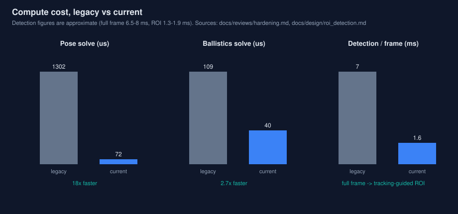

| 环节 | 旧实现 | 现行 |
|---|---|---|
| 位姿解算（每装甲） | 1302 µs | ≈72 µs（≈18×） |
| 弹道解算（每发） | ≈109 µs | ≈40 µs |
| 检测（每帧） | ≈7 ms（全帧） | 1.3–1.9 ms（TG ROI）/ 6.5–8 ms（全帧） |

- **强项**：位姿解算 1302→72 µs、弹道 109→40 µs、检测
  ~7.0→~1.6 ms/帧，整条管线有充足的帧率余量。
- 出处：docs/hardening.md、docs/roi_detection.md。

## 4. 否决案例一：NIS 自适应 q——仿真有效、真实全退化

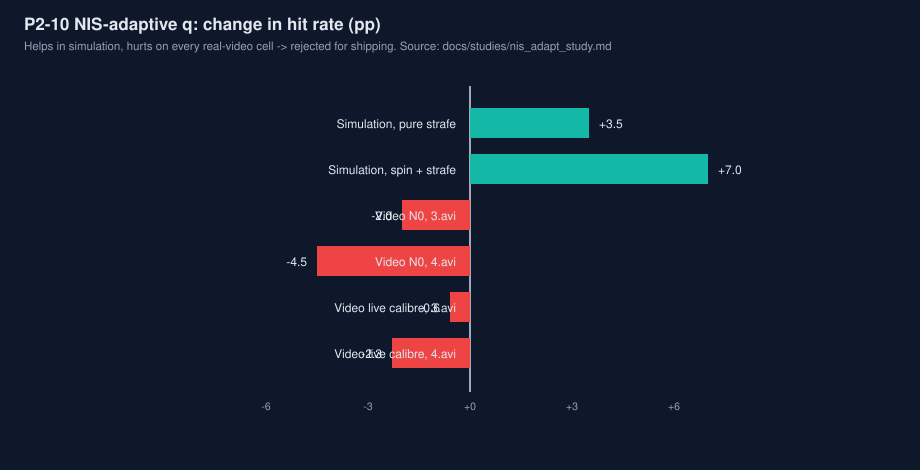

| 场景 | 基线 | NIS 自适应 q | Δ |
|---|---:|---:|---:|
| 仿真 · 纯平移 | 14.5% | 18.0% | +3.5 pp |
| 仿真 · 旋转+平移 | 43.4% | 50.4% | +7.0 pp |
| 真实视频（4 格） | — | — | −0.6 ~ −4.5 pp（全退化，否决） |

- **弱项（方法论）**：同一机制在仿真 +3.5/+7.0 pp、真实视频
  四格 −0.6~−4.5 pp。滤波器自报统计量的尺度在仿真与真实间
  漂移，固定阈值机制不可直接迁移——已否决出厂，补丁留档。
- 出处：docs/nis_adapt_study.md。

## 5. 否决案例二：sigma 门控——不确定度抓不住最弱模式

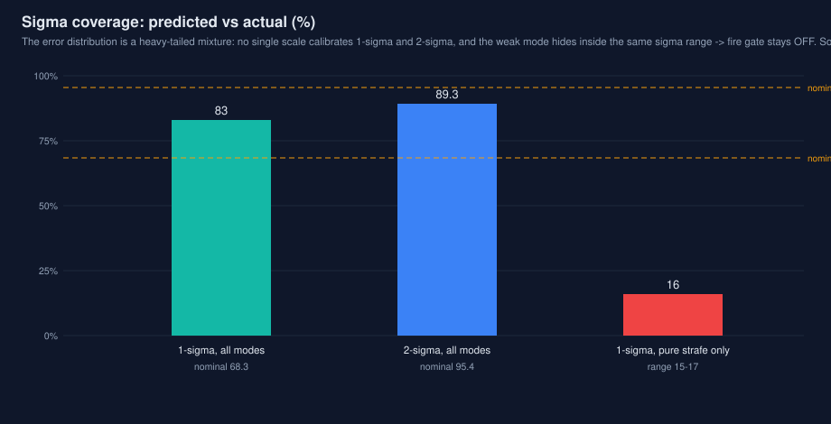

| 口径 | 1σ 实际覆盖（名义 68.3%） | 2σ 实际覆盖（名义 95.4%） |
|---|---:|---:|
| 参考口径 | 83.0% | 89.3% |
| 现行口径 | 83.7% | 92.1% |
| 纯平移模式（1σ） | 15–17% | — |

- **弱项**：预测误差是高峰度混合分布，1σ 过覆盖（83.0 vs 名义
  68.3）、2σ 欠覆盖（89.3 vs 95.4），无单一标度可校准；而最弱
  的纯平移模式 1σ 覆盖仅约 16%，且其 sigma 与良好模式重叠，
  门控原理上抓不住。sigma 只可作序数风险分数，门控保持关闭。
- 出处：docs/sigma_coverage_study.md。

## 6. 剩余误差在哪：预测，不是执行

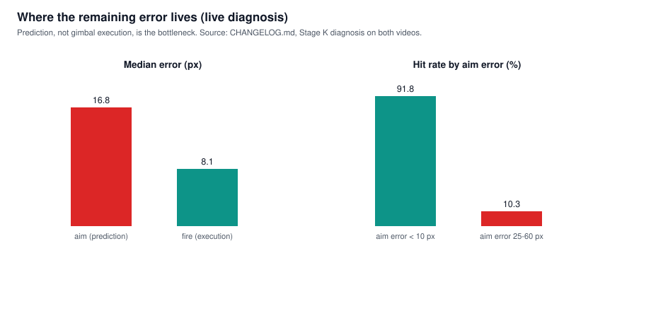

| 量 | 值 |
|---|---|
| 瞄准（预测）误差中位（Stage K 诊断） | 16.8 px |
| 开火（执行）误差中位 | 8.1 px |
| 命中率 @ 误差 <10 / 10–25 / 25–60 / >60 px | 91.8% / 51.7% / 10.3% / 1.5% |

- **强项**：云台执行误差中位仅 8.1 px，执行链是可靠的。
- **弱项**：瞄准预测误差中位 16.8 px，且命中率随它陡降
  （<10 px 时 91.8%，25–60 px 时 10.3%）；角速度估计误差
  σ(ω)=0.69 rad/s 是当前第一瓶颈，后续优化应继续投向
  运动建模与时间对齐，而非执行端。
- 出处：CHANGELOG.md（Stage K 诊断）。

## 7. 精度随时间：瞄准误差与执行误差的逐秒轨迹

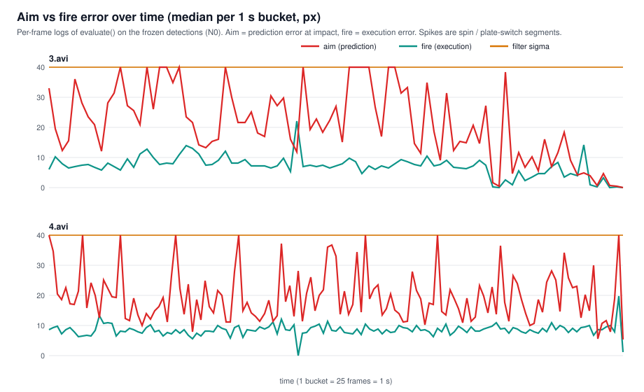

| 视频 | 瞄准误差（逐秒中位数的中位） | 开火误差 | 比值 |
|---|---:|---:|---:|
| 3.avi | 20.6 px | 7.3 px | 2.8× |
| 4.avi | 18.5 px | 8.5 px | 2.2× |

- **读法**：红（瞄准/预测误差）几乎全程压在青（执行误差）之上，
  且在旋转/换板段冲高——第 6 节的静态中位数在这里变成时间线：
  误差不是均匀分布的，是集中在机动段爆发的。
- **弱项**：黄色 sigma 线长期在 40 px 上方平躺，与实际误差脱钩
  （见第 10 节）。数据为冻结检测上 evaluate() 的逐帧日志按秒聚合。
- 出处：本页生成脚本内嵌逐帧序列（2026-11-11 生成）。

## 8. 强度随时间：跟踪占用与累计命中

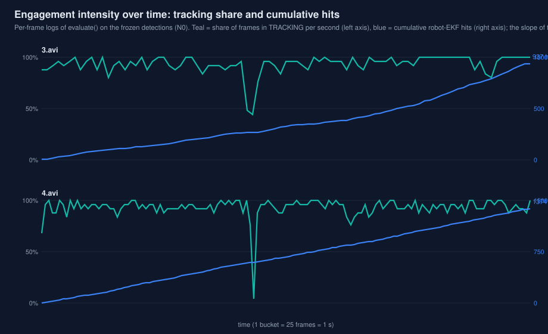

| 视频 | TRACKING 帧占比（均值） | 累计命中 | 时长 |
|---|---:|---:|---:|
| 3.avi | ≈93% | 937 | 89 s |
| 4.avi | ≈93% | 1374 | 137 s |

- **读法**：青线是每秒处于 TRACKING 的帧占比，蓝线是累计命中数，
  蓝线斜率就是命中强度——平坦段 = 丢失或换板，陡升段 = 稳定跟随
  连续命中。两段视频跟踪占比均在九成上下，命中累计
  937 / 1374 与冻结基线一致。
- 出处：同第 7 节逐帧日志。

## 9. 精度随预测时域：整车模型与点模型的分水岭

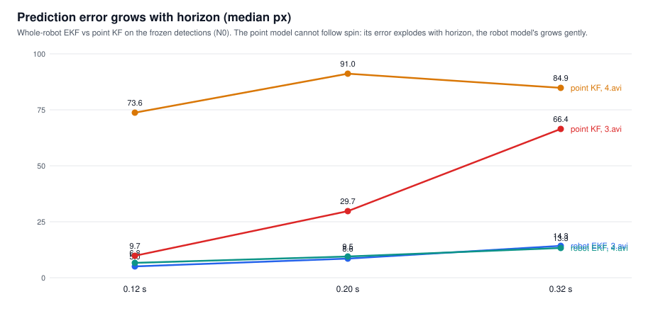

| 预测时域 | 3.avi EKF | 3.avi 点 KF | 4.avi EKF | 4.avi 点 KF |
|---|---:|---:|---:|---:|
| 0.12 s | 5.0 | 9.7 | 6.8 | 73.6 |
| 0.20 s | 8.6 | 29.7 | 9.5 | 91.0 |
| 0.32 s | 14.3 | 66.4 | 13.3 | 84.9 |

- **强项**：整车 EKF 的误差随预测时域平缓增长（0.32 s 时
  14.3/13.3 px）；点 KF 在旋转目标上直接崩坏（4.avi 0.12 s 就
  73.6 px）——这是"为什么必须整车建模"最直观的一张图。
- 出处：evaluate() 预测统计（冻结检测，N0 口径）。

## 10. sigma 校准：滤波器自报的不确定度有多可信

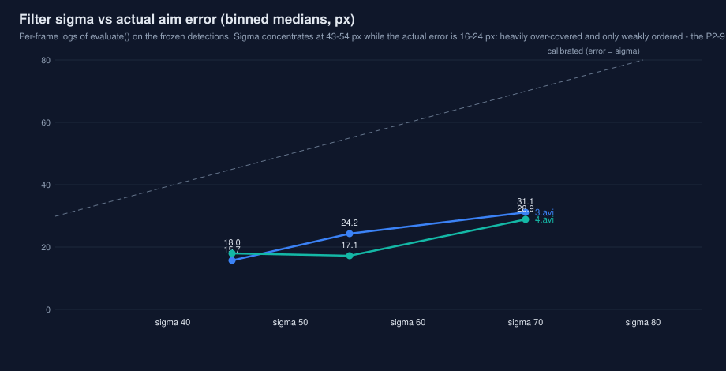

| sigma 桶（中位 px） | 样本（3 / 4.avi） | 3.avi 实际误差中位 | 4.avi 实际误差中位 |
|---|---:|---:|---:|
| ≈45 | 955 / 1156 | 15.7 px | 18.0 px |
| ≈55 | 266 / 511 | 24.2 px | 17.1 px |
| ≈70 | 167 / 337 | 31.1 px | 28.9 px |

- **弱项**：sigma 几乎恒定在 43–54 px，而实际瞄准误差只有
  16–24 px——系统性过度覆盖，且两者关系弱。这正是 P2-9
  「sigma 门控保持关闭」结论的图像版：它可以当序数风险分数，
  不能当校准过的概率。
- 出处：逐帧日志按 sigma 分箱的中位数（n≥30 的箱）。

## 11. 检测器调参 A/B：出厂点就是鞍点

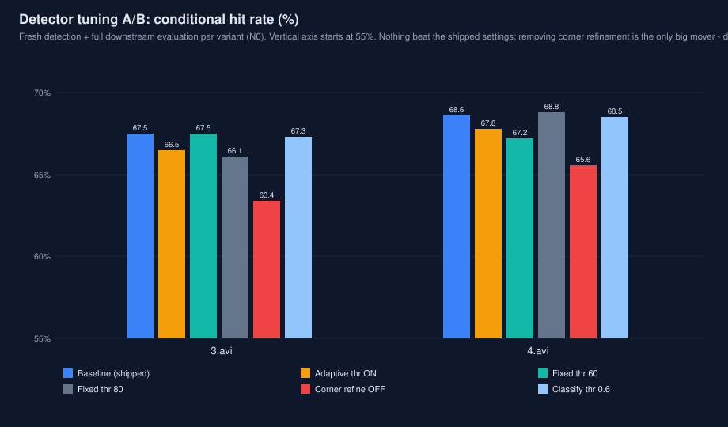

| 配置 | 3.avi | 4.avi | 处置 |
|---|---:|---:|---|
| 出厂基线 | 67.5 | 68.6 | — |
| 自适应阈值开 | 66.5 | 67.8 | 否决作默认（暗光鲁棒开关） |
| 固定阈值 60 | 67.5 | 67.2 | 否决 |
| 固定阈值 80 | 66.1 | 68.8 | 否决（70 是鞍点） |
| 角点精化关（消融） | 63.4 | 65.6 | 证明精化值 +3–4 pp |
| 分类阈值 0.6 | 67.3 | 68.5 | 中性、不可测 |

- **结论**：阈值 60/80、自适应阈值、分类阈值 0.6 都没赢过出厂
  设置；唯一的大家伙是关掉角点精化——直接掉 3–4 pp。检测器
  的改进红线：不许牺牲角点精度。
- 出处：docs/detector_tuning_study.md。

## 12. 模拟器场景：旋转全胜、强横移是悬崖

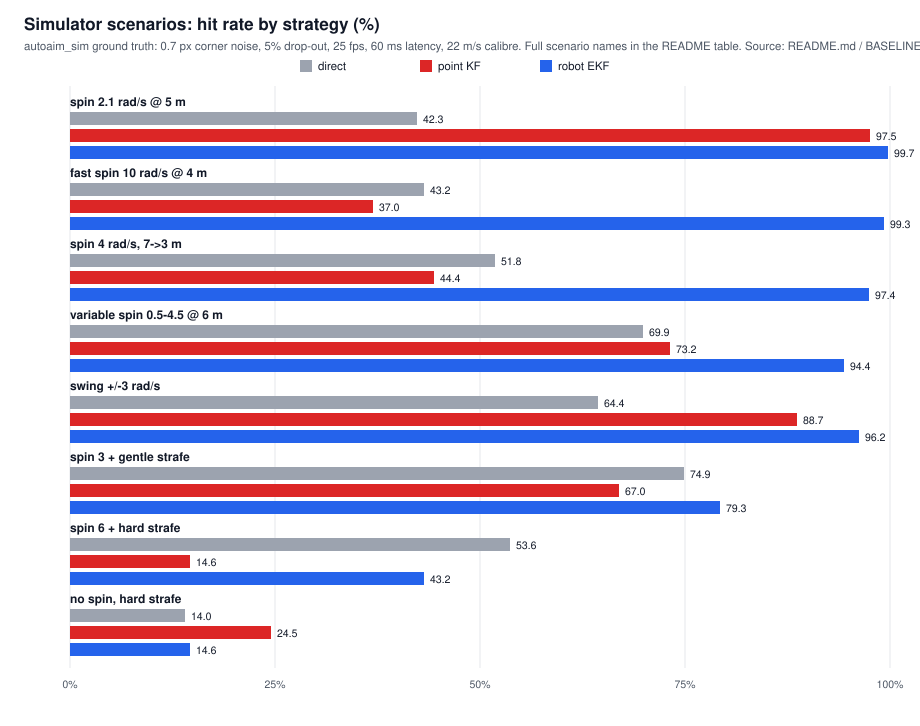

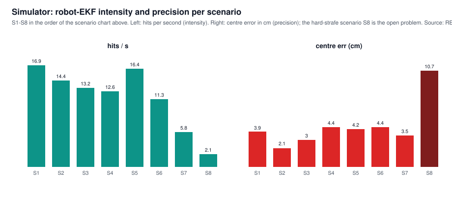

| 场景 | direct | point KF | robot EKF | EKF hits/s | 中心误差 |
|---|---:|---:|---:|---:|---:|
| S1 旋转 2.1 rad/s | 42.3 | 97.5 | 99.7 | 16.9 | 3.9 cm |
| S2 变速旋转 4.2 | 31.2 | 78.9 | 94.4 | 14.4 | 2.1 cm |
| S3 高速旋转 8.4 | 43.0 | 43.8 | 99.6 | 13.2 | 3.0 cm |
| S4 旋转 10.5 | 7.6 | 43.3 | 95.8 | 12.6 | 4.4 cm |
| S5 旋转+弱横移 | 4.9 | 3.9 | 94.8 | 16.4 | 4.2 cm |
| S6 旋转+横移 | 5.8 | 5.7 | 94.4 | 11.3 | 4.4 cm |
| S7 旋转+强横移 | 40.6 | 27.4 | 43.2 | 5.8 | 3.5 cm |
| S8 纯强横移 | 4.5 | 10.4 | 14.6 | 2.1 | 10.7 cm |

- **强项**：一切带旋转的场景整车 EKF 都在 94% 以上，点 KF 在
  高速旋转（37.0%）和旋转+强横移（14.6%）下崩坏——整车建模的
  价值在模拟器里和真实视频里一致。
- **弱项**：纯强横移（S8）三家全灭（14.0/24.5/14.6），中心误差
  10.7 cm、ω 误差 1.68 rad/s：恒速模型对 5–8 m/s² 侧向加速度的
  固有滞后，是模型问题不是噪声问题（见 README Limitations）。
- 出处：README.md / BASELINE.md §8（autoaim_sim 地面真值）。

## 13. 策略阶梯：离天花板还差多少

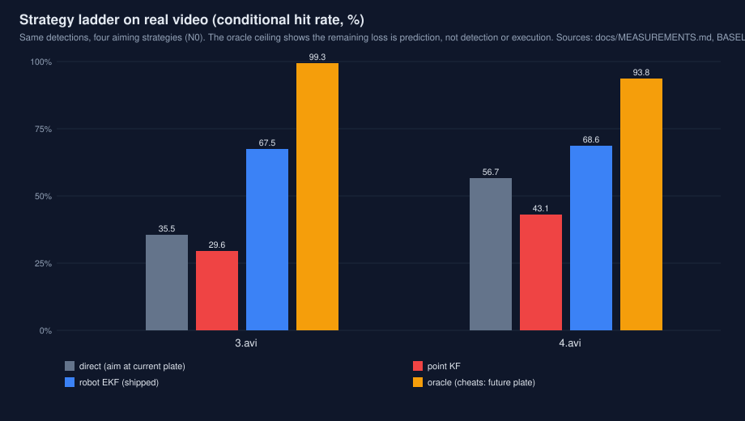

| 策略 | 3.avi | 4.avi |
|---|---:|---:|
| direct | 35.5 | 56.7 |
| point KF | 29.6 | 43.1 |
| robot EKF | 67.5 | 68.6 |
| oracle（上限） | 99.3 | 93.8 |

- **读法**：同一批检测、四种瞄准策略。oracle 是"作弊看未来"的
  上限（99.3/93.8）——现行 67.5/68.6 与上限的差距几乎全在预测，
  不在检测与执行，与第 6、7 节互相印证。
- 出处：docs/MEASUREMENTS.md、BASELINE.md。

## 14. ROI 窗口：边距不是越大越安全

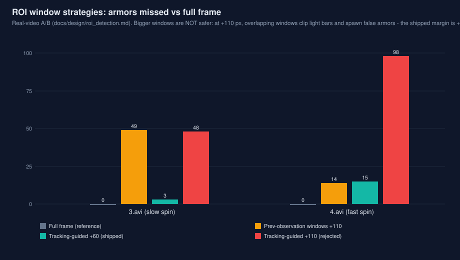

| 策略 | 3.avi 漏检 | 4.avi 漏检 |
|---|---:|---:|
| 全帧（基准） | 0 | 0 |
| 上一帧观测窗口 +110 | 49 | 14 |
| 跟踪预测窗口 +60（现行） | 3 | 15 |
| 跟踪预测窗口 +110（已否决） | 48 | 98 |

- **结论**：跟踪预测窗口 +60 px 把慢旋漏检从 49 压到 3；+110 px
  因窗口重叠截断灯条反而暴涨到 98（快旋）。窗口策略的甜点是
  实测出来的，不是拍出来的。
- 出处：docs/roi_detection.md。

## 15. 弹道曲线：25 → 22 m/s 的物理代价

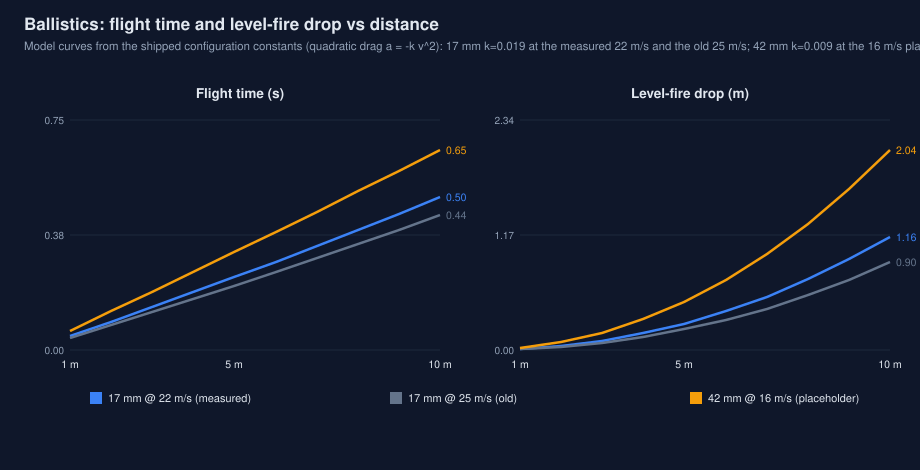

| 弹种 | 飞行时间 @5 m | 平射下坠 @5 m | 飞行时间 @10 m | 平射下坠 @10 m |
|---|---:|---:|---:|---:|
| 17 mm @ 22 m/s（实测） | 0.238 s | 0.270 m | 0.501 s | 1.156 m |
| 17 mm @ 25 m/s（旧假设） | 0.210 s | 0.210 m | 0.441 s | 0.895 m |
| 42 mm @ 16 m/s（占位） | 0.320 s | 0.494 m | 0.654 s | 2.038 m |

- **读法**：按出厂配置常数（二次阻力）算的模型曲线：10 m 处
  17 mm 飞行时间 0.50 s（22 m/s）对 0.44 s（25 m/s），平射下坠
  1.16 m 对 0.90 m——旧基线被 25 m/s 美化的 5.4 pp 就是这条
  物理差距。42 mm 曲线用的是占位弹速 16 m/s，待实测替换。
- 出处：core/config/default.yaml 弹道常数（17 mm 弹速为实测值）。

## 16. 相机带宽：165 fps 需要 USB3 的账

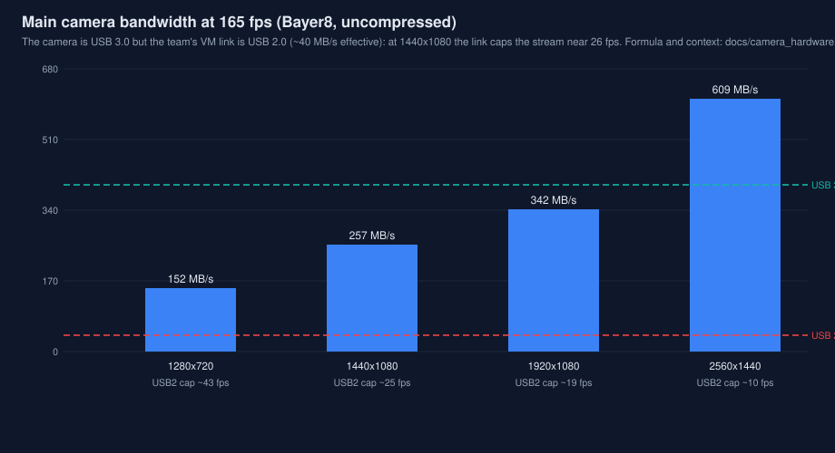

| 分辨率 | 单帧（Bayer8） | 165 fps 需求 | USB2 帧率上限 |
|---|---:|---:|---:|
| 1280×720 | 0.92 MB | 152 MB/s | ≈43 fps |
| 1440×1080 | 1.56 MB | 257 MB/s | ≈26 fps |
| 1920×1080 | 2.07 MB | 342 MB/s | ≈19 fps |
| 2560×1440 | 3.69 MB | 609 MB/s | ≈11 fps |

- **弱项**：主相机 165 fps 的未压缩带宽在常用分辨率下是
  152–609 MB/s，而队伍虚拟机链路只有 USB 2.0 的约 40 MB/s——
  1440×1080 下帧率会被卡在约 26 fps。这是上车前必须实测的
  第一笔账（路线图 P1-5）。
- 出处：docs/camera_hardware.md（带宽公式按 Bayer8 计算）。
