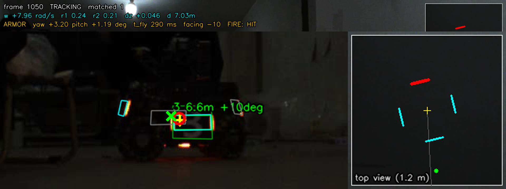
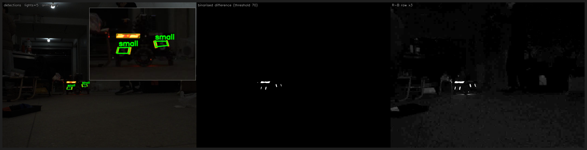
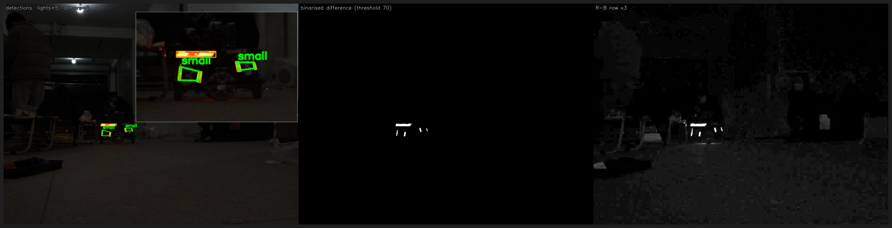

> **Provenance (rm-vision):** this is the project narrative that served as the
> README of `rm-autoaim` @ `c57343c` (results, evaluation method, tuning log).
> The sentry repo's README was the same text plus a sentry header note, so only
> this copy is kept. Build commands were updated to the rm-vision layout
> (`build/apps/…`, `build/tests/…`, `core/config/…`). The directory master
> table lives in the repository root README.

# RM Auto-Aim (视觉自瞄) — detection → pose → whole-robot EKF → ballistics → fire

A complete, self-contained RoboMaster armor auto-aim pipeline in C++17 + OpenCV
(no ROS, no Eigen). It was built by studying the best-known open-source RM
vision projects, re-implementing their strongest ideas, and then measuring
every change on the two recorded videos (`../3.avi`, `../4.avi`) and on a
ground-truth simulator.

```
frame ─► Detector ─────────► PoseSolver ─────────► RobotTracker ───────► RobotAimer ──► gimbal cmd + fire
         R−B lights           IPPE PnP              11-state EKF           latency + flight-time
         pair + contain chk   fixed-pitch yaw       (centre, v, yaw, ω,    iteration, armor choice,
         PCA corner refine    search                 r1, r2, dz)           ballistics with drag,
         MLP digit (ONNX)     yaw self-calibration   multi-armor assoc.    fire gating
```

## Results

Two real videos (1440×1080, 25 fps, the same red infantry robot "3"), plus
eight simulated scenarios with exact ground truth. **Hit rate** = hits /
verifiable shots; **hits/s** = hits per second of video (the damage output).

### Real videos: virtual shooting

| strategy | video 3 hit rate | video 3 hits/s | video 4 hit rate | video 4 hits/s |
|---|---|---|---|---|
| direct (aim at the current plate, no prediction) | 35.5% | 7.4 | 56.7%* | 11.8 |
| point KF (constant-velocity predictor on the plate) | 29.6% | 5.5 | 43.1% | 3.5 |
| **robot EKF (this system)** | **67.6%** | **10.6** | **68.6%** | **10.0** |
| oracle (cheats: aims at the plate seen at impact time) | 99.3% | 22.4 | 93.8% | 22.0 |

\* At video 4's spin rate (8.3 rad/s) the 0.33 s lead is ≈ 155°, so "aim where a plate
is now" often meets the *next* plate. That's aliasing luck at one speed: in the
simulator at 10 rad/s, direct scores 43% and the robot EKF 99.6%.

The oracle shows the evaluation's own ceiling (detector and judge noise).

**Prediction error** (median px between the predicted and the observed plate
centre; the plate's half-width is about 24 px):

| horizon | no prediction | point KF | robot EKF |
|---|---|---|---|
| video 3, 0.12 s | 27.4 | 9.7 | **5.0** |
| video 3, 0.20 s | 44.1 | 29.7 | **8.3** |
| video 3, 0.32 s | 39.1 | 66.6 | **14.3** |
| video 4, 0.20 s | 23.1 | 91.0 | **9.5** |
| video 4, 0.32 s | 44.5 | 84.9 | **13.4** |

**Recovered robot geometry.** The two videos are independent recordings, and the
tracker recovers the same robot from both:

| | r1 | r2 | dz (2nd pair height) | median ω |
|---|---|---|---|---|
| video 3 | 0.243 m | 0.210 m | 0.050 m | 2.6 rad/s, direction-changing |
| video 4 | 0.239 m | 0.214 m | 0.046 m | 8.3 rad/s |

### Simulator (ground truth)

`autoaim_sim`: 0.7 px corner noise, 5% detection drop-out, 25 fps, 60 ms latency, 25 m/s.

| scenario | direct | point KF | **robot EKF** | robot hits/s | centre err | ω err |
|---|---|---|---|---|---|---|
| spin 2.1 rad/s at 5 m (like the videos) | 42.3% | 97.5% | **99.7%** | 16.9 | 3.9 cm | 0.55 rad/s |
| fast spin 10 rad/s at 4 m | 43.2% | 37.0% | **99.3%** | 14.4 | 2.1 cm | 0.38 |
| spin 4 rad/s, approaching 7 → 3 m | 51.8% | 44.4% | **97.4%** | 13.2 | 3.0 cm | 0.49 |
| variable spin 0.5–4.5 rad/s at 6 m | 69.9% | 73.2% | **94.4%** | 12.6 | 4.4 cm | 0.53 |
| swing back and forth ±3 rad/s | 64.4% | 88.7% | **96.2%** | 16.4 | 4.2 cm | 0.55 |
| spin 3 rad/s + gentle strafe 0.3 m | 74.9% | 67.0% | **79.3%** | 11.3 | 4.4 cm | 0.57 |
| spin 6 rad/s + hard strafe 0.5 m / 2 s | 53.6% | 14.6% | 43.2% | 5.8 | 3.5 cm | 0.97 |
| no spin, hard strafe 0.8 m / 2 s | 14.0% | 24.5% | 14.6% | 2.1 | 10.7 cm | 1.68 |

The last two rows are open problems (see "Limitations"): their sideways
acceleration is 5–8 m/s². Over a 0.33 s lead, a constant-velocity prediction is
then off by 0.27–0.43 m, which is several plate widths. Singer damping helps the
real videos but not these sinusoids (see "Tuning log").

### Timing (single thread, Windows, MSVC Release)

| stage | ms / frame |
|---|---|
| detector (incl. MLP digit) | 3.6 |
| pose (PnP + yaw search) | 0.8–1.0 |
| tracker + aimer + 3 baselines + judge | 0.4 |

That is ≈ 5 ms per 1440×1080 frame, ~200 fps headroom.



*Video 4, frame 1050. Green: detection and panel outline. Cyan: model plates facing
the camera (grey: turned away). Yellow +: robot centre. Red ○: aim point at
impact time. Green ×: where the virtual bullet landed (a hit). Top view (right):
the red plate is the one chosen for impact, the back plate now, which will have
rotated to the front 0.35 s later.*

## Baseline snapshot

Every number in this README is frozen in [`BASELINE.md`](BASELINE.md), together with the exact
environment (OS / MSVC / OpenCV / commit), the commands to reproduce it, and the raw outputs in
[`reports/`](reports/). Regression thresholds live in the same file.

> Measured: the two-video evaluation is bit-for-bit reproducible (3.avi 62.5%, 4.avi 59.6%);
> the simulator drifts by up to 3 percentage points across OS/OpenCV versions, so compare it only
> on the same machine + same binary.

## What was taken from where

| idea | source (license) | here |
|---|---|---|
| light/pair geometry tests, IPPE PnP, MLP digit classifier, tracker state machine | [chenjunnn/rm_auto_aim](https://github.com/chenjunnn/rm_auto_aim) (MIT) | `detector.cpp`, `pose.cpp`, `tracker.cpp` |
| whole-robot EKF (centre + yaw + radius) | rm_auto_aim; [FaterYU/rm_auto_aim](https://github.com/FaterYU/rm_auto_aim) (MIT) | extended to 13 states (11 + axc/ay CA extension) |
| second-pair height `d_z`, best-armor selection with `side_angle`, centre tracking when spinning fast, fire tolerance | [CSU-FYT-Vision/FYT2024_vision](https://github.com/CSU-FYT-Vision/FYT2024_vision) (Apache-2.0) | `tracker.cpp`, `aimer.cpp` |
| PCA symmetry-axis corner refinement | FYT2024 `light_corner_corrector` | `Detector::refineCorners` |
| fixed-pitch yaw optimisation (FYT's BA idea) | FYT2024 `ba_solver` | 1-D search, no g2o |
| projectile with air drag | [robomaster-oss/rmoss_core](https://github.com/robomaster-oss/rmoss_core) (Apache-2.0), FYT `trajectory_compensator` | full RK4 integration |
| `LightBlob`-style template, R−B colour | [xinyang-go/SJTU-RM-CV-2019](https://github.com/xinyang-go/SJTU-RM-CV-2019) (MIT) via our assessment | detector |
| adaptive EKF, particle filter | SJTU CVRM2021, TUP-InfantryVision-2022 (GPL-3) | ideas only, no code |

All code here was written for this project; no file was copied. The
number-extraction warp follows the template's (rm_auto_aim lineage) exactly,
because the bundled `model/mlp.onnx` was trained with it.

### Beyond the references

1. **11-state EKF with multi-armor association.** Each detection is matched
   (Mahalanobis gate) to whichever of the 4 model plates it is closest to. Both
   radii and the height offset are filter states. Two plates seen in one frame
   are fused sequentially. No hand-written "armor jump" logic is needed.
2. **Anisotropic measurement noise.** Across the viewing ray, σ = d·px/f; along
   the ray, σ = d·px/bar_px (about 10× worse: depth comes from apparent size).
3. **Yaw self-calibration from the data itself.** Two plates of one robot seen
   in the same frame must be 90° apart. The measured separation was 69.3° (video 3,
   248 frames) and 69.7° (video 4, 542 frames): bar glow makes oblique plates look
   too wide. `yaw_gain = 1.3` corrects this; afterwards the separation is 89–91°.
4. **Adaptive process noise.** An EMA of the position-innovation NIS scales the
   centre's process noise, so the centre stays stiff while the robot spins in
   place and loosens when it manoeuvres. This is the largest single gain on the
   videos.
5. **Wrapped yaw residuals, Joseph-form covariance update**, and a fix of the
   `q_y_vy` typo in the reference Q matrix.
6. **An evaluation harness that can say "better"** (below).

## Evaluation method

* **Virtual shooting on real video.** Every frame, each strategy commands a
  simulated gimbal (first-order lag τ = 30 ms, 12 rad/s limit) and decides
  whether to fire. A shot leaves after the latency, flies with drag, and is judged
  against the **future** frames. Plates are interpolated to the exact impact
  time, the bullet is intersected at each plate's range, and the shot is a hit if
  the impact point projects inside that plate's panel outline. Shots whose impact
  time has no detected plate count as unverifiable.
* **Oracle.** The same judge with an aimer that looks up the future plate. This
  gives the metric's own ceiling (99% / 94%).
* **Prediction error.** The predicted plate centre vs the plate observed 0.12 /
  0.20 / 0.32 s later, on the same samples for all three methods.
* **Simulator.** A spinning, strafing 4-plate robot with two radii and heights
  is rendered through the same camera model with noise and drop-outs, and fed
  through the same pose solver and trackers. Shots are judged against the exact
  plate geometry.

## Build & run

### Camera calibration for a physical robot

`core/config/default.yaml` contains assumed intrinsics for the supplied recordings. To
use a physical camera, capture at least 12 sharp chessboard images with that same
camera, lens, focus, zoom, and resolution. Move and tilt the board across the
frame; measure the square size. Then run:

```bash
python3 tools/calibrate_camera.py 'calibration/*.png' --cols 9 --rows 6 \
  --square-mm 25 --out config/my_camera.yml
./build/apps/autoaim_video recording.avi --camera config/my_camera.yml --out out_calibrated
```

The calibration tool requires Python OpenCV and NumPy. It reports per-view
reprojection errors and frame coverage; inspect those results and repeat poor
views. `--camera` loads the measured intrinsics and distortion without changing
the detector/tracker configuration, and refuses videos with a different
resolution. Keep the original `core/config/default.yaml` and assessment outputs.
Measure camera-to-gimbal rotation and translation separately before using world
coordinates or ballistics on a robot. `--pitch-deg` records a measured downward
camera tilt when available; its default of zero is only a placeholder.

The supplied 3.avi and 4.avi lack a calibration capture. Running the tool on
images from another camera would not calibrate those recordings.

### Build and evaluation

`autoaim_video` reads the recording's FPS metadata for timestamps, tracking,
prediction horizons, virtual shots, and output video. When metadata is absent or
invalid, it uses `eval.fps` from the config. A cached detection file with the
wrong frame count is regenerated; valid cached detections are retimed to the
recording's FPS before evaluation.

Requirements: CMake ≥ 3.16, a C++17 compiler, OpenCV 4 (core, imgproc,
imgcodecs, videoio, highgui, calib3d, dnn).

```bash
# Linux
cmake -S . -B build && cmake --build build -j
./build/tests/autoaim_tests
./build/apps/autoaim_sim
./build/apps/autoaim_video ../3.avi --out out --render 300:450
```

```powershell
# Windows (VS 2026 + OpenCV 4.14 prebuilt in C:\opencv\opencv)
$cmake = "C:\Program Files\Microsoft Visual Studio\18\Community\Common7\IDE\CommonExtensions\Microsoft\CMake\CMake\bin\cmake.exe"
& $cmake -S . -B build -G "Visual Studio 18 2026" -A x64 -DOpenCV_DIR=C:/opencv/opencv/build
& $cmake --build build --config Release -j
$env:Path = "C:\opencv\opencv\build\x64\vc16\bin;" + $env:Path
.\build\Release\autoaim_video.exe ..\3.avi --out out --render 300:450
```

`autoaim_video` options:

| option | |
|---|---|
| `--config f.yaml` | parameters (default `core/config/default.yaml`) |
| `--out dir` | outputs: `<video>_report.md`, `<video>_track.csv` (per-frame state, command, shot), `<video>_yawdiag.csv`, `<video>_pairdiag.csv`, overlay video/PNGs |
| `--redetect` | ignore the detection cache `<out>/<video>_detections.txt` |
| `--render A:B` | overlay video of frames A..B |
| `--set key=value` | override a parameter (names in `src/config.cpp: setParam`) |
| `--sweep key=v1,v2,...` | re-run pose + tracking + shooting for each value (detections are reused; ~3 s per value) |

`autoaim_sim` options: `--fps --noise --dropout --seconds --set key=value`.

## Tuning log (all numbers from the sweeps)

Ablation on the real videos, adding one change at a time. Robot-EKF hit rate,
with the median prediction error at 0.32 s in brackets:

| step | video 3 | video 4 |
|---|---|---|
| A first working version | 51.2% (18.6 px) | 49.6% (21.7 px) |
| B + yaw self-calibration | 51.8% (18.0) | 49.4% (21.9) |
| C + measured yaw noise (σ ≈ 6°) | 53.6% (17.8) | 50.0% (22.5) |
| D + stiff centre + adaptive Q | 56.3% (16.2) | 54.2% (19.3) |
| E + fire only at plates within 30° (final) | **62.5%** (16.2) | **59.6%** (19.3) |
| F + Singer velocity damping (τ = 0.3 s) | **66.6%** (14.2) | **65.4%** (16.7) |
| G + plate-switch hysteresis (3°) | **66.8%** (14.2) | **65.8%** (16.7) |
| H + yaw process noise 30 → 8 | **67.2%** (14.2) | **68.1%** (14.8) |
| I + hysteresis state fix (external review) | 66.9% (14.2) | 67.3% (14.8) |
| J + `q_yaw` 3 and `q_r` 3e-3 | **67.6%** (14.3) | **68.6%** (13.4) |

Step I is a correctness fix found in an external review: the hysteresis was applied
inside the four flight-time iterations, so it compared against an intermediate pick
instead of the plate committed on the previous frame. Fixing it makes the
hysteresis actually hold; shot count rises (+1% / +3%) and so does hits/s, while the
hit rate dips 0.3 / 0.8 pp. Step J then re-tunes the two noise terms that this
changed: `q_yaw` 3 and `q_r` 3e-3 are a plateau (2–4 / 2e-3–3e-3), not a spike.
`q_r` had never been swept; raising it lets the filter follow the apparent-size
change as the robot approaches, which is where video 4's 0.32 s error drops
14.8 → 13.4 px.

| `q_yaw` | 2 | **3** | 4 | 6 | 8 |
|---|---|---|---|---|---|
| video 3 | 67.0% | **67.6%** | 67.8% | 67.1% | 66.9% |
| video 4 | 68.7% | **68.6%** | 68.2% | 67.9% | 67.3% |

| `q_r` (with `q_yaw=3`) | 2e-3 | **3e-3** | 5e-3 |
|---|---|---|---|
| video 3 | 67.2% | **67.6%** | 67.5% |
| video 4 | 68.4% | **68.6%** | 67.8% |

Step F sweep on both videos (robot-EKF hit rate / median 0.32 s error):

| `singer_tau` | video 3 | video 4 |
|---|---|---|
| 0 (constant velocity) | 62.5% (16.2 px) | 59.6% (19.3 px) |
| 0.30 | **66.6%** (14.2) | **65.4%** (16.7) |
| 0.35 | 66.7% (14.2) | 64.7% (16.9) |
| 0.40 | 66.8% (14.5) | 64.1% (16.9) |
| 0.50 | 66.6% (14.5) | 64.0% (17.3) |
| 0.80 | 65.1% (15.0) | 62.9% (17.8) |
| 1.00 | 64.6% (15.1) | 62.3% (18.3) |

Why damping helps here: a real infantry reverses translation direction and spin
direction within the 0.33 s lead, so a constant-velocity extrapolation
systematically overshoots. In the synthetic simulator the strafing is a smooth
sinusoid, which CV predicts better than a damped model — the sim mean drops
from 80.0% to 78.0% while both real videos gain 4–6 pp. Real-video evidence wins:
the sim's motion model is the less faithful one.

Step H sweep (`q_yaw`, yaw process noise; the plateau is 5–15, so the choice is not
a single-point fit):

| `q_yaw` | video 3 | video 4 |
|---|---|---|
| 5 | 67.1% | 68.0% |
| 8 | **67.2%** | **68.1%** |
| 10 | 66.8% | 67.7% |
| 15 | 67.2% | 67.3% |
| 20 | 66.9% | 66.3% |
| 30 (previous) | 66.8% | 65.8% |
| 40 | 66.2% | 65.0% |
| 50 | 65.7% | 64.8% |

Why: a per-shot analysis of every miss (`docs/miss_analysis.md`) shows the misses
are dominated by yaw-rate jitter, not by a systematic bias — aimed-at-plate
centres are correct (median `off_u` ≈ 0 on hits), the error direction follows the
spin sign, and 40–49% of the misses miss by less than half a panel width.

Other findings:

* **Fire window** trades efficiency for volume. On video 3: 15° → 69% / 6.3 hits/s,
  30° → 63% / 9.0, 50° → 58% / 10.7.
* **Centre mode** (aim at the centre, fire as plates pass) was *not* better than
  armor mode at 25 fps with this gimbal model, even at 10 rad/s with a slow
  gimbal (τ = 80 ms: 98.1% vs 99.4%). It switches on only above 12 rad/s.
* **Covariance fire gate** (`fire_sigma_scale`): implemented but off. Q is tuned
  for responsiveness, so the propagated covariance is not a calibrated
  uncertainty, and the gate blocked almost every shot.
* **Camera pitch** (−6…+6°) and **armor pitch** (8…22°) barely matter. Pitch 0°
  for the armor is clearly worse (44% vs 51%).
* **The focal length cannot be calibrated from these videos.** A smaller fx makes
  every shot look easier (closer target, shorter flight), while the model-consistency
  signals (prediction error, radius) stay flat. fx = 2400 px (8 mm lens on a
  1440×1080 / 3.45 µm sensor) is an assumption: **calibrate the real camera.**
* The video-3 robot **reverses its spin direction** several times (frames
  ≈ 270–380, 550–680, 1250–1350; visible in the raw plate motion). This
  direction-changing, variable-speed spin is why its ceiling is lower than a
  steady spinner's.
* **The adaptive-Q term never engages on these videos.** `q_adapt_max` 8 / 20 / 40
  give byte-identical runs (66.6% on video 3): the position NIS sits at its
  expected value (≈3), so `clamp(nis/3, 1, max)` stays at 1. Step D's gain
  therefore comes from the stiff-centre change, not from the adaptation. Making
  it useful would need a different trigger (e.g. NIS − 3) — untested.
* **Gimbal velocity feedforward — a hardware ask, measured in simulation.**
  The gimbal model is a first-order lag; adding the commanded yaw rate as
  feedforward (`gimbal_ff`, evaluation-only, default 0) lifts the hard-strafe
  scenario 43.8% → **51.1%** at ff = 1.0 and the no-spin strafe 14.4% → 18.0%
  at ff = 0.5 (mean 78.0% → 79.8%). The vision side cannot buy this: it needs
  the gimbal controller to accept a rate term, which is an electronics change.
* **Constant-acceleration states (CA) — tested, rejected.** Two extra states
  (`AXC`, `AYC`, `ca_model`, `q_acc`) were appended so no existing index moves.
  At `q_acc = 10` the simulator improves (mean 78.0% → 79.6%, hard strafe
  43.8% → 45.4%), but both real videos regress hard: 66.6% → 61.3% (video 3) and
  65.4% → 58.7% (video 4). At 25 fps the acceleration is not observable from
  corner positions with ~1 px noise and a biased yaw; the filter amplifies
  detection noise instead. The code stays behind `ca_model: 0` as a tested
  option, not as a default.

* **Hit rate alone is gameable - the shipped point is chosen on hits/s.** The
  early-switch angle raises the hit rate monotonically while destroying volume:
  video 4, `side_angle` 20° → 45° gives 65.4% → 71.9% but 9.2 → 5.3 hits/s.
  The fire window does the same: `max_fire_facing` 20° → 69.6% / 8.0 hits/s,
  30° → 66.6% / 9.9. Both are dominated by the shipped setting in damage per
  second, so the larger angles stay off.
* **Plate-switch hysteresis** (3°) is the one knob that improved both videos
  without costing volume: 66.6 → 66.8 and 65.4 → 65.8 at 9.9 / 9.1 hits/s.
  It stops the selector dithering at the switch boundary.

### What the detector sees

`autoaim_lights` dumps the three images the detector actually works on: the
frame with accepted light bars (yellow), armour boxes (green) and a 2.5× inset;
the binarised channel-difference mask (threshold 70); and the raw R-B
difference ×3.

| video 3, frame 875 (two plates) | video 4, frame 2625 |
|---|---|
|  |  |

Six-second clips (detection overlay, 25 fps):
[video 3, frames 850-1000](detections/3_lights.mp4) ·
[video 4, frames 2600-2750](detections/4_lights.mp4)

```bash
./build/apps/autoaim_lights video/3.avi --frames 875 --clip 850:1000 --out docs/detections
```

### Aiming accuracy: original vs overlay, side by side

[`docs/detections/compare_3and4.mp4`](detections/compare_3and4.mp4) (12 s,
1920×720) stitches the two segments: left half is the untouched frame, right half
is the HUD (`autoaim_video --render`). The HUD shows the detected plate, the
modelled other three, the aim point at `t + t_fly` (red), the virtual impact (×),
a gun-direction top view and the tracker state. Both halves get the same
display-only gamma (1.6) because the recordings are dark; nothing about the
detection changes.

```bash
./build/apps/autoaim_video video/3.avi --out runs/cmp3 --render 850:1000
python3 tools/make_compare_video.py     # needs ffmpeg on PATH
```

Full-length versions (every frame, 1920×720, H.264) are built with the same tool:

```bash
./build/apps/autoaim_video video/3.avi --out runs/cmp3 --render 0:2208
./build/apps/autoaim_video video/4.avi --out runs/cmp4 --render 0:3415
python3 tools/make_compare_video.py --full
```

They are ~47 MB / 75 MB / 123 MB (3, 4, concatenated), too large for the repo, so
they ship in the local package next to the source videos. Per-shot diagnostics of
where the misses land: [`docs/miss_analysis.md`](miss_analysis.md).
```

### Simulator-in-the-loop tuning (`tools/tune_sim.py`)

The simulator is deterministic per seed, so it can be used as an objective:
8 scenarios × N seeds, 8 tunable parameters (`q_xyz`, `q_yaw`, `q_adapt_max`,
`nis_alpha`, `r_yaw`, `max_fire_facing`, `side_angle`, `center_mode_omega`),
cross-entropy search, objective `0.6·mean + 0.4·worst + 0.05·tracking` minus a
penalty for buying hit rate by firing less. 64 evaluations:

| | baseline | sim-tuned |
|---|---|---|
| mean hit | 79.9% | **83.4%** |
| worst scenario | 17.9% | **28.9%** |
| hits/s | 11.5 | 12.7 |

**The real-video guard rejected it**: video 3 dropped from 62.5% to 53.9%
(−8.6 pp). The search had pushed `q_xyz` from 1.0 to 16.9; with the simulator's
clean Gaussian corner noise that tracks better, but on real detections (yaw
bias, glow, drop-outs) it makes the filter chase noise. The tool therefore
refuses to ship on simulator numbers alone: `--guard-exe autoaim_video
--guard-video video/3.avi --guard-tolerance 1` re-evaluates on real data and
exits 2 on regression. The Singer model above was found the other way round —
by a real-video sweep, then kept despite the simulator disliking it.

Robustness of the shipped config (8 scenarios × 3 seeds, `singer_tau = 0.3`):

| corner noise | detection dropout | mean hit | worst scenario | hits/s |
|---|---|---|---|---|
| 0.3 px | 0% | 78.6% | 16.7% | 11.9 |
| 0.7 px | 5% (default) | 77.6% | 15.4% | 11.2 |
| 1.5 px | 15% | 73.7% | 15.5% | 9.3 |

5× the corner noise and 3× the drop-out cost ~5 pp and ~2 hits/s, with no cliff —
and the worst scenario stays the hard strafe, i.e. it is a model problem, not a
noise problem. (`tools/robustness_sweep.json`)

## Regression gate

`python3 tools/regression.py` re-runs both videos (detection cache is reused) and
the simulator, compares against the frozen numbers in `BASELINE.md` §10 and exits
non-zero on a regression. CI cannot run it because the videos are not in the
repository, so it is the manual gate before a merge:

```
video      metric       reference  measured    delta  verdict
3.avi      hit               67.6      67.6     +0.0  PASS
3.avi      pred_032          14.3      14.3     +0.0  PASS
3.avi      hits_per_s        10.6      10.6     +0.0  PASS
4.avi      hit               68.6      68.6     +0.0  PASS
4.avi      pred_032          13.4      13.4     +0.0  PASS
4.avi      hits_per_s        10.0      10.0     +0.0  PASS
sim        mean_hit          78.1      78.1     -0.0  PASS
RESULT: PASS
```

### The remaining knobs are flat

Five knobs that had never been swept (or not since the last model change) were
tried after the hysteresis fix. None beats the shipped value on both videos, so
they stay where they are — this is the evidence that tuning is exhausted rather
than a claim:

| knob | values tried | video 3 | video 4 | verdict |
|---|---|---|---|---|
| `singer_tau` | 0.2 / **0.3** / 0.4 / 0.5 | 67.0 / 67.6 / 67.3 / 66.7 | 69.5 / 68.6 / 67.0 / 66.4 | 0.2 buys 0.9 pp on 4 but loses 0.6 on 3 |
| `q_dz` | 1e-5 / **1e-4** / 1e-3 / 1e-2 | 67.0 / 67.6 / 67.4 / 67.5 | 68.1 / 68.6 / 68.7 / 68.4 | flat (±0.2) |
| `pixel_noise` | 0.5 / **1.0** / 2.0 / 4.0 | 65.0 / 67.6 / 67.4 / 66.3 | 66.6 / 68.6 / 68.7 / 67.5 | flat; 0.5 is clearly worse |
| `r_yaw_head_on` | 0.01 / **0.02** / 0.05 / 0.12 | 67.8 / 67.6 / 66.8 / 65.8 | 67.7 / 68.6 / 68.7 / 69.2 | trades 3 for 4, no net gain |
| `max_match_distance` | 0.25 / **0.35** / 0.50 | 68.1 / 67.6 / 66.1 | 70.8 / 68.6 / 68.4 | 0.25 raises hit% but costs 1.1–1.2 hits/s → DPS worse |

Only a structural change (higher frame rate, better yaw observation, gimbal
feed-forward) can move the numbers now; see `docs/BACKLOG.md`.

## Limitations / next steps

1. **Camera calibration.** Intrinsics are assumed (see above), and the camera is
   treated as fixed at the gimbal origin. A real robot needs the camera→gimbal
   extrinsics and the IMU attitude at capture time (the world frame here is
   already gravity-aligned, so this is one extra rotation).
2. **Hard strafing** (≥ 5 m/s²) still defeats the 0.33 s lead: the last two
   simulator rows sit at 44% and 14%. Singer damping (τ = 0.3 s) fixed part of
   it on the real videos but is not a motion-model solution; the next options
   are a constant-acceleration / IMM model, or aiming at the middle of the
   strafe.
3. **25 fps video.** A real camera at 100–200 fps would cut prediction noise
   considerably. The tracker and aimer are time-stamped and frame-rate independent.
4. **Not included:** serial protocol to the MCU, ROS 2 nodes, energy-mechanism (buff)
   aiming, and number-model retraining (only "3" appears in the videos).
5. The gimbal model is a simple first-order lag. Measure the real latency and
   step response, then set `latency`, `gimbal_tau` and `gimbal_max_rate`.

## Layout

```
include/autoaim/  types, config, detector, pose, tracker, ballistics, aimer, evaluation, draw
src/              implementations
apps/             autoaim_video (real video + evaluation), autoaim_sim (ground-truth simulator),
                  autoaim_lights (light-blob / mask dump)
tests/            unit tests (ballistics, PnP round trip, EKF convergence)
config/           default.yaml (every tuned value is commented)
model/            mlp.onnx + label.txt (digit classifier from the team template)
tools/            tune_sim.py (CEM tuning + real-video guard)
docs/             figures, detection panels and clips, YOLO plan, backlog
```

## License

MIT — see [`LICENSE`](LICENSE). Third-party components keep their own terms:
`chenjunnn/rm_auto_aim` (MIT) and `CSU-FYT-Vision/FYT2024_vision` (Apache-2.0);
the exact mapping is in "What was taken from where" above.
