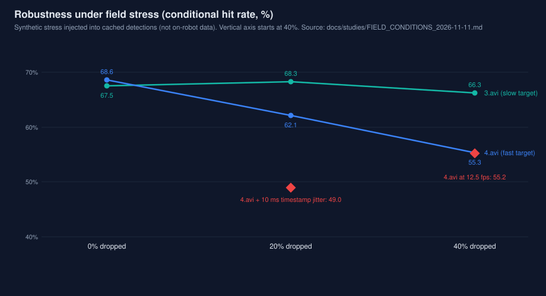

# 赛场条件压力测试（2026-11-11）

工具：`autoaim_video --stress`（本轮新增）。它对**检测缓存**做扰动，然后走完整的
pose → tracker → aimer → judge 链路，所以一次缓存可以回答"遮挡 / 掉帧 / 慢相机 /
时间戳抖动"这些问题，不需要新素材。全部扰动带固定种子，可复现。

```bash
build/apps/autoaim_video '测试视频/3(1).avi' --config core/config/video_reference.yaml \
    --out runs/stress --stress dropout=0.3            # 30% 的板随机漏检
build/apps/autoaim_video ... --stress framedrop=0.2   # 20% 整帧丢失
build/apps/autoaim_video ... --stress decimate=2      # 每 2 帧取 1 帧（12.5 fps）
build/apps/autoaim_video ... --stress jitter_ms=10    # 时间戳高斯抖动
```

`--stress` 在缓存写入**之后**才生效，所以缓存本身不会被污染；`control`（不加
`--stress`）与 `--stress seed=0,...` 之外的正常运行逐位一致。

## 先说一个必须修的缺陷

`evaluate()` 原来把仿真云台的时间步长写成常数 `dt = 1/fps`，`ShotJudge` 又用
`T*fps` 当**下标**去取前后帧。两者都隐含"视频是无洞的 25 fps 序列"。一旦丢帧：

- 云台每帧只走 40 ms 的量，而真实经过 80 ms，等效滞后半帧；
- judge 用错误的帧对插值弹着时刻的板位置。

后果不是小幅偏差，而是结论完全相反：

| 条件 | 修复前 3.avi | 修复后 3.avi |
| --- | --- | --- |
| control | 67.5% | 67.5%（逐字节一致） |
| 丢 20% 帧 | **22.5%** | **68.3%** |
| 丢 40% 帧 | 24.6% | 66.3% |

修复方式：`dt` 取相邻帧戳差（与 1/fps 相差 <1 ns 时仍用标称值，保证冻结基线不变）、
`platesAt` 用时间戳二分定位前后帧、预测误差采样按时间而不是按下标。25 fps 连续
序列上的输出与修复前**逐字节相同**，所以 §10 的基准继续可比。
回归测试：`tests/test_main.cpp::testShotJudgeNonUniform`（旧代码在该用例上返回
false，直接失败）。

这也说明一个更普遍的结论：**任何"掉帧/变帧率"的实验在本轮之前都不可信**，
包括仓库历史里可能存在的类似结论。

## 赛场条件矩阵（N0 口径，robot EKF）

| 条件 | 3.avi 命中% | 3.avi hits/s | 3.avi 预测中位 | 4.avi 命中% | 4.avi hits/s | 4.avi 预测中位 |
| --- | ---: | ---: | ---: | ---: | ---: | ---: |
| control | 67.5 | 10.6 | 14.3 px | 68.6 | 10.1 | 13.3 px |
| 板漏检 30% | 66.0 | 4.7 | 14.9 | 65.0 | 4.1 | 13.5 |
| 板漏检 50% | 64.0 | 2.2 | 16.0 | 65.6 | 1.9 | 13.6 |
| 板漏检 70% | 50.0 | 0.1 | 14.3 | 61.3 | 0.1 | 16.4 |
| 丢帧 20% | 68.3 | — | 14.5 | 62.1 | — | 13.9 |
| 丢帧 40% | 66.3 | — | 15.7 | 55.3 | — | 14.0 |
| 12.5 fps | 67.8 | — | 15.1 | 55.2 | — | 13.7 |
| 6.25 fps | 64.2 | — | 15.7 | 38.5 | — | 17.9 |
| 抖动 3 ms | 66.8 | 10.5 | 14.9 | 67.2 | 9.7 | 15.7 |
| 抖动 10 ms | 63.9 | 9.7 | 17.4 | 49.0 | 5.3 | 25.5 |
| latency 30 ms | 71.4 | 10.9 | 14.3 | 73.9 | 10.0 | 13.3 |
| latency 90 ms | 63.6 | 10.1 | 14.3 | 64.6 | 9.5 | 13.3 |
| latency 120 ms | 61.5 | 9.8 | 14.3 | 63.0 | 8.8 | 13.3 |

`hits/s` 在丢帧/降采样条件下按标称 25 fps 折算，**偏高**（帧数变少但时间轴没变），
跨条件比较请用命中率。抖动与延迟条件帧数不变，`hits/s` 可直接读。

### 1. 3 号目标（ω≈2.7 rad/s）几乎不受影响，4 号（ω≈8.4 rad/s）很脆

丢帧/降采样下 3.avi 稳定在 64–68%，4.avi 从 68.6% 掉到 55%（12.5 fps）、38.5%
（6.25 fps）。原因用 `aim_err_px` / `fire_err_px` 拆开看是**预测**而不是执行：

| 条件 | 4.avi aim_err 中位 | 4.avi fire_err 中位 |
| --- | ---: | ---: |
| control | 17.9 px | 8.6 px |
| 12.5 fps | **26.3 px** | 7.7 px |

即云台跟随没有变差，是"每帧 38° 的相位推进"让角速度估计变糙。这类目标需要
更高帧率的相机，算法侧没有便宜的补法——顺手把 `gimbal_ff`（B-01 角速度前馈）
打开做对照，结果更差：

| 4.avi | 命中% | hits/s |
| --- | ---: | ---: |
| control | 68.6 | 10.1 |
| control + `gimbal_ff=1` | 60.6 | 8.9 |
| 12.5 fps | 55.2 | 8.5 |
| 12.5 fps + `gimbal_ff=1` | **41.6** | 6.1 |

`gimbal_ff` 保持 0（本来就是默认）。原因是前馈把预测误差直接乘进角速度，而
预测误差在 12.5 fps 下已经不小。

### 2. 遮挡：命中率扛得住，开火机会没了

板级漏检 30%/50% 时命中率只掉 1.5 / 3 pp，但 **hits/s 掉 55%/80%**
（10.6 → 4.7 → 2.2）。因为 `lost_grace_frames = 0`，任何一帧匹配不上就把状态从
TRACKING 降级，而开火门控要求 TRACKING。tracking ratio 同步掉到 0.66 / 0.46。

这不是检测问题，是状态机的时间常数问题。扫 `lost_grace_frames`：

| 漏检 | grace | 3.avi 命中% | 3.avi hits/s | 4.avi 命中% | 4.avi hits/s |
| --- | ---: | ---: | ---: | ---: | ---: |
| 0 | 0 | 67.5 | 10.60 | 68.6 | 10.10 |
| 0 | 1 | 67.0 | **11.00** | 68.0 | **10.40** |
| 0 | 2 | 66.7 | 11.00 | 67.9 | 10.50 |
| 30% | 0 | 66.0 | 4.70 | 65.0 | 4.10 |
| 30% | 1 | 63.3 | 6.00 | 63.5 | 5.50 |
| 30% | 2 | 62.3 | **6.40** | 62.3 | **5.80** |
| 50% | 0 | 64.0 | 2.20 | 65.6 | 1.90 |
| 50% | 3 | 58.4 | **3.70** | 62.1 | **3.50** |

结论：grace=1 在干净素材上基本免费（+4% hits/s，命中 −0.5 pp，在噪声内），在
30% 漏检下 +28% hits/s（代价 −2.7 pp）。**默认仍保持 0**：干净素材上的收益在
噪声内，而遮挡统计是我构造的，不是实测标定；要不要换属于队伍对赛场的判断，
不应当由合成扰动决定。字段已在 `docs/parameters.md`，可逐场用 `--set lost_grace=1`。

### 3. 时间戳抖动比想象中重要

10 ms 抖动让 4.avi 从 68.6% 掉到 49.0%，预测中位 13.3 → 25.5 px，tracking ratio
0.932 → 0.880。3.avi 只掉 3.6 pp。抖动对相位预测的影响与 ω 成正比，所以快转
目标对时间同步更敏感。工程含义：曝光时刻戳（`--exposure-offset-ms`、
`stamp_offset_us`）与传输延迟必须当真，不能"差不多 40 ms 就行"。

### 4. 延迟：离线上最优是 30 ms，不要据此改默认

`latency` 从 60 ms 改到 30 ms，两条视频都涨 4–5 pp（71.4/73.9）。但离线回放没有
相机采集与传输链路，真实系统的 60 ms 里有相当一部分在离线不存在。因此这只是
"60 ms 里约一半是采集链路"的证据，**不是**把默认改小 30 ms 的理由。上机请用
`sentry_robot --calib-delay` 标定。



## 与 docs/studies/fps_ablation.md 的差异

`docs/studies/fps_ablation.md`（A-01）记录 12.5 fps 下 3.avi 36.6%、4.avi 3.6%，与本轮
67.8% / 55.2% 差得很远。原因是那份记录测于**关联门尚未随 `dt` 缩放**、且评测器
仍按 `T*fps` 取帧的年代：

- 把门限人为缩回"未放宽"的值（`--set max_match_distance=0.175`，即 0.35/2），
  12.5 fps 下 3.avi 67.8% → **53.7%**、4.avi 55.2% → **37.0%**；6.25 fps 更狠，
  3.avi 64.2% → 38.2%（ω 估计发散到 16.1 rad/s）。
- 但当前的 `match_dt_scale_` + 帧率无关评测器已经把大部分损失补回来了，
  所以那份文档的**绝对值不再适用**，其**结论**（关联门必须随 dt 缩放）依然成立。
- 顺带验证了帧率无关性：同一段 12.5 fps 素材，`eval.fps` 填 25 和填 12.5
  现在给出**完全相同**的结果（都是 67.7%）。修复前这两者会不一致——因为
  `stamp = frame/fps` 与 `dt = 1/fps` 必须自洽。

`docs/studies/fps_ablation.md` 顶部已加注，避免继续引用旧绝对值。

## 局限

- 遮挡/丢帧/抖动都是**合成**扰动，不是实拍标定；真实遮挡的时序相关性（整段被
  挡柱挡住）与独立随机丢弃不同，本矩阵只给下界。
- 颜色只跑过红方素材。阈值用 `|R−B|`，交换 R/B 并翻转 `enemy_color` 在解析上
  完全对称，但没有蓝方素材就无法验证实拍差异（尤其 ONNX 后端按颜色标签取通道）。
- 距离是窄带：两条视频 p10–p90 只有 6.5–7.2 m，无法在实拍上做距离分层；
  2–5 m 的近距与 8 m 以上的远距只有 `autoaim_sim` 覆盖。
- judge 只能对"可见板"评分，遮挡条件下 verifiable 数会下降，命中率的分母因此
  变小；漏检 70% 时只剩 12 / 31 个可判定射击，那一行不应作为结论使用。
- 目标是单机器人；多机同场、队友挡枪、outpost 与能量机关不在本矩阵内。
