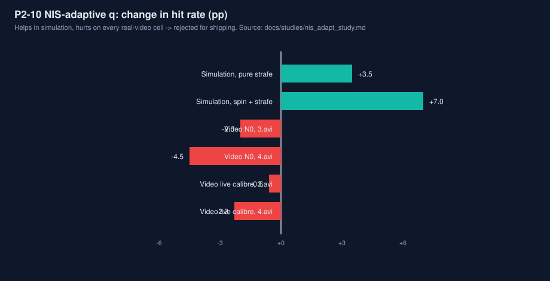

# P2-10 子实验：NIS 驱动的自适应过程噪声（q_acc / Singer τ）

**结论先行：否决出厂开启。** 机制在仿真上成立（纯平移命中率 14.5%→18.0%、旋转+平移 43.4%→50.4%，8 seeds 均值），τ 联动在仿真上即被否决；但视频守门四格**全部退化**（conditional −0.6～−4.5 pp），且轨迹诊断给出了明确的迁移失败机理：仿真标定的阈值在真实视频上触发后占用率失控（91.8%～100% 的 TRACKING 帧），机制在真实数据上等价于"全程 q_xyz×16"，与仿真中的"机动段开启"完全不是一回事。出厂建议：`q_acc_adapt` 保持 0、不写入任何出厂配置；重开条件见 §7。

实验纪律：全部改动只在副本 `~/workspace/rm-vision-nis-exp`（主树未动一字节，`diff -rq` 核验改动面正好 5 个文件）；参数只在仿真上选；真实视频只用选定的一组参数跑一次守门（外加同参数的轨迹诊断，不据此调参）。

---

## 1. 假设与现状基线

**假设**：整车 EKF 用 Singer 模型（τ=0.3 s）+ 固定 q，对手持续横向加速（平移折返）时预测系统性滞后（P2-9 实测：纯平移模式 1σ 覆盖仅 15–17%、−8.3 cm 系统偏置；仿真无旋转强横移 robot EKF 命中率约 11.4% 回归地板）。若在位置 NIS 持续偏高时临时放大过程噪声（可同时缩短 τ），并在稳态衰减回名义值，应能减小滞后而不牺牲旋转/静止的稳态精度。

**现状解剖**（`core/src/tracker.cpp`、`config.hpp`，出厂三套配置一致）：

- RobotTracker 13 状态（XC VXC YC VYC ZC VZC YAW W R1 R2 DZ AXC AY）；AXC/AY 是 CA 扩展，仅 `ca_model>0` 时激活，出厂 `ca_model=0`，故 `q_acc=2.0`（CA 状态的 jerk PSD）在出厂配置下**不生效**——本实验的放大对象因此定为实际生效的 `q_xyz`（与任务书"放大 q_acc"的意图一致：放大平移通道的过程噪声；CA 通道在出厂管线里不存在）。
- Singer τ 出厂 0.3 s（结构默认 0=CV）；`predict()` 与 `transition()` 各自实现一份 Singer 阻尼，改 τ 必须两处同改。
- **已有自适应 #1（常开）**：`q_scale_ = clamp(nis_ema_/3, 1, q_adapt_max=20)`，`nis_ema_` 是帧均值位置 NIS 的 EMA（α=0.2）。位置 NIS = y₃ᵀS₃⁻¹y₃，S₃ 是 S=HPHᵀ+R（4×4）的位置 3×3 块，3 自由度（χ²₃：均值 3、95% 7.815、99% 11.345）；帧聚合为当帧全部匹配的均值（第三轮审查修正）。
- **已有自适应 #2（Stage K）**：`q_yaw_scale_ = clamp(nis_yaw_ema_, 1, q_adapt_max)`，仅 `q_yaw_adapt=1`（default/sentry 出厂开启，配 q_yaw_walk=0.05）时作用于 q_yaw。yaw NIS 为 1 自由度。
- 新机制与 #1/#2 同构：复用同一个 `nis_ema_`、同在 `update()` 的匹配帧聚合之后计算、同从下一帧预测起生效。

**基线探针**（副本 `autoaim_sim`，default 配置，seed 0，robot EKF conditional；本轮复跑核实）：

| 探针 | 纯平移 strafe | 旋转6+平移 | 读数 |
|---|---|---|---|
| 出厂基线 | 11.4% | 44.8% | 冻结回归地板，复现一致 |
| `q_adapt_max=1`（关已有 NIS 自适应） | 11.4% | 46.7% | 已有 NIS 自适应对纯平移**毫无收益**——平滑正弦平移的逐帧 NIS 不显著，滞后是在瞄准时域上累积的 |
| `singer_tau=0.15`（静态缩短 τ） | **1.8%** | 34.3% | 静态缩 τ 直接崩坏（仿真平移是平滑正弦，短 τ 被重罚；真实折返更尖锐，故此探针只作机理警示） |
| `singer_tau=0.6` | 15.2% | 46.1% | 放长 τ 有小益 |
| `q_xyz=4`（静态放大） | 13.9% | 50.4% | 静态放大有收益但全程付代价；自适应要赢的是"只在机动时付" |

## 2. 实现（副本，相对主树 diff 见 `nis_adapt_study.patch`，5 文件）

新旋钮（`TrackerConfig`，命名对齐 `q_yaw_adapt` 先例，全部默认关/中性）：

| 旋钮 | 默认 | 语义 |
|---|---|---|
| `q_acc_adapt` | 0 | 总开关；0 = 与主树逐位一致 |
| `q_acc_thresh` | 6.0 | 触发阈值，作用在 `nis_ema_` 上（名义均值 3 的 2 倍） |
| `q_acc_frames` | 1 | nis_ema_ 连续超阈的匹配帧数 |
| `q_acc_boost` | 4.0 | 触发后 q_xyz 的额外乘子（叠加在 q_scale_ 之上） |
| `q_acc_release` | 0.3 s | 释放指数衰减时间常数 |
| `q_acc_tau_link` | 0 | 消融开关：触发期间 τ 除以实时 boost |

机制：`nis_ema_` 连续 `q_acc_frames` 帧超 `q_acc_thresh` → `acc_boost_` 瞬时升到 `q_acc_boost`（attack）；否则按 `exp(−dt/q_acc_release)` 衰减回 1。`transition()` 用 `q_xyz · q_scale_ · acc_boost_`；`singerTau()` 在联动开启时返回 `τ / acc_boost_`，`predict()` 与 `transition()` 共用。出厂三套 YAML **未改动**（参数经 `--set`/守门 YAML 注入）。

**触发统计的设计修正（如实记录）**：任务书给出两种触发——"滑动窗口内 NIS 均值"或"连续超阈计数"。最初实现的是逐帧超 χ² 阈值计数，但探针（`src/probe_nis.cpp`，无噪声 Reverser 夹具）实测：速度瞬时反转时 NIS 只冲高**恰好 1 个匹配帧**（测到它的那次更新同时把它吸收了），随后回落到 <1——`frames≥2` 的逐帧计数**永远不可能触发**。且稳态 NIS 远低于 χ² 名义尺度（见 §5 的分布实测）。故最终触发统计采用任务书的另一选项：**滑动窗口 NIS 均值（既有 nis_ema_）超阈**。这也与已有 #1 自适应的聚合方式同构。

## 3. 单元测试（ctest 3/3 全过，含新增 `testNisAccAdapt`）

1. **关=旧行为（逐位）**：默认配置 vs 旋钮关但其余参数填垃圾值的孪生跟踪器，同喂 200 帧 Spinner：状态逐位相等、P 差为 0、boost 恒 1；且结构体默认值 `q_acc_adapt=0`。
2. **触发**：Reverser（1.5 m/s 匀速→瞬时反转）夹具，阈值 4.5（该夹具 nis_ema 峰值 ≈6）：boost 必须到达上限 6；阈值设 1e9 的负对照恒 1。
3. **衰减**：反转后回到匀速，`q_acc_release=0.3` 时 boost 在 100 帧内回落 <1.05。
4. **τ 联动**：同 boost 下 predict(+0.3 s) 的平面速度保持率：未联动 0.368（=e^{−1}，理论值）、联动 0.012（≈e^{−τ被boost除} 量级），证明联动真实作用于 Singer 外推。

## 4. 仿真评测（参数选择在此完成）

`autoaim_sim`（地面真值评判），default 配置，robot EKF conditional hit%，多 seed 均值。主指标：纯平移（no spin strafe）与旋转+平移（spin 6 + strafe）；护栏：纯旋转/温和场景与总体均值。

**网格 1**（5 seeds，thresh×boost，frames=1/release=0.3/link=0）：boost 单调有益（strafe 14.1→17.1、spin6+strafe 43.8→49.3 @b8），thresh 1.6/2.0/2.4 差异弱。
**网格 2**（8 seeds，细化+消融）：

| 设置 | strafe | spin6+strafe | gentle | spin | 总体 |
|---|---|---|---|---|---|
| off | 14.5 | 43.4 | 63.0 | 99.9 | 73.7 |
| t1.6 b8 f1 r0.3 | 16.6 | 48.7 | 63.1 | 99.9 | 74.7 |
| t1.6 b16 f1 r0.3 | 17.7 | 49.6 | 63.4 | 100.0 | 75.0 |
| t1.2 b8 | 16.7 | 49.5 | 63.7 | 99.9 | 74.9 |
| t1.6 b8 **f3** | 16.8 | **44.1** | 63.0 | 99.9 | 74.0 |
| t1.6 b8 r0.15 / r0.6 | 16.1 / 17.1 | 47.9 / 49.5 | — | — | 74.5 / 74.9 |
| t1.6 b8 **link=1** | **5.9** | **33.6** | 57.6 | 99.8 | 69.7 |
| t2.0 b8 **link=1** | **6.2** | **35.0** | 59.3 | 99.8 | 70.6 |

**网格 3**（8 seeds，平台区）：t1.6 b16 r0.6 → 18.0 / 50.4 / 总体 75.2；b24 → 18.1 / 51.0 / 75.4；b32 → 18.7 / 51.1 / 75.5（平台饱和，差异在 seed 噪声内）。

**消融结论**：
- **只放大 q：有效**（上表）；**q+τ 联动：灾难性否决**——strafe 跌到 5.9%（比关还低 8.6 pp），与静态探针 τ=0.15→1.8% 同一机理：缩短 τ 在平滑机动上摧毁外推。联动开关保留在代码里仅作消融证据，永不建议开启。
- frames=3 明显差于 frames=1（EMA 在超阈段之间回落，连续计数错过窗口）；release 0.6 优于 0.3/0.15（桥接机动内 NIS 低谷）。

**选定参数（仿真最优平台的入口点，取平台内最小 boost 以减小真实数据上的协方差膨胀）**：

```
q_acc_adapt=1, q_acc_thresh=1.6, q_acc_frames=1, q_acc_boost=16, q_acc_release=0.6, q_acc_tau_link=0
```

相对 off（8 seeds）：strafe **+3.5 pp**、spin6+strafe **+7.0 pp**、gentle +0.8、spin 不变、总体 **+1.5 pp**，无任一护栏场景跌 >1 pp。video_reference 口径仿真交叉验证同样有益（总体 77.8→79.2，strafe 21.1→22.9，spin6+strafe 47.6→52.6）。

**诊断**（`nis_sim`，20 seeds，开火决策行）：

| 模式 | 指标 | off | winner |
|---|---|---|---|
| 纯平移 | err_lat 偏置 | −7.4 cm | **−4.3 cm** |
| | med \|err_lat\| | 40.5 cm | 39.0 cm |
| | 1σ / 2σ 覆盖 | 17.2% / 38.8% | **37.1% / 76.0%** |
| 旋转+平移 | err_lat 偏置 | +1.2 cm | +1.1 cm |
| | 1σ / 2σ 覆盖 | 34.4% / 89.5% | 45.6% / 93.3% |

假设在仿真内成立：偏置近乎减半、覆盖大幅回升（仍低于名义 68/95——与 P2-9 的混合分布结论一致，不夸大）。

## 5. 视频守门（选定参数只跑一次；零容忍对照）

驱动为既有 ffmpeg-pipe 离线评测（`src/evaldriver_nis.cpp`，检测走缓存），守门参数经 `data/gate_default_win.yaml` / `data/gate_video_reference_win.yaml` 注入（出厂 YAML 本体未改）。**旋钮关四格与冻结基线逐项一致**（shots/verifiable/hits/三口径/hits/s 全等），且 track CSV 与此前存档逐字节相同——关旋钮逐位一致在视频管线上亦成立。

| 视频 | 口径 | 旋钮 | shots | verifiable | hits | verifiable% | conservative | conditional | hits/s |
|---|---|---|---|---|---|---|---|---|---|
| 3.avi | N0 参考 | 关（冻结） | 1440 | 1388 | 937 | 96.4% | 65.1% | 67.5% | 10.6 |
| 3.avi | N0 参考 | **开** | 1427 | 1375 | 901 | 96.4% | 63.1% | 65.5% | 10.2 |
| 4.avi | N0 参考 | 关（冻结） | 2049 | 2004 | 1374 | 97.8% | 67.1% | 68.6% | 10.1 |
| 4.avi | N0 参考 | **开** | 2020 | 1978 | 1267 | 97.9% | 62.7% | 64.1% | 9.3 |
| 3.avi | default | 关（冻结） | 1406 | 1356 | 777 | 96.4% | 55.3% | 57.3% | 8.8 |
| 3.avi | default | **开** | 1412 | 1359 | 770 | 96.2% | 54.5% | 56.7% | 8.7 |
| 4.avi | default | 关（冻结） | 1848 | 1804 | 1206 | 97.6% | 65.3% | 66.9% | 8.8 |
| 4.avi | default | **开** | 1845 | 1803 | 1165 | 97.7% | 63.1% | 64.6% | 8.5 |

**四格全部退化**：conditional −2.0 / −4.5 / −0.6 / −2.3 pp，hits −36 / −107 / −7 / −41。守门不通过。

**机理（轨迹诊断，`src/video_nis_trace.cpp`，同参数回放缓存检测）**：

| 数据 | nis_ema 中位 | nis_ema>1.6 帧占比 | boost 占用（TRACKING 帧） |
|---|---|---|---|
| 仿真 strafe（关） | 1.36 | 36.0% | — |
| 仿真 spin+strafe（关） | 0.89 | 2.4% | — |
| 3.avi（关，default） | 1.02 | 11.9% | — |
| 4.avi（关，default） | 1.31 | 24.1% | — |
| 3.avi（开，default / N0） | — | — | **91.8% / 93.4%** |
| 4.avi（开，default / N0） | — | — | **100.0% / 100.0%** |

阈值 1.6 在仿真上能把平移（36% 超阈）与旋转（2.4%）分开；但两段以旋转为主的真实视频自身就有 11.9%/24.1% 的帧超阈（真实 PnP 噪声、装甲板切换、遮挡使 NIS 尺度整体高于仿真）。frames=1 + release 0.6 s 的组合一旦被零星超阈反复重触发即**事实上锁存**：boost 在 91.8%～100% 的跟踪帧上处于激活态，跟踪器全程以 q_xyz×16 运行，预测协方差长期膨胀、预测变噪，命中全面下降。仿真里同样的高占用只出现在持续平移段（开火行占用 100%）且有益——区别不在机制，在 NIS 尺度不可迁移。这与 P2-9 的结论同构：**滤波器自报统计量（σ/NIS）的尺度在仿真与真实数据之间系统性漂移，任何在其上标定的固定阈值都不能直接迁移。**

**过程诚实记录**：本目录 `results/superseded/` 保存着一轮更早的 "on" 结果，其数值与 off 逐字节相同——经复查证实那轮运行旋钮实际未生效（守门配置未被驱动采用），属无效运行。本报告的守门数字全部来自修正后以可复现守门 YAML 重跑的认证运行（off 四格同时复现冻结基线并与旧存档逐字节一致，可互证管线无误）。



## 6. 结论与出厂建议

**否决出厂开启**，理由：

1. 视频守门四格一致退化（−0.6～−4.5 pp conditional），按项目纪律守门不通过即不上车；
2. 迁移失败机理明确且已量测：阈值标定在仿真 NIS 尺度上，真实视频 NIS 分布更高、触发后占用率失控（91.8%～100%），机制在真实数据上退化为"全程大 q"，与设计意图（机动段短暂开启）背离；
3. 仿真收益本身温和（总体 +1.5 pp）且集中于合成平移场景；两段真实视频以旋转为主、本非目标工况，但退化是真实、全格一致的，不能以"工况不对"豁免。

**具体建议**：
- `q_acc_adapt` 保持默认 0，**不写入 default / video_reference / sentry 任何出厂配置**；τ 联动（`q_acc_tau_link`）独立永久否决（仿真即崩坏）。
- 机制代码与旋钮可保留在本实验副本（patch 随报告交付），不建议以当前形态合入主树；若合入，必须保持默认关且注明本报告结论。
- **重开条件**（与 P2-9 同一条路）：N1 数据（本队相机素材/日志）到位后，先在真实数据上测 NIS EMA 分布再标定阈值；触发须改双阈值迟滞 + 最短关断时间，先验占用率可控（目标工况外占用应近 0），再在 N1 上同时验收占用率与命中率。届时本报告的仿真网格与诊断管线可直接复用。

## 7. 交付物与复现

- 本报告；`nis_adapt_study.patch`（副本相对主树的完整 diff：config.hpp / tracker.hpp / tracker.cpp / config.cpp / tests/test_main.cpp，共 353 行）。
- 原始数据 `data/`：仿真网格 `grid1_default.csv`、`grid2_default.csv`、`grid3_default.csv`、`grid_ref.csv`；诊断行 `diag_off.csv` / `diag_win.csv` 与逐帧轨迹 `diag_*_trace.csv`；视频守门汇总 `video_gate_summary.csv`；视频 NIS 轨迹 `v{3,4}_*_trace.csv`；守门配置 `gate_default_win.yaml` / `gate_video_reference_win.yaml`。
- 工具 `src/`：`nis_sim.cpp`（sigma_sim 分叉，加 --set 与 NIS/boost 轨迹）、`evaldriver_nis.cpp`、`video_nis_trace.cpp`、`probe_nis.cpp`；运行日志与报告在 `results/`（含被取代的无效运行 `results/superseded/` 及重跑对照）。
- 复现：副本按 AGENTS.md 配方构建后 `ctest` 3/3；`autoaim_sim --config core/config/default.yaml --seed 0`（旋钮关）逐行复现冻结仿真表；视频守门用 `build/evaldriver_nis <video> <config> ~/workspace/rm-vision-nis-exp results/<prefix> 25 1440 1080`。
