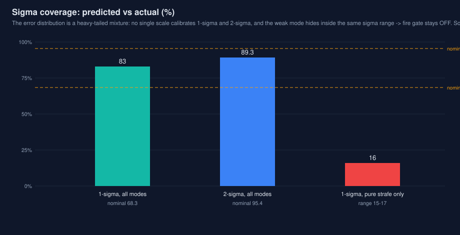

# 开火 sigma 门控标定研究（P2-9）

第三轮审查把 `sigma_lat` 改成完整预测协方差 $FPF^\top+Q(dt)$ 后留下一个明确
的尾巴：门控在所有出厂配置里保持关闭（`fire_sigma_scale: 0`），因为 $Q$ 是
按跟踪响应整定的，没有人证明过这个 sigma 作为**预报分布**是否可信。本研究
就是审查当时指定的那项工作——先在有真值的仿真器里测 1σ/2σ 经验覆盖率并
标定 scale，再把标定值拿到真实视频上做门控 A/B，最后按 P2-9 升级后的六项
验收口径给出结论与建议。

## 结论先行

**不建议把标定 scale 写进任何出厂配置，门控保持关闭。** 三条证据（细节见
§3、§4）：

1. **标定不可迁移。** 仿真标定出的阈值（参考口径 1.97、现行口径 2.22）落到
   真实视频上，恰好压在视频稳态 sigma 带（参考口径 0.13–0.16 m、现行口径
   0.16–0.20 m）的下沿或之下：3.avi 还能保留 41% 发数，4.avi 只剩 1.5%
   （参考口径）乃至 0 发（现行口径）。每秒有效命中损失 51%–100%。
2. **选择性不足。** 被拦下的发数里未命中只占 31%–45%，与不加门控时的整体
   未命中率（31%–43%）相比富集倍数只有 1.00–1.30×；3.avi @1.97 拦下的
   852 发里有 477 发本来是命中。门控拦掉的命中比拦掉的脱靶还多。
3. **覆盖盲区不在 sigma 的量程内。** 覆盖最差的运动模式（纯平移：1σ 覆盖
   15%–17%、系统性横向偏置 −8.3/−7.4 cm）的 sigma 中位数与良好模式几乎
   重叠（0.114 vs 0.103，参考口径）。这不是阈值没选好，而是该模式的误差
   来自模型/偏置（无旋转时 yaw 不可观），原理上不被协方差预报。

同时有一个正面结论：**sigma_lat 作为序数风险分数是好的**（仿真十分位下
横向误差 MAE 单调上升 4–7 倍、横向命中率从 ~92% 单调降到 35%–56%）；
不合格的是把它当作可标定的高斯标准差——其分布中心过窄、尾部过重，
任何单一 scale 都无法同时校准 1σ 与 2σ（§3.1）。$FPF^\top+Q$ 的修正本身
仍然成立：它让 sigma 至少在量级与排序上诚实（对比旧 $FPF^\top$ 门控在
scale=1 时放行约 83% 且命中率仅比未门控高约 2 pp，见
`docs/reviews/code_review_fixes_r3.md`）。

若将来要启用门控，缺的不是再调一个数，而是：(a) sigma 真正有动态范围的
数据（N1：多距离、旋转+平移混合、换板/重捕获密集，见 P2-7）；(b) 门控
形态改为相对量（相对稳态中位数的瞬态峰值）或限定于换板后的短暂窗口，
而不是对带高稳态底噪的信号做绝对阈值。纯平移盲区属于跟踪器问题
（P2-10 方向），不在本门控可解范围。本研究未修改仓库任何文件，出厂配置
默认值未动。

## 1. 方法

### 1.1 第一步：仿真覆盖率

仪器化程序 `src/sigma_sim.cpp`（研究目录内，不进仓库）：逐字复刻
`apps/autoaim_sim.cpp` 的观测生成（同场景、同真值模型、同 rng 播种），只
跑 `evaluation.cpp` 中 robot EKF 一条通路（同云台步进、同 `onTarget` 判
定），对每个有有效命令的帧记录一行：所选装甲板 $k$ 在
$t_\text{impact}$ 的真值位置、瞄准点、`sigma_lat`、`t_fly`、距离，以及

$$
\text{err}_\text{lat} = (\text{aim\_point} - \text{true}_k(t_\text{impact})) \cdot n,
\qquad n = (-\sin\psi,\ \cos\psi,\ 0)
$$

其中 $\psi$ 为命令 yaw——与 `aimer.cpp` 中 sigma 的定义方向一致。覆盖的
定义即 $|\text{err}_\text{lat}| \le m\cdot\sigma_\text{lat}$（$m=1,2$），
$z = \text{err}_\text{lat}/\sigma_\text{lat}$。

- 总体：**开火决策**（`cmd.fire == true`，门控关）为主总体；实际发射
  （再叠加 `onTarget`）为复核总体，两者统计几乎一致（z_std 1.1018 vs
  1.1023，参考口径），下文不重复区分。
- 场景：出厂 sim 的 8 个场景 + 本研究补 1 个全静止场景（出厂场景集没有
  静止档，而验收口径要求静止分档）。运动模式映射：静止=新增场景；平移=
  无旋转平移；旋转=2.1/10/variable/swing；旋转+平移=6+strafe/approach/
  3+strafe。
- 规模：2 套配置（`video_reference.yaml` 参考口径、`default.yaml` 现行
  口径）× 9 场景 × 20 个 seed（rng 42–61）× 20 s @25 fps。每套配置
  89,401 个有效命令帧、57,124 / 57,562 个开火决策。改一列重跑后其余列
  逐位一致（确定性已核验）。覆盖率的逐 seed 离散度：总体 cov1 的 seed 间
  标准差 0.04；纯平移 cov1 为 0.151 ± 0.014——是系统属性，不是抽样噪声。
- 两个口径都要测的原因：两配置的 tracker 参数不同（现行口径含 Stage K
  的 `q_yaw_walk`/`q_yaw_adapt`、弹速 22 vs 25），sigma 行为确实不同，
  标定值不能只测一处。视频 A/B 按任务书用参考口径，另补现行口径一组
  （§4.4）。

口径注记三条：

- **中心模式休眠。** 两套出厂配置的 `center_mode_omega` 都是 12 rad/s，
  高于全部场景与两段视频的转速，本研究所有帧均为装甲模式。覆盖结论只
  对装甲模式路径成立；中心模式（哨兵高转速）不在本数据内。
- **邻板效应。** err 配对的是**所瞄的那块板**——这正是 sigma 的定义对象
  （其雅可比就是对该板位置求的）。真值 judge 的命中率系统性更高，因为
  飞行时间内邻板会转进弹道（spin 6+strafe 场景：本板横向达标率 19.5%、
  任一板 68.1%、judge 命中率 44.8%，三者度量的不是同一件事）。
  spin 2.1 场景邻板效应可忽略，两口径一致（99.9% vs 100%），可作对照。
- **帧间自相关。** 同一次开火机会横跨多帧，样本非独立；名义二项区间
  （±0.3 pp）偏窄，故同时报告逐 seed 离散度。

### 1.2 第二步：真实视频 A/B

评测路径与冻结基线同一条：仓库缓存的 detections（`data/eval_cache/{3,4}`）
→ `tools/offline_eval/evaldriver.cpp` 的复刻驱动（本研究在其 CSV 中加了
`cmd_fire`、`sigma_lat` 两列，报告与原版逐项一致）。门控设置通过配置副本
实现，副本与原文件 `diff` 只有 `fire_sigma_scale` 一行：

- 关（0）：原始 `video_reference.yaml`；
- 完整协方差 scale = 1.0；
- 完整协方差 scale = 标定值 1.97（§3.6）；
- 另引用第三轮审查已测的第四种设置：旧 $FPF^\top$ 估计 scale = 1.0
  （旧代码已不存在，数字引自 `docs/reviews/code_review_fixes_r3.md`，未重跑）。

被拦发数的解剖用逐帧 join：先核验三种设置的命令流（cmd yaw/pitch、
sigma）逐帧完全一致——门控只翻转 `fire`，跟踪与瞄点不受影响（已验证，
见 §6）；于是被拦发数在关门控运行中的 `ShotRecord` 就是它"本来的结局"。

## 2. 第一步结果：sigma 的覆盖真相

### 2.1 总体：中心过覆盖、尾部欠覆盖、且不是缩放高斯

| 配置 | n（开火决策） | err 均值 (m) | err 标准差 (m) | sigma 中位 (m) | z 均值 | z 标准差 | 1σ 覆盖 | 2σ 覆盖 | q68.3(\|z\|) | q95.4(\|z\|) |
|---|---:|---:|---:|---:|---:|---:|---:|---:|---:|---:|
| 参考口径 | 57,124 | −0.003 | 0.118 | 0.097 | −0.010 | 1.102 | **83.0%** | **89.3%** | 0.507 | 2.991 |
| 现行口径 | 57,562 | −0.002 | 0.147 | 0.137 | +0.002 | 0.954 | **83.7%** | **92.1%** | 0.450 | 2.623 |

名义值应为 1σ 68.3%、2σ 95.4%。实际分布是典型的峰度过高混合体：大半
时间预报远比 sigma 保守（|z| 中位数仅 0.19），少数时段（换板、相位滑移、
重捕获）误差冲到 3σ 以外。两个"标定"互相矛盾正是其指纹——按方差看
std(z) ≈ 0.95–1.10（sigma 大致对、甚至略低估）；按中心分位看 q68.3 ≈
0.45–0.51（sigma 把中心散布高估了约 2 倍）。在标定倍率下检查 2σ：
$P(|z| \le 2s^*)$ 只有 83.2% / 82.9%，离 95.4% 很远。**结论：不存在能
同时校准两个水平的 scale；把 sigma 当高斯标准差用，在数学上就不成立。**

### 2.2 分运动模式：从 100% 到 15%

| 模式 | n（参考/现行） | 1σ 覆盖（参考/现行） | 2σ 覆盖 | z 均值 | err 均值 (m) | 横向达标率 |
|---|---:|---:|---:|---:|---:|---:|
| 静止 | 8,854 / 9,146 | 100% / 100% | 100% / 100% | +0.01 / 0.00 | ~0 | 100% |
| 旋转 | 25,963 / 26,196 | 96.6% / 96.8% | 97.4% / 98.4% | +0.08 / +0.07 | +0.007 | 87% / 79% |
| 旋转+平移 | 16,912 / 16,541 | 74.9% / 76.7% | 89.1% / 95.9% | +0.06 / +0.06 | +0.004 | 56% / 51% |
| 纯平移（无旋转） | 5,395 / 5,679 | **15.1% / 17.2%** | 33.3% / 38.8% | **−0.69 / −0.46** | **−0.083 / −0.074** | 8.8% / 5.8% |

- 静止时真实误差在毫米量级（z_std 0.04–0.06），而 sigma 有约 0.09–0.13 m
  的稳态底噪（Q/R 稳态决定）——高估约 20 倍，但无害（全中）。
- 纯平移是最差象限且是**偏置型失败**：err 均值 −8.3/−7.4 cm 不是散布而
  是系统性偏移（无旋转时整车 yaw 弱可观，EKF 的相位估计被平移牵引）。
  其 sigma 中位数（0.114 / 0.172）与旋转模式（0.103 / 0.140）大面积重叠，
  阈值门控抓不住它。这与出厂 sim 中该场景 robot EKF 命中率垫底（11.4%）
  是同一件事的两面。
- 场景级最差两名：纯平移（上行）与 spin 6 + strafe（1σ 覆盖 28.0% /
  34.4%，z_std 1.64 / 1.41，本板横向达标率 19.5% / 17.0%）——高速旋转
  叠加大幅平移时相位预报的尾部最重。全表见 `data/sim_summary.csv`。

### 2.3 分飞行时间：越远越不诚实

按各配置自身三分位切分（参考口径界 0.199/0.241 s，现行口径 0.226/0.274 s)：

| 飞行时间档 | 1σ 覆盖（参考/现行） | 2σ 覆盖 | q68.3(\|z\|) | z 标准差 |
|---|---:|---:|---:|---:|
| 短 | 90.3% / 91.0% | 94.7% / 97.1% | 0.144 / 0.127 | 0.77 / 0.62 |
| 中 | 80.4% / 82.3% | 89.9% / 95.1% | 0.540 / 0.456 | 0.98 / 0.84 |
| 长 | 78.3% / 77.8% | 83.3% / 84.0% | 0.710 / 0.651 | 1.44 / 1.28 |

覆盖随预报时域单调恶化：误差随时间的增长快于协方差承认的速度（过程
噪声按响应整定、不是按预报分布整定的直接后果）。这也意味着任何单一
scale 的门控在不同距离上松紧不一。

### 2.4 sigma 的判别力（为什么说它作序数分数是好的）

开火决策按 sigma_lat 十分位（参考口径；现行口径同形态）：

| sigma 十分位 | sigma 中位 (m) | err MAE (m) | 横向达标率（参考/现行） |
|---|---:|---:|---:|
| 最低 10% | 0.071 / 0.099 | 0.024 / 0.028 | 91.7% / 91.5% |
| 中间 50% | 0.093 / 0.134 | 0.053 / 0.051 | 72.4% / 76.6% |
| 最高 10% | 0.123 / 0.178 | 0.099 / 0.183 | 56.3% / 35.0% |

排序单调、无反转。问题不在信号本身，在信号的**分布形态**：仿真里 sigma
横跨 0.05–0.25 m 有足够动态范围（§2.5 的权衡曲线因此成立），视频里却
挤在一条窄带里（§4.3）。

### 2.5 仿真内的门控权衡（机制本身没问题）

在仿真开火决策上模拟门控（保留 = sigma < FSS × 半板宽 0.0675 m）：

| 配置 | FSS | 保留比例 | 保留组横向达标 | 被拦组横向达标 |
|---|---:|---:|---:|---:|
| 参考 | 1.0 | 1.7% | 95.2% | 72.4% |
| 参考 | 1.5 | 52.5% | 84.3% | 60.1% |
| 参考 | 1.97（标定） | 99.3% | 72.7% | 78.4%* |
| 现行 | 1.5 | 7.7% | 91.8% | 65.0% |
| 现行 | 2.0 | 47.2% | 83.0% | 52.9% |
| 现行 | 2.22（标定） | 64.1% | 79.8% | 44.4% |

*参考口径在标定点几乎不拦（其 sigma 分布整体压在阈值下），被拦组样本
过小，该格无统计意义。现行口径的标定点则是一条像样的权衡：拦掉 36%
决策、被拦组达标率只有 44%（富集成立）。**机制在仿真分布下是成立的**——
失败发生在迁移（§4.3），不在机制。

### 2.6 标定值

按"诚实 1σ = s\*·sigma、且诚实 1σ < 半板宽才开火"的定义：

$$
s^* = q_{68.3}(|z|), \qquad \text{FSS}^* = 1/s^*
$$

| 配置 | s\* | std(z)（对照） | FSS\* |
|---|---:|---:|---:|
| 参考口径 | 0.507 | 1.102 | **1.97** |
| 现行口径 | 0.450 | 0.954 | **2.22** |

注意 s\* 与 std(z) 给出方向相反的修正（前者要把 sigma 缩小一半、后者
说基本不用动）——这不是计算错误，而是 §2.1 的非高斯指纹在标定语言下
的必然结果。视频 A/B 使用各自口径的 FSS\*。

## 3. 第二步结果：真实视频 A/B

### 3.1 参考口径，三种可跑设置 + 一种引用设置

| 设置 | 视频 | 发数 | 可验证 | 命中 | 可验证率 | 保守口径 | 条件口径 | hits/s | 未命中占比* |
|---|---|---:|---:|---:|---:|---:|---:|---:|---:|
| 关（冻结基线） | 3 | 1,440 | 1,388 | 937 | 96.4% | 65.1% | 67.5% | 10.6 | 32.5% |
| 关（冻结基线） | 4 | 2,049 | 2,004 | 1,374 | 97.8% | 67.1% | 68.6% | 10.1 | 31.4% |
| 旧 FPFᵀ，scale=1（引用） | 3 | 1,201 | — | — | — | — | 69.8% | 9.1 | — |
| 旧 FPFᵀ，scale=1（引用） | 4 | 1,442 | — | — | — | — | 71.4% | 7.4 | — |
| 完整协方差，scale=1.0 | 3 | 12 | 8 | 8 | 66.7% | 66.7% | 100.0% | 0.1 | 0.0%（n=8） |
| 完整协方差，scale=1.0 | 4 | 0 | 0 | 0 | — | — | — | 0.0 | — |
| 完整协方差，scale=1.97（标定） | 3 | 588 | 561 | 460 | 95.4% | 78.2% | 82.0% | 5.2 | 18.0% |
| 完整协方差，scale=1.97（标定） | 4 | 30 | 21 | 16 | 70.0% | 53.3% | 76.2% | 0.1 | 23.8%（n=21） |

*未命中占比 = 可验证发数中未命中的比例（误开火率的视频代理口径）。

scale=1.0 的两行与第三轮审查的既有 A/B 逐发一致（3.avi 12 发、4.avi 0
发），管线可信度由此再获一次交叉验证。

### 3.2 被拦发数解剖：拦掉的命中比脱靶多

| 设置 | 视频 | 被拦 | 其中命中 | 其中未命中 | 其中不可验证 | 被拦未命中占比（已知结局） | 整体未命中率（对照） | 富集倍数 |
|---|---|---:|---:|---:|---:|---:|---:|---:|
| 1.97 | 3 | 852 | 477 | 350 | 25 | 42.3% | 32.5% | 1.30× |
| 1.97 | 4 | 2,019 | 1,358 | 625 | 36 | 31.5% | 31.4% | 1.00× |
| 1.0 | 3 | 1,428 | 929 | 451 | 48 | 32.7% | 32.5% | 1.01× |
| 1.0 | 4 | 2,049 | 1,374 | 630 | 45 | 31.4% | 31.4% | 1.00× |

以 3.avi @1.97 为例：门控确实拦下了 77.6% 的脱靶（350/451），但同时拦
下了 50.9% 的命中（477/937）——条件口径 +14.5 pp、保守口径 +13.1 pp 的
"改善"是用 hits/s 从 10.6 跌到 5.2 换来的。4.avi @1.97 的富集倍数是
1.00×：在那条视频上，被拦与保留之间没有可分性，门控等价于随机抽掉
98.5% 的发数。

### 3.3 迁移为什么失败：视频 sigma 是一条窄带

开火帧的 sigma_lat 分布（关门控运行）：

| 数据 | 配置 | sigma 中位 (m) | p5 | p95 | 门控阈值 (m) |
|---|---|---:|---:|---:|---:|
| 仿真开火决策 | 参考 | 0.097 | — | — | 0.133（FSS 1.97） |
| 3.avi 发射帧 | 参考 | 0.136 | 0.089 | 0.154 | 0.133 |
| 4.avi 发射帧 | 参考 | 0.143 | 0.135 | 0.155 | 0.133 |
| 仿真开火决策 | 现行 | 0.137 | — | — | 0.150（FSS 2.22） |
| 3.avi 发射帧 | 现行 | 0.170 | 0.117 | ~0.20 | 0.150 |
| 4.avi 发射帧 | 现行 | 0.177 | 0.167 | ~0.20 | 0.150 |

两段视频都是单车定速旋转的稳态跟踪：协方差迅速饱和到 Q/R 决定的稳态
水平，sigma 几乎不随帧变化。视频稳态 sigma 又比同配置仿真高 1.3–1.5 倍
（真实检测噪声与微动态不是仿真的 0.7 px 高斯）。于是绝对阈值无论放在
标定点的哪一侧，结果都是"几乎全放行"或"几乎全拦"，不存在可用工作点。
这不是标定数值算错，而是**标定量（仿真 sigma 分布）与部署量（视频稳态
sigma 带）不是同一个分布**。

### 3.4 补充：现行口径在视频上的 A/B（任务书之外，多跑一组）

| 设置 | 视频 | 发数 | 命中 | 保守口径 | 条件口径 | hits/s | 被拦未命中占比 / 富集 |
|---|---|---:|---:|---:|---:|---:|---:|
| 关（冻结基线） | 3 | 1,406 | 777 | 55.3% | 57.3% | 8.8 | — |
| scale=2.22（标定） | 3 | 151 | 108 | 71.5% | 78.3% | 1.2 | 45.1% / 1.06× |
| 关（冻结基线） | 4 | 1,848 | 1,206 | 65.3% | 66.9% | 8.8 | — |
| scale=2.22（标定） | 4 | 0 | 0 | — | — | 0.0 | 33.1% / 1.00× |

出厂配置 + 其自身标定值，在真实视频上同样退化为近全拦（3.avi 保留
10.7%、4.avi 保留 0%），富集倍数 1.00–1.06×。结论与参考口径一致，
且这是对"部署口径"最直接的证据。

## 4. 验收六项逐项结论

| # | 验收项 | 结论 |
|---|---|---|
| 1 | 1σ 实际覆盖率 | 总体 83.0%（参考）/ 83.7%（现行），名义 68.3%——中心过覆盖；但分模式 15%–100%，总体值不可作为标定依据单独引用 |
| 2 | 2σ 实际覆盖率 | 89.3% / 92.1%，名义 95.4%——尾部欠覆盖；标定倍率 2s\* 处仅 83.2% / 82.9%，分布非高斯，双水平不可同时校准 |
| 3 | 分飞行时间覆盖率 | 单调恶化：1σ 覆盖短档 ~90% → 长档 ~78%（两口径同形态），q68.3 随飞行时间 0.13–0.14 → 0.65–0.71 |
| 4 | 分运动模式覆盖率 | 静止 100%、旋转 ~97%、旋转+平移 ~75%、纯平移 15%–17%（伴 −8.3/−7.4 cm 系统偏置）；最差模式 sigma 不分离，门控原理上抓不住 |
| 5 | 误开火率变化 | 视频：3.avi 32.5% → 18.0%（参考 @1.97）；但 4.avi 与现行口径下样本被拦到无统计意义（n=21 / 0 发）。仿真横向代理：现行口径 32.9% → 20.2%（@FSS\*、保留 64% 时） |
| 6 | 每秒有效命中变化 | 全面大幅下降：3.avi 10.6 → 5.2（参考 @1.97）、8.8 → 1.2（现行 @2.22）；4.avi 10.1 → 0.1、8.8 → 0.0。以有效命中计，门控在现有数据上是净损失 |

六项里第 5 项的方向（少打废发）与第 6 项的方向（总产出）互相拉扯，而
第 1–4 项说明拉扯的根源是分布形态与迁移问题，不是阈值位置问题。按
P2-9 的验收标准（"门控开时发数下降且命中率不降"尚不完整——还需要
hits/s 不发生量级损失），**判定：不通过，不开启。**

## 5.
...[truncated 3010 chars]