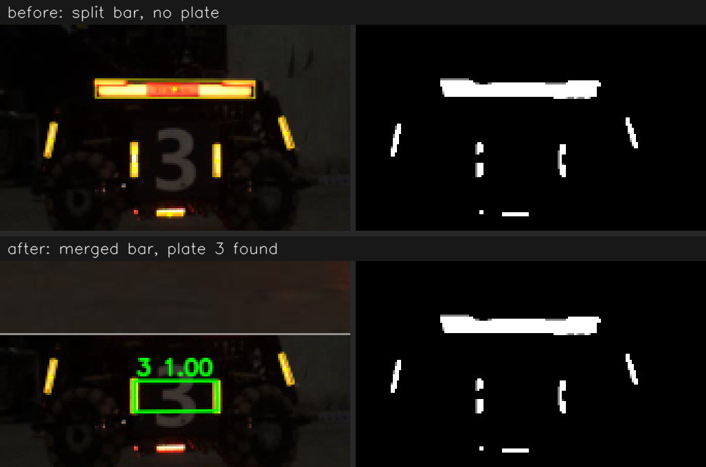

# 灯条断裂修复与横向色块过滤（2026-11-11）

> 问题：近距离正对的装甲板，检测器偶尔整帧漏检。逐帧排查 3.avi 的漏检段，
> 发现两个检测前端的缺陷：**过曝灯条被二值化切成两段**，以及
> **横向色块被当成灯条**。两处都在 `core/src/detector.cpp` 的 `findLightsIn`，
> 各有一个开关，关掉即逐字节回到旧行为。
>
> 开关约定与 `q_yaw_walk` 相同：结构体默认值**关**（旧行为），所以冻结的 N0 文件
> `core/config/video_reference.yaml` 一字未改、§10 门禁数字不动；出厂配置
> `core/config/default.yaml`、`sentry/config/default.yaml`、`sentry/config/sentry.yaml`
> 显式打开。



## 1. 现象：近距离正对板整帧漏检

N0 口径下 3.avi 有 77 帧零检测、4.avi 有 73 帧。逐段渲染（`autoaim_lights`）后分三类：

| 类别 | 例子 | 是否检测器可修 |
|---|---|---|
| 人腿/障碍物遮挡，灯条只剩碎片 | 3.avi 932–967、4.avi 1472–1491 | 否（信息缺失） |
| 极斜视/远距，单根灯条过短 | 零散单帧 | 否 |
| **板正对相机、两根灯条清晰可见，却 0 装甲** | 3.avi 1966–2050（14 帧） | **是** |

第三类全部集中在 3.avi 末段机器人开到镜头前的时候。

## 2. 原因一：过曝芯把灯条切断

第 2023 帧左灯条中心一列的灰度与 R−B（节选）：

| 位置 | 灰度 | R−B |
|---|---|---|
| 灯条上段 | 190–240 | 120–187 |
| **灯条中段（过曝芯）** | **240–253** | **11–60** |
| 灯条下段 | 220–245 | 130–199 |

灯条中心三个通道同时饱和，R−B 塌到阈值 70 以下；只有 1–2 px 宽的红边还在阈值之上，
被第一步 3×3 腐蚀吃掉。于是二值图里一根 33 px 的灯条变成 13 px + 11 px 两段，
与另一侧完整的 31 px 灯条长度比 2.4 > `max_length_ratio` 1.7，配对失败。

这正是检测器头注释里写的"灯条中心过曝发白、只有边缘是红的"——近距离时芯更大，
红边相对更细，断裂才出现。

**修复（`merge_split_lights`）**：在灯条过滤之前，把上下堆叠的两个色块的并集
**追加**为一个新的灯条候选，条件全部满足才追加：

1. x 范围重叠 ≥ 较窄者宽度的一半，宽度比 ≤ 2；
2. 两块都不是"扁"的（高 ×2 ≥ 宽），横向灯带不会被拼成竖条；
3. 竖直间隙 ≤ `merge_max_gap_ratio`（0.5）×两段高度之和；
4. **间隙的平均灰度 ≥ 两段自身平均灰度**——这是过曝断裂的物理特征（缝里是白热的芯）。
   灯条与地面倒影之间的缝是暗的，不会被拼上。

并集仍须通过所有原有灯条过滤（长度、长宽比、填充率、倾角）。

**为什么是"追加"而不是"替换"**：第一版直接用并集替换两段，结果 4.avi 丢了 3 块、
3.avi 丢了 3 块原本正确的板——例如 4.avi 第 654 帧右灯条上方另有一道细红光，
缝也是亮的，替换后灯条变成 33.5 px，与 19 px 的左灯条配不上。改成追加后两种读法
都在候选里，配对按长度一致性打分，正确的那个自然胜出；这 6 块全部恢复。
配套两处：`containsOtherLight` 不把"落在本对灯条自身外接框内的光"算作板内异物
（那是它自己的碎片）；配对去重把"合并灯条与它自己的碎片"视为同一根灯条。

## 3. 原因二：横向色块被当成灯条

`makeLight` 把旋转矩形的四个角按 y 排序、取上下两边中点当灯条两端。对一个**横躺**的
矩形（例如车顶横向灯带），上下两边恰是两条长边，于是"长度"= 厚度、倾角 = 0°，
`max_light_tilt_deg` 形同虚设。第 2023 帧里车顶灯带（155×17）和车底灯带都以
"灯条"身份进入候选（见上图"修复前"的黄框）。

后果：它们会被 `reject_contained_lights` 当成"板内另一根灯条"从而否决真实装甲板，
也会挤占 40 根灯条的名额。

**修复（`reject_horizontal_lights`）**：灯条的测量长度必须 ≥ 宽度。长宽比过滤已保证
长边/短边 ≥ 1.6，所以 length < width 等价于"长轴是横的"。

在这两段视频上它对命中率**无可测影响**（单独开启时输出逐字节不变）——横向灯带恰好
没落进任何真实板的配对框；它是正确性修复，在合成场景里可复现否决（见测试）。

## 4. 实测（全新检测，不用缓存）

条件命中 / 保守命中 / hits/s / 0.32 s 预测中位误差 / 有检测帧数：

| 口径 | 视频 | 修复前 | 修复后 |
|---|---|---|---|
| 实车 `core/config/default.yaml` | 3.avi | 57.3 / 55.3 / 8.8 / 15.3 px | **58.1 / 56.5 / 9.1 / 15.2 px** |
| | 4.avi | 66.9 / 65.3 / 8.8 / 12.4 px | 66.9 / 65.3 / 8.8 / 12.4 px（检测逐字节相同） |
| 哨兵上车 `sentry/config/sentry.yaml`（robot EKF） | 3.avi | 68.3 / 65.9 / 10.7 / 14.4 px | **68.9 / 67.1 / 11.0 / 14.3 px** |
| | 4.avi | 71.1 / 69.6 / 10.5 / 12.5 px | 71.1 / 69.6 / 10.5 / 12.5 px |
| 哨兵上车 `sentry.yaml`（sentry 多目标策略） | 3.avi | 68.4 / 65.9 / 10.7 | **69.0 / 67.2 / 11.0** |
| | 4.avi | 71.0 / 69.5 / 10.5 | 71.0 / 69.5 / 10.5 |
| N0 `video_reference.yaml` + `--set` 打开（仅供对照，门禁不用） | 3.avi | 67.5 / 65.1 / 10.6 / 14.3 px / 2132 帧 | 68.1 / 66.3 / 10.9 / 14.1 px / 2146 帧 |
| | 4.avi | 68.6 / 67.1 / 10.1 / 13.3 px / 3343 帧 | 不变 |

`sentry/config/default.yaml`（哨兵离线默认）与 `sentry.yaml` 数字相同。

- 3.avi 的检测变化**只有新增**：14 帧从 0 装甲变成 1 块"3"号板（分类置信度最低 0.9999），
  没有任何一帧丢板或改板；跟踪率 0.933 → 0.939。
- 4.avi 全片检测输出与修复前逐字节相同（4.avi 没有近距离正对段）。
- `merge_max_gap_ratio` 0.3 / 0.5 / 0.8：0.3 只救回 10 帧（67.9%），0.5 与 0.8 结果相同，取 0.5。
- 两个开关都关：三套口径全部逐字节复现修复前数字（关掉即旧行为）；
  `tools/regression.py` 两套口径均 PASS（N0 +0.0，现行口径按上表重新冻结）。
- 单帧检测耗时（`detector_bench`，3.avi 全片，单线程，各跑 3 次）：修复前 3.31–3.52 ms，
  修复后 3.35–3.41 ms，噪声内无差别。合并只在色块数 ≤ 400 时运行（O(n²) 包围盒比较）。

## 5. 局限与提醒

- 证据只来自这两段视频，且收益集中在 3.avi 末段 14 帧。它修的是一个**物理上确定**的
  失效模式（过曝芯 + 细红边 + 腐蚀），近距离或高曝光（队伍相机 2500 µs）下会更常见，
  但幅度要等 N1（队伍相机实拍）再量。
- 合并不处理被切成三段及以上的灯条（只做两两并集）；目前未观测到。
- 对比度极低的场景里"缝的灰度 ≥ 碎片灰度"可能不成立，此时合并不发生，等价于旧行为。

## 6. 复现

```bash
# 修复后（出厂配置已打开）
./build/apps/autoaim_video video/3.avi --out out --config core/config/default.yaml --redetect
# 修复前
./build/apps/autoaim_video video/3.avi --out out_old --config core/config/default.yaml --redetect \
    --set merge_split_lights=0 --set reject_horizontal_lights=0
# 单帧可视化
./build/apps/autoaim_lights video/3.avi --frames 2023 --out out_lights --config core/config/video_reference.yaml
```

回归测试：`testSplitLightMerge`（亮缝合并、暗缝不合、杂光不破坏原配对）、
`testHorizontalBlobRejected`（旧行为下横条否决装甲板，新行为不会）。
